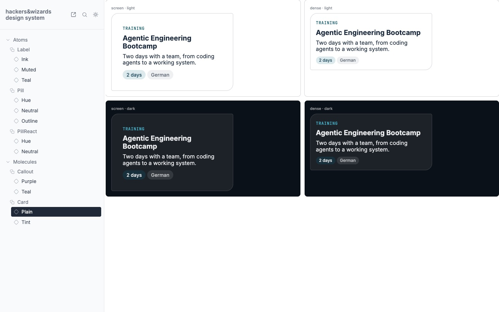
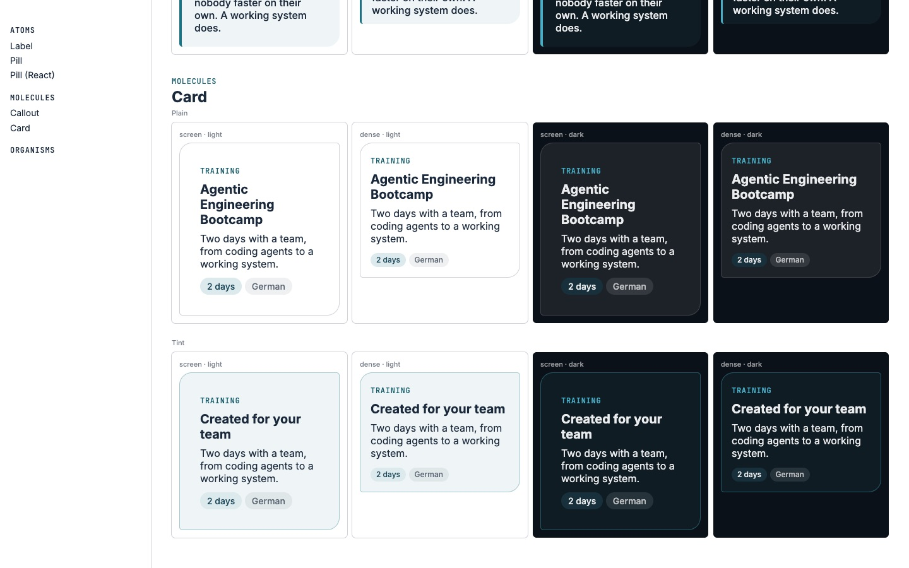
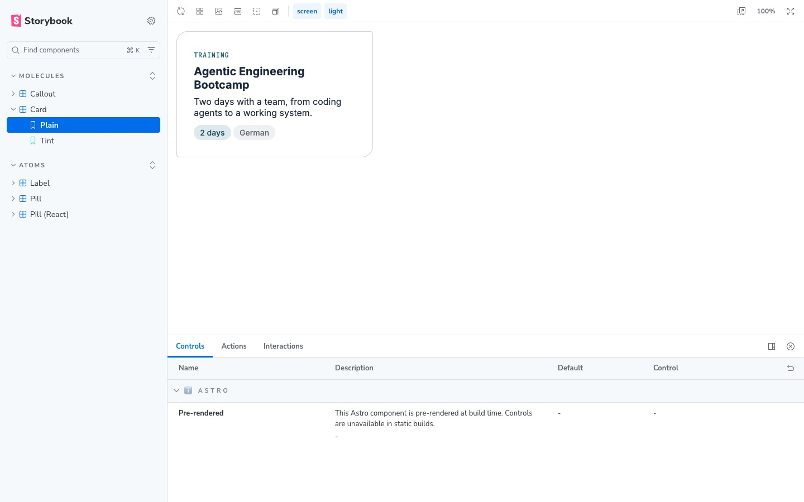
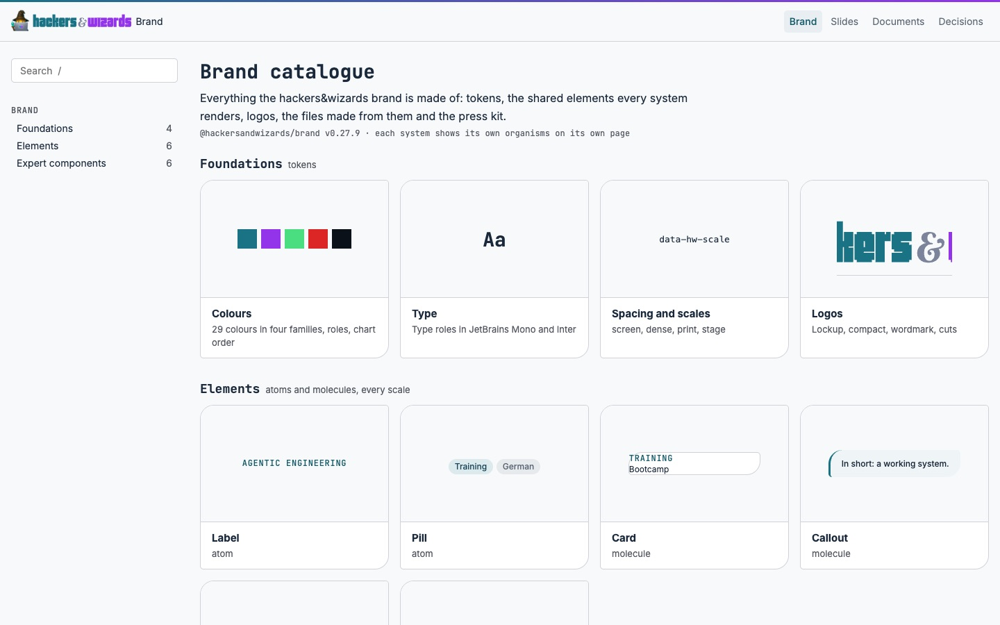
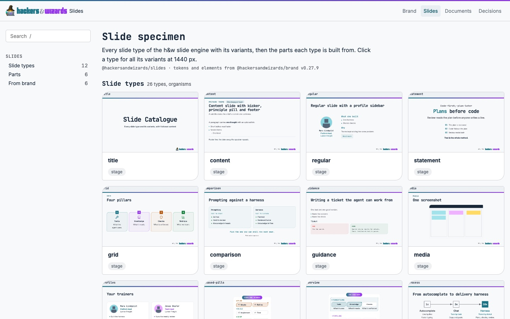
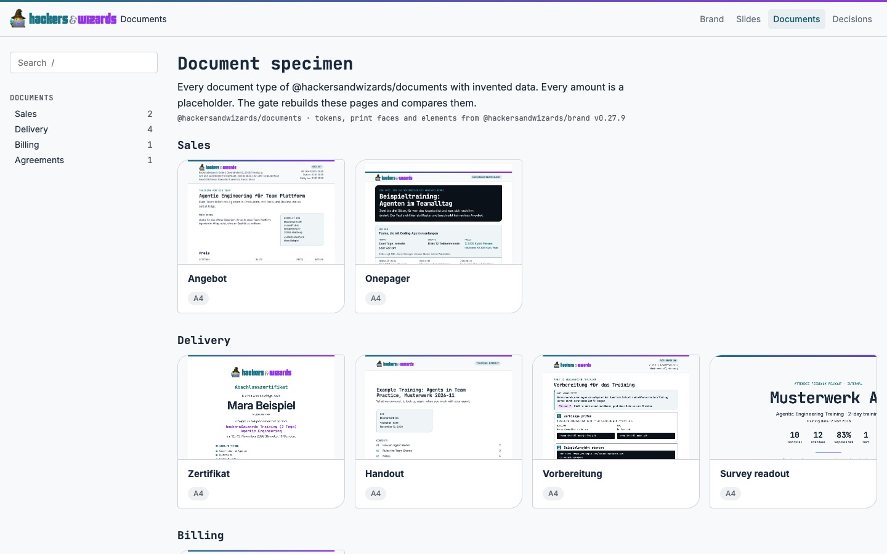

# Design-System-Form: ein Werkzeug, eine Katalogseite, Hub und Spokes, zwei Dichten

Stand 02.11.2026, Phase 1: Recherche, Inventar, Prototypen, blinde Bewertung. In keinem Repo ist
etwas gebaut außer diesem Bericht und seinen Bildern.

Benedikt am 02.11. (Auszüge): «ist mir wichtig, dass wir jetzt in allen unseren Repos Design Guides
haben, Design Systems, tokenbasiert mit schönen kleinen Atomen, Molekülen und Organismen. […] Ich
hätte gerne, dass das jetzt überall identisch ist, dass ich nicht in jedem Repo wieder neu mich in
das Design System reindenken muss. […] im Brand Guide dann der ganze Core […] die meisten Tokens,
Atome und vielleicht Moleküle […] in den einzelnen Spokes dürften eigentlich fast gar keine Atome
sein und gar keine Tokens, wenige Moleküle, dafür aber […] mehr Organismen» und «Im Moment kommt es
mir fast schon so vor, als ob wir im Company OS zu stark den Designvorlagen aus der Webseite folgen.
Die Elemente werden im Company OS gerade relativ groß seit den letzten Änderungen. […] Am schönsten
ist natürlich meiner Meinung nach, wenn wir dieselben Elemente verwenden, aber vielleicht etwas
weniger Abstände und etwas kleiner, damit wir mehr auf den Screen bekommen».

## Antwort

- **Die Elemente in os sind größer geworden, aber nicht durch die Website.** Alle Texte von 10 bis
  13 px in os und trainer-hub stehen seit dem 30.10. auf 14 px. Ein Drittel davon kommt aus deiner
  Ansage vom 28.10. (os `4235c4556`, «ui 14, meta 13, micro 12»), zwei Drittel aus einer
  Agenten-Annahme in brand v0.8.0: «`meta` 13 px geht in `small` 14 px auf». Dein «bitte die
  recommended variante umsetzen» deckte Option B als Ganzes, nicht diesen Schritt. Zeilenhöhen,
  Paddings, Kopfzeile und Überschriften sind unverändert. Auf dem Dashboard passen dadurch 7 statt
  11 Aufmerksamkeitszeilen auf den ersten Bildschirm.
- **Dichte:** dieselben Elemente, eine kompakte Stufe für os und trainer-hub. Der Prototyp mit 13 px
  UI-Text (eine Token-Änderung) gewinnt blind mit 8,25 gegen 7,26 für heute und 7,40 für eine noch
  engere Stufe; 7 von 8 Läufen wählen ihn. Apple setzt am Mac genau 13 pt Text und 28 pt Controls,
  am iPhone 17 pt und 44 pt.
- **Werkzeug: Astrobook überall.** Astrobook (8,43) und eine eigene Seite (8,10) liegen gleichauf,
  Claude wählt immer die eigene, Codex immer Astrobook. Storybook liegt mit 5,75 klar dahinter. Der
  Gleichstand geht an Astrobook, weil website, os und trainer-hub es schon fahren und die
  Story-Dateien dasselbe Format haben wie Storybook.
- **Katalogseite: eine Form** für brand, slides und documents (Kopf, linke Leiste mit Suche und
  Gruppen, Titel, Einleitung, Herkunft, Kachelraster je Gruppe). Blind 8,31 gegen 4,71 für die drei
  heutigen Seiten, alle 8 Läufe wählen sie. Die Entscheidungsseite ist eine Arbeitsliste, kein
  Katalog: sie nimmt die Listenform von os.
- **Dein Hub-Spoke-Bild hält**, mit zwei Korrekturen aus der Forschung: Spokes brauchen
  Komponenten-Tokens für ihre eigenen Organismen, und die Grenze Atom/Molekül/Organismus ist laut
  Brad Frost ein Denkmodell, keine Regel, die ein Gate prüfen kann. Heute ist es umgekehrt: die
  sieben h&w-Spokes halten zusammen 81 Atome und 130 Moleküle, brand rund 12 und 7.

## Inventar

Definition nach Brad Frost, _Atomic Design_, Kapitel 2 (geholt 02.11.): Atome sind «UI elements
that can't be broken down any further», Moleküle «collections of atoms that form relatively simple
UI components», Organismen «relatively complex components that form discrete sections of an
interface». Tokens in drei Stufen nach Material: «Reference tokens hold concrete values», «System
tokens define decisions and roles», Komponenten-Tokens gehören einem Element. Gezählt auf
`origin/main` am 02.11. zwischen 07:23 und 07:31; jede Einstufung eines Elements ist Urteil,
Tokens zählt ein Skript (Literal = primitiv, Verweis oder Rollenname = semantisch, nach einem
Element benannt = Komponente).

| Repo                 | Werkzeug                                | Übersichtsseite                                    | Tokens p/s/k | Atome | Moleküle | Organismen |
| -------------------- | --------------------------------------- | -------------------------------------------------- | -----------: | ----: | -------: | ---------: |
| brand (Hub)          | eigene Seite `catalogue.html`           | Katalog: Leiste, Suche, Bereiche                   |   113/105/26 |   ~12 |       ~7 |         ~2 |
| website              | Astrobook 0.13.3, `/design-system/`     | Startseite plus 87 Story-Dateien                   |       4/3/24 |    21 |       27 |         40 |
| os                   | Astrobook 0.13.3, `/design-system`      | Startseite, Seitenleiste nach Gruppen              |      1/31/17 |    18 |       37 |         31 |
| trainer-hub          | Astrobook 0.13.3, `/design-system`      | Kacheln «From brand» und eigene mit Grund          |        0/3/0 |     7 |       13 |          4 |
| slides               | eigene Seite `specimen/index.html`      | Kopf, Abschnitte, keine Leiste                     |     44/34/76 |    15 |       14 |         50 |
| documents            | eigene Seiten `specimen/*.html`         | Linkliste links, Tabellen, eine Seite je Typ       |    29/76/225 |     9 |       28 |         17 |
| talks                | eigene Seite `app/design-system`        | fünf Abschnitte untereinander                      |        0/1/1 |     4 |        1 |          1 |
| certificate-verifier | eigene Seite `/design-system`           | eine Spalte                                        |        3/0/2 |     7 |       10 |          4 |
| hycle-private        | keins                                   | keine                                              |        1/9/3 |     9 |       12 |          9 |
| benedikt.stemmildt   | eigene Seite `design-system/index.html` | Inhaltsverzeichnis, 16 Abschnitte                  |      13/15/4 |    16 |       20 |         20 |
| Entscheidungsseite   | `hub.ts` (Skill parallel-session)       | Arbeitsliste: Filter, Gruppen, aufklappbare Zeilen |            – |     – |        – |          – |

Drei Werkzeuge, fünf eigene Seitenformen. Jede Astrobook-Instanz hat eine andere Startseite und
Hülle; website und trainer-hub prüfen mit einem Test, dass jede Komponente eine Story hat, os mit
`src/stories/story-coverage.test.ts`. hycle-private und die persönliche Seite tragen nicht die
h&w-Marke: für sie zählt nur die Form, nicht die Werte.

Was in Spokes liegt und in den Hub gehört, gefunden von mindestens zwei Systemen:

| Element                                                   | Wo heute                                                               | Stufe   |
| --------------------------------------------------------- | ---------------------------------------------------------------------- | ------- |
| Button (Kunde)                                            | website, verifier                                                      | Atom    |
| Pfeil-Link mit Extern-Zeichen                             | website, verifier, talks                                               | Atom    |
| Großbuchstaben-Tag                                        | os, trainer-hub                                                        | Atom    |
| Segment-Schalter                                          | os, trainer-hub                                                        | Molekül |
| Eingabe mit Button                                        | website, verifier                                                      | Molekül |
| Faktenliste (Label über Wert)                             | website, verifier                                                      | Molekül |
| Listenzeile mit Streifen                                  | os, trainer-hub                                                        | Molekül |
| Prosa-Block (Checkbox, Inline-Code, Tabelle)              | os, trainer-hub                                                        | Molekül |
| Code-Panel                                                | os, trainer-hub, slides `CodePanel`                                    | Molekül |
| KPI-Kachel                                                | os `.kpi-segment`, slides `NumberTile`, documents Onepager und Readout | Molekül |
| Gestrichelter Rahmen                                      | os, trainer-hub, slides `DashedFrame`                                  | Molekül |
| Status- und Warnhinweis                                   | os, trainer-hub, slides                                                | Molekül |
| Breadcrumb                                                | os, trainer-hub                                                        | Molekül |
| Bewegungs-Tokens, Label-Regel unter 48rem                 | website, verifier                                                      | Token   |
| Nacht-Umschlüsselung heller Tokens                        | talks, os, trainer-hub                                                 | Token   |
| App-Breite 96rem, `--nav-offset`, Bildschirm-`@font-face` | os, trainer-hub                                                        | Token   |
| Bühnenwerte `--deck-*` gleich `--slide-*`                 | documents Readout, slides                                              | Token   |

Kopien dessen, was brand schon liefert: Fokusring, Link, Icon-Button und Disclosure-Pfeil in os;
`AppHeader` und `ThemeToggle` als React-Kopie in talks; die Website kopiert `disclosure.css`. Ein
Fund nebenbei: die slides-Ausnahme `number-tile` begründet sich mit «no other system», aber os und
documents zeigen KPI-Kacheln.

Pins heute: brand ist v0.27.9; website v0.27.7, trainer-hub v0.27.8, documents v0.27.9, os und
verifier v0.27.5, slides v0.27.3, talks v0.27.2.

## Hub und Spokes gegen Best Practice

| Dein Bild                               | Was die Quellen sagen                                                                                                                                                                                                                                                                                                                                                                                  | Urteil                                                                                                    |
| --------------------------------------- | ------------------------------------------------------------------------------------------------------------------------------------------------------------------------------------------------------------------------------------------------------------------------------------------------------------------------------------------------------------------------------------------------------ | --------------------------------------------------------------------------------------------------------- |
| Der Kern liegt im Hub                   | Brad Frost, «The design system ecosystem»: der Kern «contains the common, organization-wide UI building blocks», die «settled solutions that don't need re-hashed for the 15th time».                                                                                                                                                                                                                  | hält                                                                                                      |
| Spokes halten vor allem Organismen      | Dieselbe Quelle: Rezepte sind «composed UI components to be used consistently across specific contexts», die «aren't reusable across the entire organization», gepflegt von den Produktteams. Ein Rezept, das sich bewährt, kann in den Kern «graduate».                                                                                                                                               | hält                                                                                                      |
| Keine Tokens in den Spokes              | Material: «Component tokens are design attributes assigned to elements», jedes zeigt auf ein System-Token. Ein Organismus des Spokes hat also eigene Komponenten-Tokens. Primitive und semantische Tokens gehören in den Kern.                                                                                                                                                                         | hält für primitive und semantische, nicht für Komponenten-Tokens                                          |
| Dieselben Elemente für Kunde und intern | GitHub fährt zwei Komponentenbibliotheken, Primer für das Produkt und Primer Brand («GitHub's design system for creating marketing websites»), über dieselben Primitive: das Token-Build von Primer Brand kopiert `@primer/primitives` (`build-tokens.js`, Zeile 25). Adobe Spectrum fährt dieselben Komponenten mit Maßen je Plattform, etwa `component-height-100` 32 px am Desktop und 40 px mobil. | beides kommt vor; unsere Messung vom 01.11. (14 von 23 Elementen gleiche Regel) spricht für Spectrums Weg |
| Atome, Moleküle, Organismen als Ordnung | Frost: «Atomic design is not a linear process», es sei «merely a mental model».                                                                                                                                                                                                                                                                                                                        | als Ordnung ja, als Gate-Regel nein                                                                       |
| Token-Format                            | Die Design Tokens Community Group hat am 28.10.2025 die erste stabile Fassung 2025.10 veröffentlicht, mit Themes und mehreren Dateien.                                                                                                                                                                                                                                                                 | `tokens.json` später darauf heben, nicht jetzt                                                            |

Daraus die Regel für jedes Spoke: keine primitiven Tokens, semantische nur als Hook für Theme und
Dichte, Komponenten-Tokens nur für eigene Organismen, keine Atome außer begründeten Ausnahmen in
`brand-elements.json`, Moleküle als Rezept nur, solange kein zweites System sie zeigt.

## Dichte: Experten-Werkzeug und Marketing-Seite

### Was die Plattformen sagen

| Quelle                         | Aussage                                                                                                                                                                                                                                                                        |
| ------------------------------ | ------------------------------------------------------------------------------------------------------------------------------------------------------------------------------------------------------------------------------------------------------------------------------ |
| Apple HIG, Accessibility       | Control-Größe Standard/Minimum: iOS 44x44/28x28 pt, macOS 28x28/20x20 pt. Text Standard/Minimum: iOS 17/11 pt, macOS 13/10 pt.                                                                                                                                                 |
| Apple HIG, Designing for macOS | «Leverage large displays to present more content in fewer nested levels […] while maintaining a comfortable information density». Bei Touch am Mac: größere Ziele, «while keeping control size and density the same to stay optimized for keyboard and pointing device input». |
| Angular Material, Theming      | Dichte von 0 bis -5, jeder Schritt «reduces the affected sizes by 4px». «Setting the density below 0 can reduce accessibility». Pop-ups und Dialoge bleiben ausgenommen.                                                                                                       |
| Carbon, Data table             | Zeilenhöhen 24, 32, 40, 48, 64 px; Kopfzeile und Paginierung folgen der Zeilenhöhe.                                                                                                                                                                                            |
| Adobe Spectrum, `layout.md`    | Komponentenhöhen als Skalensatz: 32 px Desktop, 40 px mobil (Faktor 1,25), dieselbe Komponente.                                                                                                                                                                                |

Hauptgerät je Oberfläche: os und trainer-hub am Schreibtisch mit Maus (deine Aussage; os hat
trotzdem Telefon-Regeln, etwa `be54669e4`), die Website am Telefon zuerst (deine Aussage, Analytics
nicht gelesen), slides auf der 1440er-Bühne, documents auf A4. brand kennt diese vier Maße schon
als `data-hw-scale` (`screen`, `dense`, `print`, `stage`), aber `dense` setzt nur die Maße der
Elemente, nicht die Typo-Stufen: die stehen in `expert/expert.css` (`--text-ui` 14 px).

### Gemessen: os und trainer-hub vor einer Woche und heute

1440x900, hell, `origin/main` vom 26.10. (os `d912ffcdd`, trainer-hub `8573be7`) gegen heute (os
`2cf40b3d2`, trainer-hub `6a24ce0`). Jede Ursache ist mit einem Build des Commits und seines
Elternteils gezeigt.

| Seite             | Maß                         | 26.10.           | heute                    |
| ----------------- | --------------------------- | ---------------- | ------------------------ |
| os Dashboard      | Aufmerksamkeitszeile        | 69,5 px          | 80 px                    |
| os Dashboard      | Grund- und «Next:»-Zeile    | 12 und 11 px     | 14 px                    |
| os Dashboard      | Pills                       | 11 px            | 14 px, Höhe gleich       |
| os Dashboard      | Zeilen im ersten Bildschirm | 11               | 7                        |
| os Deals          | Zeile                       | 41 px, einzeilig | 62 px, «Next:»-Zeile neu |
| os Deals          | Filter                      | Chip 24 px       | Segment 34 px            |
| os Deals          | Kennzahl-Kachel             | 42 px            | 77 px, Label bricht      |
| os Deals          | Zeilen im ersten Bildschirm | 9                | 7                        |
| os People         | Zeilen im ersten Bildschirm | 12               | 14 (Filter in Dropdowns) |
| trainer-hub Units | Meta-Zeile                  | 11 px Mono       | 14 px Inter              |
| trainer-hub Units | Filter                      | 26 px, 4 Reihen  | 31 px, 6 Reihen          |
| trainer-hub Units | Zeilen im ersten Bildschirm | 12               | 10                       |

Unverändert: Fließtext 16 px, h1 24 px, Kopfzeile 60 px, Zeilen-Padding 8/12 px, Suche 40 px.

| Schritt | Commit                                                                         | Gemessen                           | Grund laut Commit                                                                                            |
| ------- | ------------------------------------------------------------------------------ | ---------------------------------- | ------------------------------------------------------------------------------------------------------------ |
| 1       | os `4235c4556`, trainer-hub `cbaa954c`, 28.10.                                 | Meta 12 auf 13 px, Zeile 69 auf 74 | «Benedikt: the medium decides sizes, and Company OS is an internal tool […] ui 14 at 1.5, meta 13, micro 12» |
| 2       | brand `92613b1` (v0.8.0), in os `91be2a5fa` und trainer-hub `ba06f94e`, 30.10. | Meta 13 auf 14 px, Zeile 74 auf 80 | «text-meta is a former name of text-ui, 14 px»; im Bericht dahinter als «Annahme» geführt                    |
| 3       | os `5b39a247a`, 01.11.                                                         | Filter-Chips werden 34-px-Segmente | «segments for small categories, a dropdown for large ones»; nicht per Kontrolle gemessen                     |

### Prototyp und blinde Bewertung

In den laufenden os-Stand (`2cf40b3d2`) per Stylesheet eingespielt, Dashboard und Deals, gleiche
Daten:

| Variante | Änderung                                                                                       | Dashboard: Zeilen, Zeilenhöhe | Deals: Zeilen, Zeilenhöhe |
| -------- | ---------------------------------------------------------------------------------------------- | ----------------------------- | ------------------------- |
| heute    | –                                                                                              | 7, 80 px                      | 7, 62 px                  |
| kompakt  | `--text-ui` 13 px bei 1,45, `--text-micro` 11 px                                               | 8, 73,5 px                    | 7, 59,8 px                |
| eng      | kompakt plus Fließtext 15 px, Tailwind-`--spacing` 3,5 px, Zeilen-Padding 5 px, Segmente 32 px | 10, 63,6 px                   | 8, 52,5 px                |

Bewertung: drei Personas (du als täglicher Nutzer am 14-Zoll-MacBook, eine Betriebsleiterin, die
Stunden am Tag in os arbeitet, eine UX-Designerin für Experten-Werkzeuge), Claude und Codex, du
zweimal für das Rauschen; Bilder in voller Größe, Buchstaben neutral, Reihenfolge je Lauf gemischt.

| Variante | Gesamt | Info je Bildschirm | Lesbarkeit | Ruhe | Hierarchie | Täglicher Einsatz |
| -------- | -----: | -----------------: | ---------: | ---: | ---------: | ----------------: |
| kompakt  |   8,25 |               7,89 |       8,12 | 7,86 |       7,84 |              8,36 |
| eng      |   7,40 |               9,06 |       6,71 | 6,15 |       7,01 |              7,66 |
| heute    |   7,26 |               6,19 |       8,94 | 8,20 |       8,07 |              7,04 |

Rauschen (zweiter Lauf derselben Persona): bis 1,0 bei Claude, bis 0,5 bei Codex. Der Vorsprung
von kompakt (0,99) liegt am Rand des Rauschens, die Wahl ist es nicht: 7 von 8 Läufen nehmen
kompakt, einer eng. Alle nennen dasselbe: «eng» kostet Lesbarkeit an den grauen Meta-Zeilen,
«heute» bricht Zeilen um und scrollt zu viel, und auf Deals schiebt der Block aus Kacheln und
Filtern die Tabelle auf etwa 410 px herunter. Eine reine Token-Änderung bringt auf Deals keine
Zeile: dort sitzen die Höhen in den Komponenten (`list-row` 8 px Padding fest, Segmente `min-h-10`).

Vorschlag: die Dichte ist eine Token-Stufe in brand. `dense` trägt dann auch die Typo-Stufen
(`--text-ui` 13 px wie macOS) und die Höhen, die Komponenten lesen (Zeilen-Padding, Control-Höhe,
Kachel), so wie Spectrum es mit seinem Skalensatz macht. Die Website bleibt `screen`, mobil zuerst
mit 44-px-Zielen. os und trainer-hub stellen ihre Listenzeilen und Filter auf diese Tokens um; der
Kopfblock der Listenseiten ist danach die größte Reserve und eine Aufgabe für os selbst.

## Werkzeug

Dieselben vier Elemente aus brand v0.27.9 (Label, Pill, Karte, Callout, dazu die Pill als React)
mit denselben Story-Dateien im Storybook-Format, je Story `screen` und `dense`, hell und Nacht:

| Kandidat                                                 | node_modules | Build | Ausgabe | Übertragung je Seite | Pflege                                                                                                                                                                                              |
| -------------------------------------------------------- | -----------: | ----: | ------: | -------------------: | --------------------------------------------------------------------------------------------------------------------------------------------------------------------------------------------------- |
| Astrobook 0.13.3                                         |       183 MB | 1,2 s |  0,9 MB |              ~0,2 MB | ein Maintainer, 280 Sterne, zuletzt 11.09.2026; schon in website, os, trainer-hub                                                                                                                   |
| Storybook 10.6.5 mit `@storybook-astro/framework` 1.14.0 |       286 MB | 4,6 s |  8,5 MB |              ~5,1 MB | Storybook groß; der Astro-Teil ist Community, 67 offene Issues; Telemetrie standardmäßig an; im statischen Build keine Controls für Astro-Komponenten («Controls are unavailable in static builds») |
| eigene Astro-Seite (~40 Zeilen)                          |       180 MB | 2,4 s |  0,5 MB |              ~0,2 MB | unser Code, liest dieselben Story-Dateien                                                                                                                                                           |

Bewertung: drei Personas (du als Gründer, der zehn Design Systems prüft und nicht neu lernen will;
ein Frontend-Entwickler, der jede Woche Komponenten baut; eine Markendesignerin), Claude und Codex,
du zweimal; Bilder auf 1000 px.

| Kandidat  | Gesamt | Auffinden | Alle Maße ohne Klick | Einmal lernen | Ruhe | Markenpassung |
| --------- | -----: | --------: | -------------------: | ------------: | ---: | ------------: |
| Astrobook |   8,43 |      9,00 |                 9,00 |          8,75 | 8,38 |          6,75 |
| eigene    |   8,10 |      7,50 |                 9,50 |          8,12 | 6,75 |          8,88 |
| Storybook |   5,75 |      8,38 |                 3,00 |          9,00 | 6,50 |          3,38 |

Rauschen: 0 bei Astrobook und eigener Seite, 2,0 bei Storybook (Claude). Alle vier Claude-Läufe
wählen die eigene Seite, alle vier Codex-Läufe Astrobook: ein Gleichstand. Was jeder fehlt:
Astrobook die Marke in der Hülle und mehrere Varianten auf einen Blick, der eigenen Seite die
Varianten in der Navigation. Beides ist klein: trainer-hub zeigt schon eine Astrobook-Hülle mit
eigener Startseite und CSS. Die Matrix aus Maßen und Themes war in beiden Prototypen ein Decorator
von uns; Astrobook hat dafür keine Leiste wie Storybook.

Empfehlung Astrobook, weil es in drei Repos läuft, React-Komponenten rendert (trainer-hub zeigt
schon die Folienbausteine) und die Stories bei einem späteren Wechsel zu Storybook gültig bleiben.
brand liefert die gemeinsame Hülle (Startseite, CSS, den Decorator für Maß und Theme) als
exportierte Dateien; jedes Repo hat dieselbe Adresse `/design-system`. Für slides, talks, documents
und den Verifier heißt das Astro als Dev-Abhängigkeit, slides gemessen am 01.11. mit +41 MB.

## Katalogseite

Eine Form, aus Elementen, die brand und os schon haben: Kopf (`AppHeader`), linke Leiste mit Suche
und Gruppen samt Anzahl (wie `SpaceNav`), Titel und Einleitung (`PageHeader`), eine Herkunftszeile
in Mono, je Gruppe ein Raster aus `hw-card`-Kacheln mit Vorschau, Name und Pill. Gebaut als ein
Generator mit drei Datensätzen aus den echten Seiten.

| Seite              | Heute                                        | In der Form                                |
| ------------------ | -------------------------------------------- | ------------------------------------------ |
| brand-Katalog      | Leiste, Suche, Bereiche, Kacheln in Textform | dieselbe Leiste, Elemente live gerendert   |
| slides-Specimen    | Tabelle der Teile, Folien weit unten         | Folientypen als Kacheln, dann Teile        |
| documents-Specimen | Linkliste, Typentabelle, dann alle Seiten    | Dokumenttypen nach Gruppe als A4-Kacheln   |
| Entscheidungsseite | Filter-Pills, aufklappbare Gruppen, Zeilen   | bleibt Liste: os-Listenzeile, Filter, Pill |

Bewertung: dieselben drei Personas, Claude und Codex, du zweimal, Bilder auf 1000 px.

| Version   | Gesamt | Auffinden | Gleichheit | Überblick | Ruhe | Markenpassung |
| --------- | -----: | --------: | ---------: | --------: | ---: | ------------: |
| eine Form |   8,31 |      8,12 |       9,00 |      8,00 | 8,12 |          8,25 |
| heute     |   4,71 |      5,75 |       3,50 |      4,75 | 5,00 |          6,50 |

Rauschen 1,0 (Claude) und 0,3 (Codex), Vorsprung 3,6, alle 8 Läufe wählen die eine Form. Was sie
noch stört: die Leiste nennt nur Gruppen, keine Typen; Vorschauen sind zu klein zum Lesen; das
Logo-Bild im brand-Prototyp war beschnitten; die Zahl 26 in der Überschrift gegen 12 Kacheln im
Prototyp der Folien.

Die Frage, ob brand, slides und documents dafür Astro nehmen, steht schon als os-Zeile
`catalogue-sites-astro`; diese Form gilt mit und ohne Astro.

## Bauplan

| Phase | Wo                       | Was                                                                                                                                                                                                                                                                                                    | Zielzahlen                                                                                                       |
| ----- | ------------------------ | ------------------------------------------------------------------------------------------------------------------------------------------------------------------------------------------------------------------------------------------------------------------------------------------------------ | ---------------------------------------------------------------------------------------------------------------- |
| 1     | brand                    | Token-Stufen benannt (primitiv, semantisch, Komponente); `dense` mit Typo und Höhen; die 17 Kandidaten aus dem Inventar als `elements/` und Expert-Komponenten; Astrobook als Design System des Hubs mit Matrix aus vier Maßen mal hell und Nacht; die Hülle als Export; der Katalog in der einen Form | Atome ~12 auf ~20, Moleküle ~7 auf ~25 (Urteil)                                                                  |
| 2     | os, trainer-hub          | Pin auf den Release, `dense` mit 13 px, Listenzeile und Filter auf die Dichte-Tokens, eigene Kopien weg                                                                                                                                                                                                | je Spoke 0 primitive Tokens, Atome nur als begründete Ausnahme (≤ 2), Moleküle nur Ausnahmen; Organismen bleiben |
| 3     | website, verifier        | Button, Pfeil-Link, Feld, Faktenliste, Bewegungs-Tokens aus brand; Astrobook-Hülle aus brand (Verifier neu mit Astro als Dev-Abhängigkeit)                                                                                                                                                             | wie Phase 2                                                                                                      |
| 4     | slides, documents, talks | Astrobook statt eigener Seite, KPI-Kachel, Code-Panel, Rahmen aus brand, `--deck-*` aus der Bühnenstufe; talks nimmt `AppHeader` statt der React-Kopie                                                                                                                                                 | wie Phase 2                                                                                                      |
| 5     | alle                     | UX/UI-Review gegen Apple HIG und Material: os und trainer-hub gegen macOS (28 pt Controls, 13 pt Text), die Website gegen iOS und Material mobil (44 pt, 48 dp, 17 pt Text), slides gegen Bühnen-Abstand                                                                                               | je Oberfläche eine Liste mit Befund, Quelle, Fix                                                                 |

Die persönliche Seite hat schon die Form (eigene Seite, Zustände nebeneinander, ein
Abdeckungs-Check) und übernimmt nur die Seitenform. hycle-private braucht vorerst keine.

## Was offen bleibt

- Gebaut seit diesem Bericht: der Bauplan in Phase 2 (`2026-11-02-design-system-phase2.md`, brand
  v0.29.0 bis v0.30.0). trainer-hub liest nach Benedikts Entscheidung vom 02.11. (ds-roll-trainer-hub-compact)
  14 px statt der kompakten 13 px (trainer-hub c99277d0). Zum Zeitpunkt dieses Berichts nicht gemessen: Astrobook mit echter Marken-Hülle, Storybook mit
  angepasster Hülle, die Katalogform in Nacht und am Telefon, trainer-hub in kompakt.
- Die Deals-Tabelle vom 26.10. nur in der Gruppenansicht gemessen; heute ist die Tabellenansicht
  Standard. Die Daten unterscheiden sich zwischen den Ständen, die Zeilenzahlen vergleichen den
  ersten Bildschirm, nicht dieselben Datensätze.
- Für die Kontrollbuilds vom 30.10. fehlen die damaligen brand-Commits, weil die brand-Historie neu
  geschrieben wurde; die Builds nutzen die Tags v0.7.0 und v0.9.1, inhaltlich nicht abgeglichen.
- Storybook hat im Prototyp-Build seine Telemetrie gesendet, bevor sie abgeschaltet war.
- Eine NN/g-Quelle zu Dichte in Datentabellen gab nichts her; die Material-3-Seiten sind per Skript
  gerendert und waren nicht lesbar, zitiert ist Angular Material.

Quellen, geholt am 02.11.: atomicdesign.bradfrost.com/chapter-2, bradfrost.com «The design system
ecosystem», github.com/material-components/material-web `docs/theming/README.md`,
designtokens.org (2025.10), github.com/primer/brand und `packages/design-tokens/scripts/build-tokens.js`,
developer.apple.com HIG `accessibility`, `buttons`, `designing-for-macos` (JSON), github.com/angular/components
`guides/theming.md`, carbondesignsystem.com Data table Style, github.com/adobe/spectrum-design-data
`docs/markdown/tokens/layout.md`, npm-Registry für Versionen und Downloads.

Review: groß, weil drei Entscheidungen über alle Repos und die tägliche Arbeitsfläche anstehen:
drei Personas, Claude und Codex, ein Persona-Lauf doppelt für das Rauschen, je Frage der heutige
Stand mitbewertet. Ein Prompt wörtlich (Dichte, Gründer, Claude, Lauf 1; Pfade gekürzt):

> You are the co-founder of a small consultancy. Every day you work in the company's internal
> operating system on a 14-inch MacBook at desk distance: you scan the deals pipeline and the list
> of items that need attention, and you want to see as much as possible on one screen without
> strain. Medium: the internal operating system of the consultancy (a web app, used only on
> desktop), two pages: the dashboard with its attention list, and the deals list. Viewed in a
> browser at 1440x900 CSS px on a laptop at desk distance. Images are full-size screenshots of that
> viewport. There are three sets, R, S and T, each showing the same two pages with the same data;
> files are named <set>-<n>-<page>.png. Audience: you, in the role above. Files, look at every one:
> […] Criteria fixed before any score: information per screen (how much you can scan without
> scrolling), legibility (every text readable without strain at desk distance), calm (breathing
> room, not cramped, nothing competes), hierarchy (what matters reads first), fit for daily expert
> work. Score each 0-10, plus overall 0-10, for each set as a whole. For each criterion name in one
> sentence what keeps it below 10. Then pick the set you would choose, or say tie.
