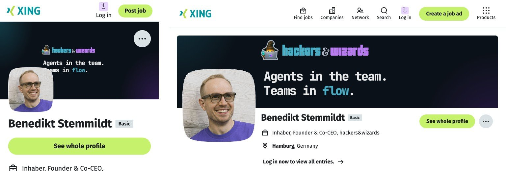
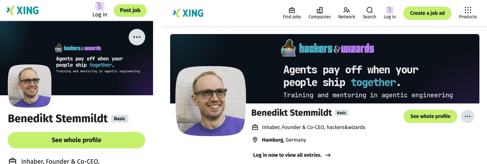
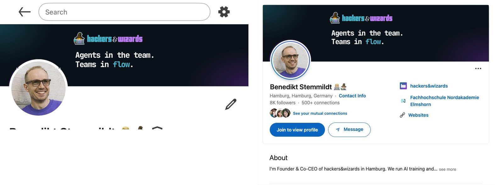
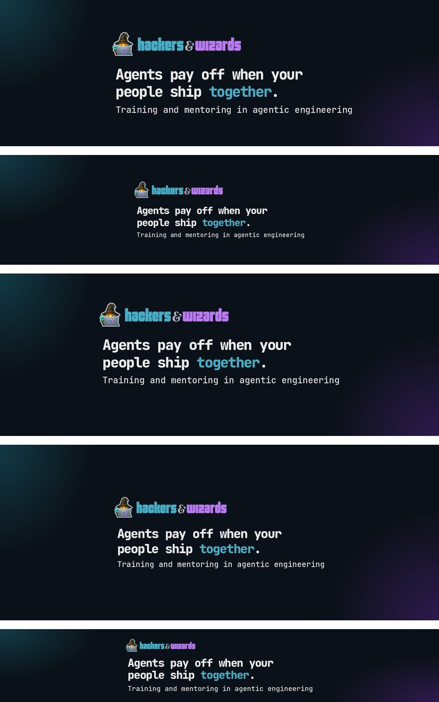

# Claim rollout: u1 from brand v1.56.0

Benedikt decided on 08.11. to follow the recommendations: the claim u1 (`claim-confirm-after-round-8`)
and the home H1 step-every (`decide-home-headline-wording`), with the German H1 "zusammenspielen"
(`home-claim-line`) and nothing above the H1. Brand v1.56.0 ships it. All three items are deleted;
`git log --all -- docs/agent-work/items/<id>.md` finds them. Their images moved to
`2026-11-08-claim-all-candidates/<id>/`, where the round reports link them.

## What changed in brand

- `verbal.json`: `claim` is "Agents pay off when your people ship together." / "KI-Agenten lohnen
  sich, wenn eure Leute gemeinsam liefern.", since 2026-11-08. `claim.word` stays and names
  "together" / "gemeinsam" (panel below). `headline.de` is "Eure Teams haben Agenten. Wenn alle
  Rollen zusammenspielen, werden eure Releases schneller.", since 2026-11-08; `headline.en` is
  unchanged. "Agents in the team. Teams in flow.", "Agenten im Team. Teams im Flow." and the German
  H1 with "eingespielt sind" are in `retired` (the H1 with `replacedBy: "headline"`, a new value),
  so `brand-retired` fails on any consumer build that still shows them.
- `applications/channel-banners/render.py`: the claim is one sentence now, so the profile banners
  break it into two rows at the space that leaves the longer row shortest ("Agents pay off when
  your" / "people ship together."), with the word in the accent. Under it stands the descriptor
  "Training and mentoring in agentic engineering" at 0.62 of the claim size, in the subline weight
  and colour, as measured in round 10. Every banner is re-rendered.
- XING (`work-banner-photo-overlap`, settled): the group moved right of the phone photo (below).
- Client logo banners (`profile-banner-2-clients`, `linkedin-featured-link`): since v1.36.0 the
  raster marks have transparent grounds, which the renderer turned black (Mercedes-Benz and bonprix
  as black boxes, found on this render). The renderer now composites them on the white band, and
  the dm mark, whose box changed, takes the height that gives it the ink size it had before. Both
  banners now match the shipped files apart from antialiasing.

No exported field was removed and no command or file moved: a minor release.

## XING, measured 08.11.

On xing.com, logged out, in Chrome for Testing: a 390 px phone shows the whole cover (390 x 190);
the photo covers banner x 67 to 441 from row 363. At 1024 px XING crops the cover to rows 172 to 468;
the photo covers x 22 to 323 from row 309. At 1440 px the crop shows rows 148 to 491; the photo
covers x 32 to 320 from row 336. The figures stored in `render.py` before (photo x 126 to 542 from
row 431 on the phone) no longer hold: the shipped c3 cover already collided on the phone, with the
photo over the start of "Teams in flow.". The group now sits right of x 470, at 0.9 of slide 1's
size, centred in rows 172 to 468: clear of the photo in every layout.





## Blind panel

Medium: the banner set on its pages. Audience: engineering leaders who open a profile after a first
contact. Display: LinkedIn in the iPhone app and on the laptop (round 10's real screenshots, the
photo restored over the banner), XING live on a 390 px phone and at 1024 px with the cover swapped
in, X, Sessionize, Facebook, Brella and the YouTube strip every device shows, each scaled to 1000 px
wide. Personas: CTO of a Mittelstand manufacturer, VP of Engineering of an e-commerce company,
senior brand designer. Claude (`opus`) and Codex (`gpt-6.1-sol`, high), two runs, labels and order
shuffled per reviewer. Criteria fixed before scoring: legible, breathing room, visual calm, clear
of the photo and buttons, hierarchy, use of colour in the text, one family, offer clear at a glance.

Round 1, 12 runs. "Shipped" is the c3 set live today, scored as the current state.

| Set                          | Overall | Run 1 / 2   | Claude / Codex | Colour | Clear of photo | Offer clear |
| ---------------------------- | ------- | ----------- | -------------- | ------ | -------------- | ----------- |
| u1, "together" in the accent | 83.6    | 83.5 / 83.7 | 82.0 / 85.2    | 8.9    | 8.6            | 8.3         |
| u1, all white                | 80.6    | 80.7 / 80.5 | 77.0 / 84.2    | 6.8    | 8.6            | 8.3         |
| Shipped c3                   | 72.6    | 73.0 / 72.2 | 68.2 / 77.0    | 8.8    | 5.0            | 3.8         |

The accent leads by 3.0 at noise 0.2, in both runs and with both models (Claude +4.6 and +5.4,
Codex +1.0 and +1.0). Claude reviewers name the all-white claim "flat": only the logo carries the
brand colours. So `claim.word` stays, which keeps the field the slides closing and the banners read.
Every reviewer of the shipped set names the missing offer line and, on Claude, the photo over
"Teams in flow." on the XING phone.

The weakest criterion of the winner was legibility: the descriptor too small on the Sessionize
cover and the XING phone, and the YouTube strip tight at top and bottom. Round 2 enlarged the
Sessionize group to nearly the phone's visible width (claim 38 to 45 px) and shrank the YouTube
group to 0.9. A larger XING group crowded the 1024 px crop's bottom edge and was dropped.

Round 2, 12 runs, same panel, the round 1 winner against the fix:

| Set            | Overall | Run 1 / 2   | Claude / Codex | Legible | Breathing room |
| -------------- | ------- | ----------- | -------------- | ------- | -------------- |
| Fixed          | 81.8    | 81.2 / 82.3 | 77.7 / 85.8    | 7.2     | 8.1            |
| Round 1 winner | 79.2    | 78.3 / 80.0 | 73.3 / 85.0    | 6.6     | 7.6            |

The fix leads by 2.6 at noise 1.7, in both runs and with both models; it ships. What still holds
legibility below the top: the descriptor on the XING phone, which shows the whole cover at 0.3 scale.
A larger group there runs into the desktop crop, so this is a plateau and no third round ran.

Skipped: German banners (the banners are English only), the closing slide and the link preview
(the website and slides render those from `verbal.json`, judged in round 10), Stefan's LinkedIn.
The LinkedIn app screenshot still shows the owner's edit pencil.






One reviewer prompt, verbatim (Claude, CTO, round 1, run 1; paths shortened to `<run>`):

```text
You are the CTO of a German Mittelstand manufacturer with 120 developers. You look at company profiles on LinkedIn and XING when a training provider gets in touch.
You are shown three sets of profile banners for the same training company, hackers&wizards. Each set is the banners for every channel the company uses. The medium is a social or event profile page; the audience is engineering leaders who open the profile after a contact; the display sizes are those in the screenshots (a 390 px phone, a laptop browser), the other banners are scaled down to 1000 px wide.
Read every image file named below.

Set K:
- <run>/set-K-linkedin.jpg: the LinkedIn profile banner as it shows in the LinkedIn iPhone app (left) and on the LinkedIn desktop site on a laptop (right), with the profile behind it
- <run>/set-K-xing.jpg: the XING profile cover on a 390 px phone (left) and in a 1024 px desktop browser (right)
- <run>/set-K-others.jpg: from the top, the X profile header, the Sessionize speaker cover, the Facebook profile cover, the Brella event profile cover, and the strip of the YouTube channel banner every device shows, each scaled to 1000 px wide
(Sets M and T alike)

Score each set on these criteria, 0 to 10 each: legible at the size shown; breathing room, not cramped; visual calm; clear of the profile photo and the page's own buttons; hierarchy between logo, main line and the small line; use of colour in the text; one set: the banners read as one family; message: what the company offers is clear at a glance. Then give each set an overall score from 0 to 100.
For each set, name in one sentence what keeps its lowest criterion below 10, and which question the banner leaves open for you as a reader.
Answer as JSON only: {"sets": {"<letter>": {"criteria": {"<criterion>": <0-10>, ...}, "overall": <0-100>, "lowest_reason": "...", "open_question": "..."}}}
```

## Consumers

Found by searching every repository under `~/dev/hackersandwizards` (without `node_modules` and
`docs/agent-work`) for the claim, the headline, `verbal.json` and `channel-banners`. Every
repository that runs `brand-retired` fails once it raises its pin while a build still shows the old
claim. Each brief is for a session in that repository, and each carries one rule (item `work-claim-rollout-holistic`): the copy around the claim or the headline on a surface is rewritten to fit it and blind-reviewed in that surface's context against the current copy, aiming at the highest score, never only the claim line swapped. That item also holds every consumer run until the profile texts and the banners are tuned as a whole.

- **website** (pin v1.28.5): raise to v1.56.0. The home hero's title is `claim` today
  (`src/copy/start.en.ts:58`, `start.de.ts:33`); the decision makes it `headline.en` / `headline.de`
  from `verbal.json`, with nothing above the H1. `src/copy/ui.ts` `claimLines` splits the claim at
  ". " for the footer and leaves an empty first line for a one-sentence claim: show the claim whole
  or break it like the banners. The social cards (`src/lib/social-cards.ts`), the default image alt
  (`src/layouts/Layout.astro`) and the onepager script read `claim` and follow the pin. Re-render the
  link-preview images. The jump from v1.28.5 brings every release since; read their commit messages.
- **os** (pin v1.53.0): raise to v1.56.0 and re-render every onepager (`scripts/onepager/render.ts`
  writes the claim; 16 HTML files still hold the old one). `src/content/handbook/company/business-foundation.md`
  lines 152 and 313 explain the claim through "flow" ("Always connect speed to teams in flow"):
  rewrite them for a claim about people shipping together. `src/content/documents/marketing/brand-message-2026-09.md`
  M3 and `linkedin/profile-and-page-drafts-2026-09.md` (P2 headline, P3 Featured title, P4 slide 1,
  C1 and C9 taglines, D3) state the old claim as text: set them to the new one, as in brand's item
  `work-update-external-profiles-after-claim`. The handbook pages that embed `verbal.json#claim.*`
  follow the pin.
- **slides** (pin v1.52.0): pin raise only. `claimParts` accents "together" / "gemeinsam" on the
  closing; the closing tests read `verbal.json`. Check the contact closing's claim line for wrapping:
  the claim is 47 characters in English and 59 in German, longer than c3.
- **talks** (v1.52.0), **trainer-hub** (v1.52.0), **practitioners** (v1.52.0), **documents**
  (v1.53.0), **mail** (v1.50.0), **admin** (v1.52.0), **certificate-verifier** (v1.52.0),
  **hycle-private** (v1.52.0), **personal site** (`benedikt.stemmildt.com`, v1.52.0): pin raise only.
  None shows the claim or the headline as its own text; talks' closing tests and the documents'
  mission test read `verbal.json`.
- **scaffolding**, **bench**: no brand pin and no claim; only their voice skill copy changes, through the hub sync.
- **hub** (`~/.claude`): raise `~/.claude/package.json` to brand v1.56.0, `bun install`, run
  `scripts/sync-agent-config.sh`, so every repository's `voice/verbal.json` and `verbal.source` carry
  the new claim. `skills/voice/brand-voice.md` "Core positioning" says "Primary headline: the claim
  ... Flow is the emotional result": since 07.11. the home headline is `headline` and the claim no
  longer names flow. Rewrite it: the claim is the sign-off line (banners, closing slide, onepager
  header, link preview), `headline` is the home H1, and the claim's result is people shipping
  together.
- **Client and partner repositories** (`clients/*`, `partners/*`): `partners/packt/packt-book-1`
  carries a voice skill copy with the old claim; it changes only through the hub sync. Not changed here.

## External profiles

`work-update-external-profiles-after-claim` lists each profile's file and the text fields to
change; Benedikt uploads.

## Left out

From the closing `/simplify` and `/code-review`, not done in this release:

- The banners size each client mark by a hand-set height (dm raised to keep its ink size) rather
  than from `clients.json`'s `height`. Reading it from there moves pixels on two shipped banners
  and needs its own render and review; worth it at the next change to a mark's box.
- The descriptor text stands in `render.py` and, with a full stop, in `applications/booth/generate.ts`.
  It belongs in `verbal.json` once a third surface or a consumer shows it.
- `claim_block` takes size, step and grid height per surface where one size would derive the
  others; a refactor with no visible change.
