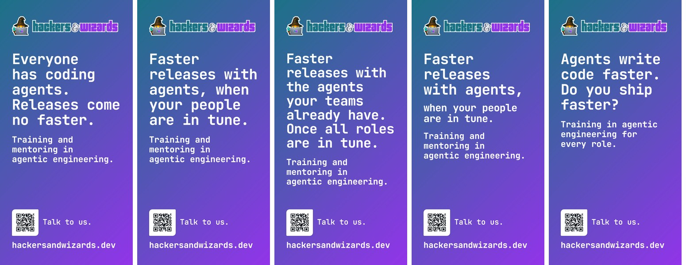
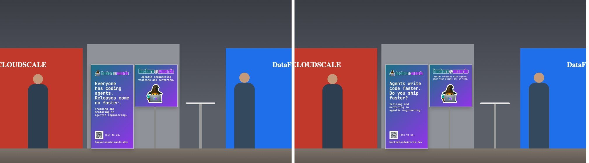
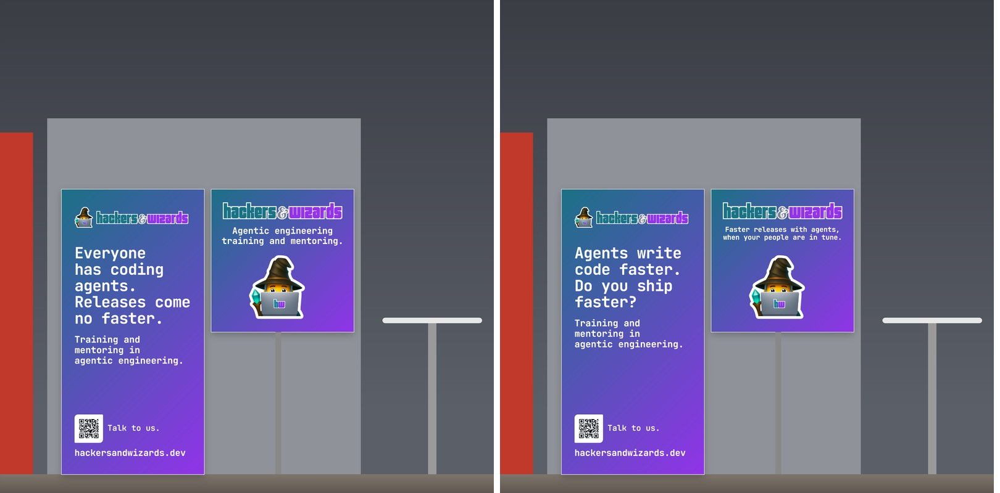
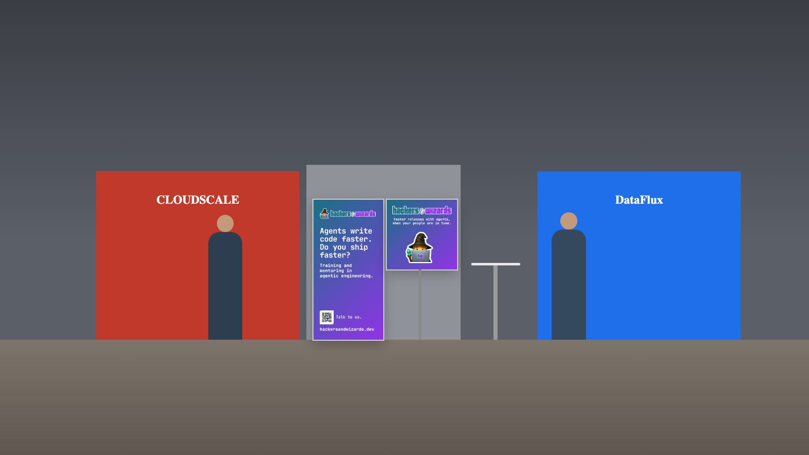
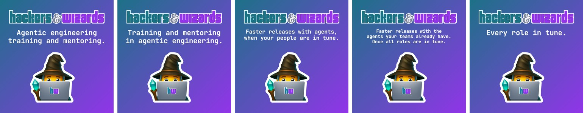

# The applications against the claim and headline, 11.11.2026

Until today only the channel banners carried the claim of 10.11. (v2.14.0, `06ef37d`). The booth
banners carried their own lines, and every other application shows no claim, headline or retired
line. The booth pair changes in v2.20.0: the 1 x 2 m asks "Agents write code faster. Do you ship
faster?" over the descriptor, and the 1 x 1 m answers with the claim. That pair scores 73.7 against
62.4 for today's pair (noise 1.2), ahead in all four model and run cells, and in a third round
each of the two changes holds against today's text on its own banner. The descriptor "Training
and mentoring in agentic engineering" moves into `verbal.json` as `descriptor`, English and German,
and `render.py` and the booth generator read it from there (item `work-claim-followups`, point 1).

Nothing is printed or uploaded. The print files are `applications/booth/booth-banner-gradient-100x200.pdf`
and `-100x100.pdf`; ordering them for code.talks 2027 stays Benedikt's.

## Every application file and the words it shows

Read on 11.11. from the files in `applications/` at `9cbd0d1`: every PNG opened, every SVG
rendered in Chrome, every PDF rendered with pdftoppm and read with pdftotext, `gradients.ai`
rendered as PDF. `brand-retired applications` read the 48 text files and found none of the 21
retired lines; its control, a file holding a retired line, failed as it must.

Classes: **claim** and **headline** are `verbal.json`'s current lines, **descriptor** is the offer
line under the claim, **retired** a line of `retired`, **other** any other line, **marks only** the
logo, wordmark or hw mark and nothing else.

| Files                                                                                                                                                                                                                                                                                                    | Words shown                                                                                                                                                                                                | Class                                                                       |
| -------------------------------------------------------------------------------------------------------------------------------------------------------------------------------------------------------------------------------------------------------------------------------------------------------- | ---------------------------------------------------------------------------------------------------------------------------------------------------------------------------------------------------------- | --------------------------------------------------------------------------- |
| avatars: circle-community-icon-32, -512, fathom-brandfetch-logo-1024 (.png, .svg), github-org-avatar-500, gitlab-group-avatar-192, google-account-photo-800, google-workspace-logo-320x132, linkedin-company-logo-400, notion-workspace-icon-512, slack-workspace-icon-1024, youtube-profile-picture-800 | hw                                                                                                                                                                                                         | marks only                                                                  |
| avatars: qonto-invoice-logo-1000                                                                                                                                                                                                                                                                         | hackers&wizards                                                                                                                                                                                            | marks only                                                                  |
| backgrounds: call, ipad-home, ipad-home-landscape, ipad-lock, iphone-home, iphone-lock, macbook, studio-display                                                                                                                                                                                          | hackers&wizards (lockup)                                                                                                                                                                                   | marks only                                                                  |
| booth: booth-banner-gradient-100x200 (.pdf, .png), before this run                                                                                                                                                                                                                                       | hackers&wizards; "Everyone has coding agents. Releases come no faster."; "Training and mentoring in agentic engineering."; "Talk to us."; hackersandwizards.dev                                            | other (the problem from `position`, in other words); descriptor; other; URL |
| booth: booth-banner-gradient-100x100 (.pdf, .png), before this run                                                                                                                                                                                                                                       | hackers&wizards; "Agentic engineering training and mentoring."; hw on the wizard's laptop                                                                                                                  | other (the descriptor in another word order)                                |
| booth: qr-hackersandwizards-dev.svg                                                                                                                                                                                                                                                                      | a QR code, no words                                                                                                                                                                                        | marks only                                                                  |
| channel-banners: profile-banner-1-claim-1584x396, brella-profile-cover-2000x800, facebook-profile-cover-2000x740, sessionize-profile-cover-2000x500, x-profile-header-1500x500, xing-profile-cover-1312x639, youtube-channel-banner-2560x1440                                                            | hackers&wizards; "Faster releases with agents, when your people are in tune."; "Training and mentoring in agentic engineering"                                                                             | claim; descriptor                                                           |
| channel-banners: linkedin-company-cover-1512x256, -3024x512, linkedin-company-cover-canva-4200x700                                                                                                                                                                                                       | hackers&wizards; "Agentic engineering training and mentoring."                                                                                                                                             | other (the descriptor in another word order)                                |
| channel-banners: linkedin-company-cover-canva-background-4200x700                                                                                                                                                                                                                                        | none                                                                                                                                                                                                       | none                                                                        |
| channel-banners: linkedin-featured-link-1200x627, -2400x1254, profile-banner-2-clients-1584x396                                                                                                                                                                                                          | hackers&wizards; "200+ teams trained."; the marks of Mercedes-Benz, dm, Tchibo, Vorwerk, bonprix                                                                                                           | other                                                                       |
| channel-banners: omr-reviews-cover-1920x1080                                                                                                                                                                                                                                                             | hackers&wizards; "KI-Schulungen für Agentic Engineering."; "200+ Teams und 1.000+ Entwickler:innen trainiert."                                                                                             | other                                                                       |
| device-stickers: ipad.svg, iphone.svg, macbook.svg                                                                                                                                                                                                                                                       | hackers&wizards (sticker), hw on the wizard (macbook); the placement labels "50 mm", "22 mm", "45 mm"                                                                                                      | marks only; placement labels                                                |
| gradients: gradient-linear-01 to -04, gradient-mesh-01 to -04, gradient-radial-01, -02, gradients.ai (2 pages)                                                                                                                                                                                           | none                                                                                                                                                                                                       | none                                                                        |
| linkedin-visuals: post-terminal-sample.png                                                                                                                                                                                                                                                               | "The queue sits outside engineering."; gh pr list; b2b-invoices waiting: legal; the queue is outside engineering; cart-timeout, search-boost merged by agent; tax-export waiting: finance; hackers&wizards | other (a sample post)                                                       |
| linkedin-visuals: sketch-example-context-change-release.png                                                                                                                                                                                                                                              | "A context change is a release."; the shared context; new model; real problems, known answers; release; hackers&wizards                                                                                    | other (a sample post)                                                       |
| linkedin-visuals: sketch-example-each-person-owns.png                                                                                                                                                                                                                                                    | "Name what each person owns."; factory engineer: how the factory runs; product engineer: into production; both can do everything, each answers for one part; hackers&wizards                               | other (a sample post)                                                       |
| linkedin-visuals: sketch-example-night-shift-day-shift.png                                                                                                                                                                                                                                               | "People spend it deciding, not typing."; night shift: build the variants; day shift: decide; hackers&wizards                                                                                               | other (a sample post)                                                       |
| linkedin-visuals: sketch-prompt.txt and the three sketch-example-\*.txt                                                                                                                                                                                                                                  | prompts for an image generator; no claim, headline or retired line                                                                                                                                         | other (prompts)                                                             |
| slide-visuals: sketch-example-next-token.png, sketch-prompt.txt, sketch-example-next-token.txt                                                                                                                                                                                                           | the build is; done; broken; slow; next token (and the prompts behind it)                                                                                                                                   | other (a sample sketch)                                                     |
| mail-signature: template.html, template.txt                                                                                                                                                                                                                                                              | hackers&wizards; {{name}}; {{role}}, hackers&wizards; phone, hackersandwizards.dev, LinkedIn; the imprint                                                                                                  | other (identity and imprint)                                                |
| merch: cloth-K10 (.pdf, .svg)                                                                                                                                                                                                                                                                            | "Clear vision. Clean code."; hackers&wizards                                                                                                                                                               | other                                                                       |
| merch: cloth-K12 (.pdf, .svg)                                                                                                                                                                                                                                                                            | "Any sufficiently advanced technology is indistinguishable from magic. // Arthur C. Clarke"; hackers&wizards                                                                                               | other (a quotation)                                                         |
| merch: cloth-K9, hoodie-H12-front, mug-M6, notebook-N6, shirt-T12-back, shirt-T12-front, stickerB-B16, stickerD-D1, stickerL-L13, stickerP-P10 (.pdf, .svg each); stickerZ-Z1, stickerZ-Z2 (.pdf, .svg)                                                                                                  | hackers&wizards; hw on the wizard (Z1, Z2, mug, notebook, K9)                                                                                                                                              | marks only                                                                  |
| social-previews: each file shows hackers&wizards, an icon, a kind label, the repository name and its description                                                                                                                                                                                         | as in the rows below                                                                                                                                                                                       | other (repository descriptions)                                             |
| social-previews: admin                                                                                                                                                                                                                                                                                   | PACKAGE · DEVELOPER TOOLS; admin; "Admin engine of hackers&wizards: an admin page per repository and one hub across all of them."                                                                          | other                                                                       |
| social-previews: agentic-engineering-for-developers                                                                                                                                                                                                                                                      | TRAINING CODEBASE; "The practice codebase for Agentic Engineering for Developers and QA: a small CRM in Next.js and React."                                                                                | other                                                                       |
| social-previews: agentic-engineering-training-kotlin-vue                                                                                                                                                                                                                                                 | TRAINING CODEBASE; "A product search app in Vue.js and Kotlin with Quarkus, a practice codebase for Agentic Engineering trainings."                                                                        | other                                                                       |
| social-previews: agentic-software-factory                                                                                                                                                                                                                                                                | TRAINING EXERCISES; "The exercises for Agentic Software Factory: build a planner, refine and implement factory with Claude Code, then trace, eval and guard it."                                           | other                                                                       |
| social-previews: artificer                                                                                                                                                                                                                                                                               | AGENT TOOLKIT; "An artificer's kit for building minimal dark-factories on Claude Code. Compose small, gated agent steps into deterministic builds you can read end to end."                                | other                                                                       |
| social-previews: bench                                                                                                                                                                                                                                                                                   | DEVELOPER SETUP; "Terminal setup for hackers&wizards: zsh, Ghostty, Starship, fzf. macOS on Apple Silicon."                                                                                                | other                                                                       |
| social-previews: brand                                                                                                                                                                                                                                                                                   | PACKAGE · DESIGN SYSTEM; "Brand package of hackers&wizards: design tokens, fonts, logos and UI components."                                                                                                | other                                                                       |
| social-previews: claude-rust-guard-example                                                                                                                                                                                                                                                               | EXAMPLE; "Claude Code PreToolUse hook in Rust: blocks 'rg -r' (ripgrep --replace) typed as grep's recursive -r."                                                                                           | other                                                                       |
| social-previews: discussions                                                                                                                                                                                                                                                                             | COMMUNITY; "Home of the hackers&wizards organization discussions."                                                                                                                                         | other                                                                       |
| social-previews: documents                                                                                                                                                                                                                                                                               | PACKAGE · DESIGN SYSTEM; "Document engine of hackers&wizards: brand components composed to HTML and rendered to PDF."                                                                                      | other                                                                       |
| social-previews: github                                                                                                                                                                                                                                                                                  | ORGANIZATION; .github; "The public profile of the hackers&wizards GitHub organization: Agentic Engineering training and mentoring from Hamburg."                                                           | other (the descriptor's words in another order)                             |
| social-previews: hycle                                                                                                                                                                                                                                                                                   | MANIFESTO; "Source of hycle.org: a hypothesis on how work shifts when agentic software development makes building cheap. In German."                                                                       | other                                                                       |
| social-previews: local-mlx-stack                                                                                                                                                                                                                                                                         | DEVELOPER SETUP; "A local OpenAI-compatible MLX inference server for Apple Silicon, version-controlled."                                                                                                   | other                                                                       |
| social-previews: mail                                                                                                                                                                                                                                                                                    | PACKAGE · DESIGN SYSTEM; "Mail engine of hackers&wizards: React Email components, rendered to HTML and plain text."                                                                                        | other                                                                       |
| social-previews: practitioners                                                                                                                                                                                                                                                                           | WEBSITE CONTENT; "The bios and portraits of the practitioners on hackersandwizards.dev, one directory per person."                                                                                         | other                                                                       |
| social-previews: scaffolding                                                                                                                                                                                                                                                                             | PACKAGE · DEVELOPER TOOLS; "Repository template of hackers&wizards: the skeleton and shared checks (secrets, coupling, format, lint)."                                                                     | other                                                                       |
| social-previews: slides                                                                                                                                                                                                                                                                                  | PACKAGE · DESIGN SYSTEM; "Slide engine of hackers&wizards: slide components, deck types and a PDF renderer."                                                                                               | other                                                                       |
| social-previews: testimonials                                                                                                                                                                                                                                                                            | WEBSITE CONTENT; "Client quotes, portraits and company marks of hackers&wizards, one source for every surface"                                                                                             | other                                                                       |

No file carries a retired line, so nothing needed a plain correction. "Out of step" here means a
line that states one of `verbal.json`'s lines in other words. Four places do: the two booth
banners, now changed; the LinkedIn company cover and the `.github` social preview, which stay
(see "Open").

## The booth banners

The surface: two Pixlip GO lightbox frames in front of the stand wall, 1 x 2 m on the floor and
1 x 1 m on a pole with its top at 2 m, seen by visitors walking the aisle from 10 m down to 3 m.
`generate.ts`'s layout rules stay: gradient only, white type only, the lockup and the QR code with
URL on the 1 x 2 m, the wordmark and the large wizard on the 1 x 1 m. Only the texts and the text
sizes change.

The claim report says a surface's copy fits the place and the claim pasted in unchanged is one
candidate, never the default. For a booth seen for a few seconds from 10 m, that reads as: the line
readable from 10 m must name the visitor's problem or gain in very few words, and the claim's
condition can wait for 3 m. Hence the split candidate: the claim's first half large, its second
half below in a smaller size. The counter-draft came from a separate Claude run that got the facts,
`verbal.json`'s lines and the slots, and saw no other draft.

### Round 1: the 1 x 2 m (16 reviews)

The 1 x 1 m stays as it was. Text sizes: 108 mm for every headline, except the home headline, which
at 108 mm needs eight rows and leaves 32 mm above the contact block, so it runs at 100 mm (seven
rows, 172 mm left; today's text leaves 341 mm).

| Variant                                                                                                            | Overall | Claude run 1, 2 | Codex run 1, 2 | Read from 10 m, whole line   | Would stop |
| ------------------------------------------------------------------------------------------------------------------ | ------- | --------------- | -------------- | ---------------------------- | ---------- |
| Counter-draft: "Agents write code faster. Do you ship faster?" / "Training in agentic engineering for every role." | 76.2    | 72.2, 68.2      | 82.8, 81.5     | 16 of 16                     | 16 of 16   |
| Split claim: "Faster releases with agents," large, "when your people are in tune." smaller                         | 69.4    | 63.8, 66.0      | 74.5, 73.2     | 0 of 16 (the first half: 16) | 10 of 16   |
| Claim                                                                                                              | 68.8    | 66.2, 67.0      | 71.5, 70.5     | 14 of 16                     | 9 of 16    |
| Today: "Everyone has coding agents. Releases come no faster."                                                      | 68.1    | 64.5, 62.5      | 72.8, 72.5     | 15 of 16                     | 15 of 16   |
| Home headline                                                                                                      | 60.9    | 56.8, 54.0      | 68.2, 64.8     | 6 of 16                      | 1 of 16    |

Noise 1.9 (Claude 2.4, Codex 1.4). Every variant except the counter-draft carries the descriptor
under it. The counter-draft leads today's text by 8.1 (+7.8, +5.8, +10.0, +9.0). The claim and the
split claim tie with today's; the home headline loses by 7.1 in all four cells.

- Today's text and the counter-draft lose points for the same reason: they name the problem and
  leave the gain implied. "States the pain, not the gain; 'come no faster' sounds stiff" (developer,
  Claude). "The question implies the gain rather than promising it" (developer, Claude).
- The claim: 12 of 16 name "in tune" as vague, 11 of 16 the five rows as long for a glance.
- The split claim: from 10 m "it's a generic promise any AI vendor could make; the condition is too
  small" (developer, Claude); 15 of 16 name the generic first half or the lost condition.
- The home headline: seven rows, too long to read walking (16 of 16); 8 of 16 also name the
  fragment "Once all roles are in tune".



### Round 2: the 1 x 1 m with the pair (16 reviews)

Round 1's reasons point to a pair: the 1 x 2 m asks the question, the 1 x 1 m gives the answer,
which is the claim. The 1 x 2 m stays at the counter-draft's headline with the descriptor under it,
`verbal.json`'s line, in place of the counter-draft's own offer line. On the 1 x 1 m each text
runs at the largest size that keeps the wizard clear: 62 mm for the offer lines, 48 mm for the
claim (two rows), 40 mm, the print minimum, for the home headline (three rows). Today's pair and the
counter-draft's full set run alongside.

| 1 x 2 m headline              | 1 x 1 m line                                                 | Overall | Claude run 1, 2 | Codex run 1, 2 |
| ----------------------------- | ------------------------------------------------------------ | ------- | --------------- | -------------- |
| counter-draft, own offer line | "Every role in tune." (counter-draft's set)                  | 74.1    | 69.5, 66.0      | 80.8, 80.0     |
| counter-draft                 | the claim, 48 mm (**shipped**)                               | 73.7    | 69.0, 70.0      | 78.0, 77.8     |
| counter-draft                 | the home headline, 40 mm                                     | 69.3    | 61.8, 65.5      | 75.8, 74.2     |
| counter-draft                 | "Every role in tune."                                        | 69.3    | 64.2, 62.0      | 75.5, 75.5     |
| counter-draft                 | "Agentic engineering training and mentoring."                | 68.2    | 60.0, 59.0      | 77.2, 76.8     |
| counter-draft                 | "Training and mentoring in agentic engineering."             | 67.8    | 59.0, 58.2      | 77.0, 77.0     |
| today                         | "Agentic engineering training and mentoring." (today's pair) | 62.4    | 57.5, 57.8      | 66.5, 67.8     |

Noise 1.2 (Claude 1.8, Codex 0.6). Against today's pair:

- The claim pair leads by 11.3 (+11.5, +12.2, +11.5, +10.0), the counter-draft's set by 11.7
  (+12.0, +8.2, +14.2, +12.2): both outside the noise in every cell.
- Between the two the lead is 0.4 (+0.5, -4.0, +2.8, +2.2): a tie. It goes to the claim pair, whose
  two other lines are `verbal.json`'s claim and descriptor; the counter-draft's set adds two lines
  of its own, and its offer line drops "mentoring", which two Claude reviews noted.
- The new 1 x 2 m alone, with today's 1 x 1 m, leads today's pair by 5.9 (+2.5, +1.2, +10.8, +9.0):
  outside the noise with Codex, inside it in Claude's second run. The claim on the 1 x 1 m is what
  makes the pair's lead hold in every cell: it adds 5.4 over today's 1 x 1 m line under the same
  1 x 2 m (+9.0, +11.0, +0.8, +1.0).
- The descriptor's two word orders on the 1 x 1 m tie (-0.4), so `verbal.json`'s wording would have
  cost nothing; the shipped 1 x 1 m carries no offer line, since the 1 x 2 m already says it.
- What keeps the shipped pair below the maximum: the claim on the pole is small at 48 mm (12 of 16),
  "in tune" stays vague (10 of 16), the booth looks small beside large neighbouring walls (7 of 16).
  The first comes from the layout, which fixes the wordmark and the wizard; the third comes from the
  booth's size. Neither is text.






### Round 3: each change on its own (16 reviews)

Round 2 tested the new 1 x 2 m headline only beside today's 1 x 1 m line, where its lead over
today's pair stayed inside Claude's noise in one run. Round 3 holds the claim on the 1 x 1 m and
changes the 1 x 2 m alone, with today's pair as anchor.

| 1 x 2 m headline                                          | 1 x 1 m line                                  | Overall | Claude run 1, 2 | Codex run 1, 2 | Would stop |
| --------------------------------------------------------- | --------------------------------------------- | ------- | --------------- | -------------- | ---------- |
| "Agents write code faster. Do you ship faster?" (shipped) | the claim                                     | 73.9    | 68.2, 68.5      | 81.0, 78.0     | 16 of 16   |
| "Everyone has coding agents. Releases come no faster."    | the claim                                     | 69.8    | 67.2, 66.0      | 74.5, 71.5     | 15 of 16   |
| "Everyone has coding agents. Releases come no faster."    | "Agentic engineering training and mentoring." | 65.0    | 58.8, 59.2      | 73.5, 68.5     | 8 of 16    |

Noise 2.2 (Claude 0.7, Codex 3.7). The new headline leads today's under the same 1 x 1 m by 4.1
(+1.0, +2.5, +6.5, +6.5), outside the noise in every cell, by 0.3 points in Claude's first run. The
shipped pair leads today's by 8.9 (+9.5, +9.2, +7.5, +9.5). The claim on the 1 x 1 m under today's
headline leads today's pair by 4.8 (+8.5, +6.8, +1.0, +3.0): a tie by the rule, Codex's noise being
3.7 in this round, while in round 2 the same change under the new headline counted.

### Every criterion

Panel means, 0 to 10, overall 0 to 100; each round's own panel.

| Round: variant                          | Presence 10 m | Read 10 m | Legible 3 m | Message | Gain | Distinctive | Language | Breathing room | Calm | Ours | Pair | Overall |
| --------------------------------------- | ------------- | --------- | ----------- | ------- | ---- | ----------- | -------- | -------------- | ---- | ---- | ---- | ------- |
| 1: counter-draft set                    | 5.4           | 6.8       | 9.1         | 8.0     | 6.9  | 6.1         | 9.2      | 8.7            | 8.5  | 6.2  | 8.3  | 76.2    |
| 1: split claim                          | 5.4           | 6.4       | 8.9         | 7.2     | 7.5  | 4.8         | 7.4      | 8.2            | 7.9  | 5.8  | 8.0  | 69.4    |
| 1: claim                                | 5.4           | 5.9       | 9.0         | 7.1     | 7.6  | 5.0         | 7.4      | 7.9            | 7.9  | 5.9  | 7.9  | 68.8    |
| 1: today                                | 5.4           | 5.9       | 9.0         | 7.2     | 5.1  | 5.9         | 7.7      | 8.0            | 7.9  | 6.0  | 7.8  | 68.1    |
| 1: home headline                        | 5.3           | 4.3       | 8.5         | 7.1     | 7.7  | 5.7         | 6.5      | 5.9            | 6.2  | 5.9  | 7.4  | 60.9    |
| 2: counter-draft set                    | 5.5           | 6.3       | 9.2         | 7.8     | 7.0  | 5.9         | 8.4      | 8.9            | 8.7  | 6.9  | 8.3  | 74.1    |
| 2: new headline + claim (shipped)       | 5.5           | 6.3       | 8.3         | 7.9     | 7.7  | 5.7         | 7.9      | 8.2            | 8.2  | 6.8  | 8.3  | 73.7    |
| 2: new headline + home headline         | 5.5           | 6.3       | 7.3         | 7.8     | 7.5  | 5.9         | 6.9      | 7.3            | 7.3  | 6.7  | 7.8  | 69.3    |
| 2: new headline + "Every role in tune." | 5.5           | 6.3       | 9.2         | 6.9     | 6.7  | 5.2         | 8.3      | 8.9            | 8.7  | 6.6  | 7.1  | 69.3    |
| 2: new headline + today's 1 x 1 m       | 5.5           | 6.3       | 9.1         | 7.4     | 6.6  | 4.2         | 8.6      | 8.4            | 8.3  | 6.0  | 6.8  | 68.2    |
| 2: new headline + descriptor            | 5.5           | 6.3       | 9.1         | 7.3     | 6.6  | 4.2         | 8.8      | 8.4            | 8.3  | 6.0  | 6.6  | 67.8    |
| 2: today's pair                         | 5.4           | 5.5       | 9.0         | 6.9     | 5.0  | 5.2         | 7.1      | 7.7            | 7.7  | 6.2  | 6.7  | 62.4    |
| 3: shipped pair                         | 5.5           | 6.8       | 8.6         | 7.8     | 7.2  | 5.2         | 8.4      | 8.5            | 8.2  | 6.4  | 8.2  | 73.9    |
| 3: today's headline + claim             | 5.5           | 6.0       | 8.6         | 7.4     | 5.9  | 5.4         | 7.2      | 8.0            | 7.9  | 6.6  | 8.0  | 69.8    |
| 3: today's pair                         | 5.5           | 6.0       | 9.0         | 7.2     | 4.9  | 4.8         | 7.5      | 8.0            | 8.0  | 6.3  | 6.5  | 65.0    |

### Method

- Rendering: a scratch copy of `generate.ts` with the texts and sizes as parameters, headless
  Chrome for Testing with software drawing, a fresh profile with the cache off, waits for fonts and
  images. Every candidate was built twice and both builds matched byte for byte. The shipped
  generator's HTML, rendered the same way, is pixel-identical to the scored variant. The committed
  PNGs come from `generate.ts` itself, whose default raster differs from the software one in glyph
  edges and gradient dithering, and by one colour level between two of its own runs.
- Fit: each text's rows, the free height above the contact block and the gap between the 1 x 1 m
  line and the wizard were measured in the DOM before scoring. Smallest type on any variant: 40 mm.
- The aisle: drawn to scale with a 60 degree horizontal field of view, eye at 1.6 m, 1600 px wide,
  from 10 m and 6 m (one image) and 3 m (1600 x 1600), the mid-grey stand wall of `generate.ts`,
  two neighbouring stands and visitors. A drawing, not a photo: a file-name search of brand and os
  found no photo of a stand to check it against. The frames are LED lightboxes; the views draw them
  unlit in a lit hall, as `generate.ts`'s default views do.
- Panel: a developer walking the aisle, a VP of Engineering of a 150-engineer scale-up, a CTO of a
  Mittelstand manufacturer with 120 developers, a senior brand designer. Claude (`claude-opus-5-5`,
  effort medium) and Codex (`gpt-6.1-sol`, reasoning high), two runs each, labels and order
  shuffled per review, image files under hashed names. Criteria fixed before the first score.
- Noise is the mean gap between the panel means of a model's two runs. A lead counts where it has
  the same sign in all four model and run cells and lies outside that model's noise in each.

One reviewer prompt, round 2, VP of Engineering, Codex, run 1 (`<run>` replaces the scratch path):

```text
You are the VP of Engineering of a European scale-up with 150 engineers, at a developer conference partly to find help with how your teams work with coding agents. You judge the booth of a small training company, hackers&wizards, at that conference. You run unattended: nobody answers questions.

Medium, audience and display size: two printed fabric banners in lightbox frames in front of the stand wall, a 1 x 2 m banner standing on the floor and a 1 x 1 m banner on a pole with its top at 2 m, beside a high table. The audience is conference visitors walking down the aisle, mostly software engineers and engineering leaders, who see the booth for a few seconds from 10 m down to 3 m. The images are drawn to scale as a person sees the aisle with a 60 degree field of view, 1600 px wide: from 10 m and 6 m, and from 3 m. Each variant is the same booth; the text on one or both banners differs between variants.

Read every image file named below. Open no other file.

Variant RT
- <run>/blind-S/6b548b2584.jpg: the aisle seen from 10 m (top) and from 6 m (bottom)
- <run>/blind-S/a2b6515e31.jpg: the booth seen from 3 m
Variant SX
- <run>/blind-S/3485e24a10.jpg: the aisle seen from 10 m (top) and from 6 m (bottom)
- <run>/blind-S/ef580655ef.jpg: the booth seen from 3 m
Variant VP
- <run>/blind-S/3dc3293fe6.jpg: the aisle seen from 10 m (top) and from 6 m (bottom)
- <run>/blind-S/4820cb9bf0.jpg: the booth seen from 3 m
Variant KM
- <run>/blind-S/6132b3e564.jpg: the aisle seen from 10 m (top) and from 6 m (bottom)
- <run>/blind-S/06ac99d7d3.jpg: the booth seen from 3 m
Variant HN
- <run>/blind-S/f556e6ef71.jpg: the aisle seen from 10 m (top) and from 6 m (bottom)
- <run>/blind-S/da179707fb.jpg: the booth seen from 3 m
Variant QF
- <run>/blind-S/1d76e314aa.jpg: the aisle seen from 10 m (top) and from 6 m (bottom)
- <run>/blind-S/16d2fd0a45.jpg: the booth seen from 3 m
Variant ZD
- <run>/blind-S/3d9bf0a329.jpg: the aisle seen from 10 m (top) and from 6 m (bottom)
- <run>/blind-S/a0f13abee2.jpg: the booth seen from 3 m

Score each variant 0 to 10 (integers or halves):
- presence_10m: from 10 m, the booth stands out in the aisle and you can tell who this is
- read_10m: from 10 m, you can read the main line of the 1 x 2 m banner
- legible_3m: from 3 m, you can read every line on both banners without effort
- message: you understand what the company offers and why you would stop
- gain: the main line makes you see what gets better for your team or company
- distinctive: the text could not stand just as well on a competitor's booth
- language: natural, idiomatic English
- breathing_room: enough space, nothing cramped
- visual_calm: calm and ordered rather than busy
- ours: made for this company, could not be any other's
- pair: the two banners work together as one booth
Then overall, 0 to 100: how well this booth works for its job.
For each variant also:
- read_far: the exact words you can make out on the 1 x 2 m banner in the 10 m view, or "nothing"
- stop: "yes" or "no", whether you would stop or scan the code walking past
- open_question: the one question the booth leaves open for you (at most 15 words)
- below_max: what keeps it below the maximum (at most 20 words)

Answer with JSON only: {"<label>": {"presence_10m":0,"read_10m":0,"legible_3m":0,"message":0,"gain":0,"distinctive":0,"language":0,"breathing_room":0,"visual_calm":0,"ours":0,"pair":0,"overall":0,"read_far":"...","stop":"yes","open_question":"...","below_max":"..."}, ...} covering every label.
```

## Open

- **The LinkedIn company cover** says "Agentic engineering training and mentoring.", the
  descriptor in the other word order, which the 1 x 1 m booth banner carried until today. The brief
  for this run asked for variants and a blind review on every surface out of step; this one was
  skipped, because Benedikt chose that cover, text included, on 31.10. (`6a58cca`). Whether it
  takes `verbal.json`'s descriptor is his question; a render and a review on the company page would
  come first.
- **The `.github` social preview** reads "Agentic Engineering training and mentoring from Hamburg",
  the description of the GitHub organization's `.github` repository, which `social-previews/generate.ts`
  reads with `gh`. The text lives on GitHub, not here; changing it changes the public profile.
- **The OMR cover** ("KI-Schulungen für Agentic Engineering.") and the German descriptor
  ("Schulung und Mentoring in Agentic Engineering") differ; the cover predates the claim and was
  not part of any round.
- **Not explained:** today's pair scores 68.1 with 15 of 16 stops in round 1, 62.4 with 6 of 16 in
  round 2 and 65.0 with 8 of 16 in round 3, against other candidates each time. Scores compare only
  within a round; why the stop answers move that much is not established. Codex's run gap in round
  3 (3.7) is five times its gap in round 2 (0.6), with no change to prompt or images; not explained
  either.

Review: large, because the banners are printed, and a print run is expensive to take back.
