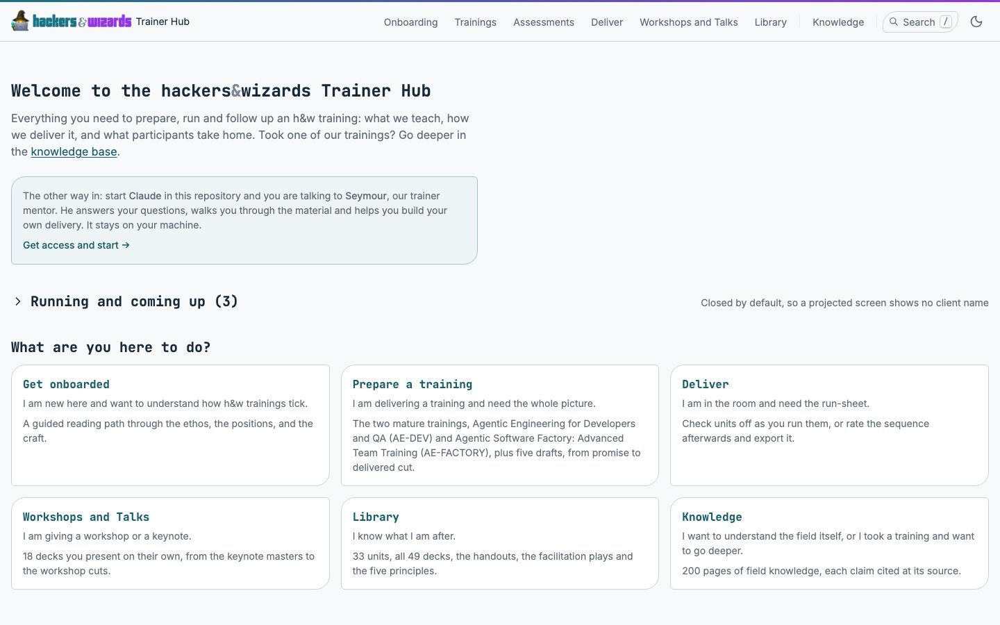
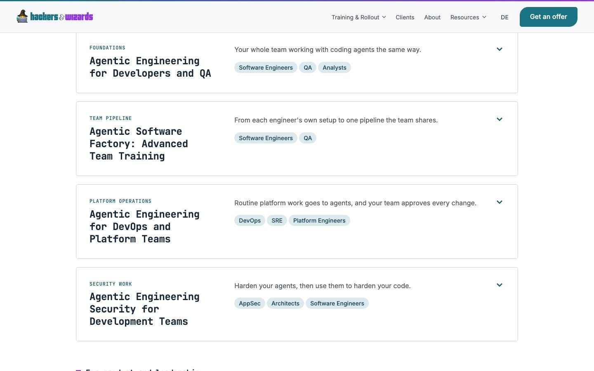
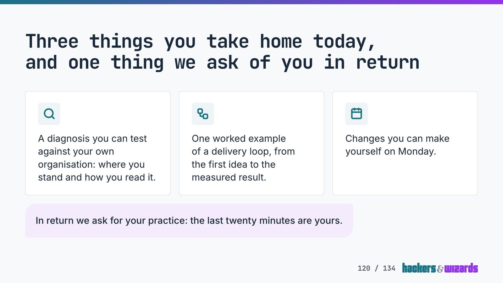
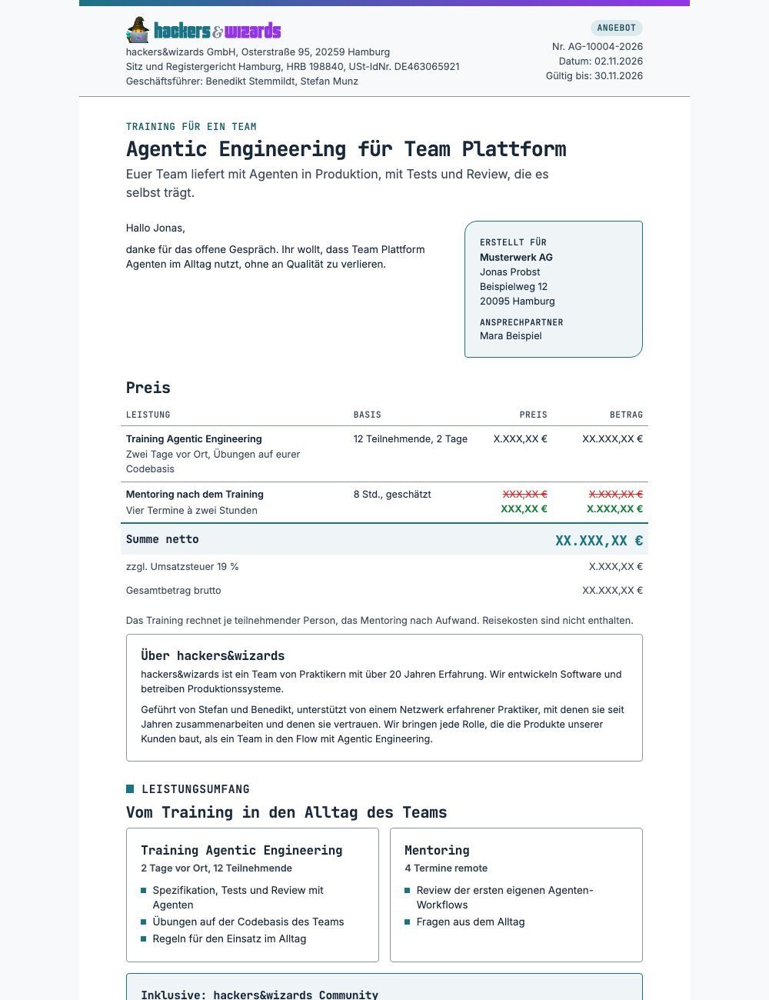
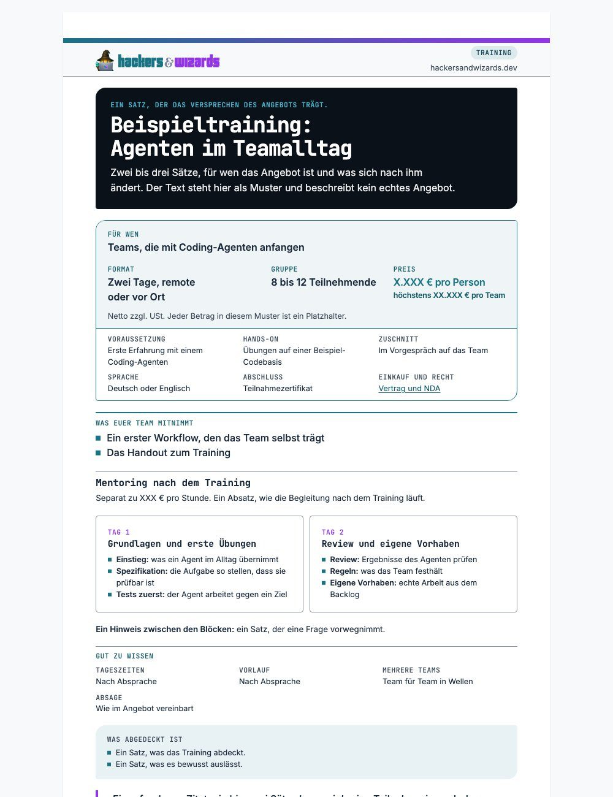
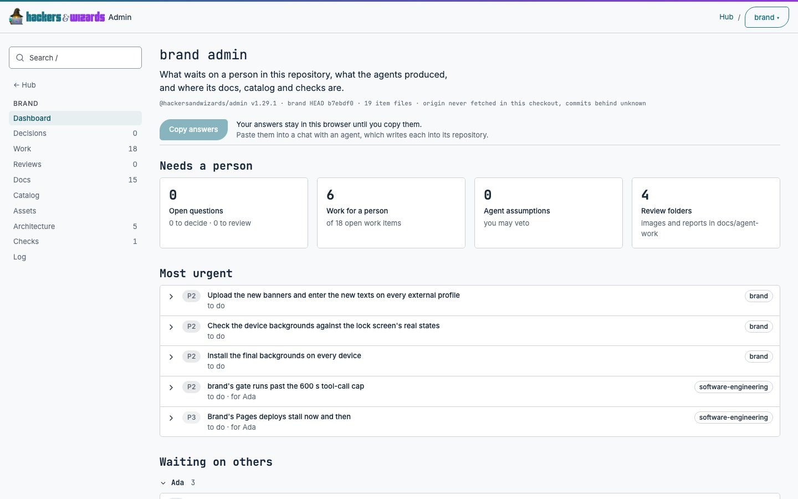

# Where the brand corner belongs

Recommendation, for Benedikt to decide (item `decide-brand-corner`): the brand corner appears on a
block or action that stands alone in its view, such as a hero panel, a single callout, a cover box,
a lone button, a single code block or a dialog, and nowhere else. A card, tile or button that
repeats in a grid, list or row takes the small corner, as does everything inside a brand-cornered
block and every field.

The blind review confirms the overuse. Today's state scores last or tied for last on every surface
with Claude, and with Codex on all but slides and the internal tools. Among the reductions no
variant leads with both models outside the noise on the website, documents or slides: there they
tie. The rule above wins the tie because it is one rule for every surface, with no exception per
surface. It also beats "no brand corner in internal systems" with both models on the internal
tools. Part of the brief's hypothesis is therefore contradicted: the colleagues' panel prefers one
corner on a single block over none.

Nothing in an element or a consumer changed in this run. Form fields lose the brand corner in
another run; every variant below already renders them with the small corner.

## The brand corner today

### Token and elements in brand

`--radius-brand: 20px 5px` (`tokens/tokens.css`): 20 px top left and bottom right, 5 px on the
other two corners. Each medium scales it: `--print-radius: 16px 4px` (`tokens/print.css`),
`--slide-radius: 1.875rem 0.46875rem`, 40 px and 10 px at 1920 (`tokens/stage.css`), and
`--deck-corner` (`tokens/document.css`) takes the slide radius. `elements/scales.css` hands it to
the elements as `--hw-card-corner`.

| Draws the brand corner                                                  | Selector                                                   |
| ----------------------------------------------------------------------- | ---------------------------------------------------------- |
| Card                                                                    | `.hw-card` (`elements/card.css`)                           |
| Button                                                                  | `.hw-button`, via `--hw-button-corner`                     |
| Callout                                                                 | `.hw-callout`                                              |
| Code block                                                              | `.hw-code`                                                 |
| Status box, error summary, empty state                                  | `.hw-status`, `.hw-error-summary`, `.hw-empty`             |
| Dialog                                                                  | `.hw-dialog`                                               |
| Dashed frame                                                            | `.hw-frame`                                                |
| Field and joined field row (moves to the small corner in the other run) | `.hw-field`, `.hw-field-row`                               |
| Tailwind utility the apps and engines use                               | `rounded-brand`                                            |
| Expert component                                                        | `SpaceNav.astro`, the mobile toggle                        |
| Catalog tile on every design-system page                                | `.hw-catalog-tile` (a `.hw-card`)                          |
| LinkedIn post frame, the picture                                        | `applications/linkedin-visuals/frame.ts`                   |
| Channel banners, the band of client logos                               | `applications/channel-banners/render.py`, `brand_corner()` |

### The rule today

`tokens/tokens.css` gives the brand corner to "everything that holds content or is pressed with
words on it: cards, panels, callouts, code blocks, pictures, buttons (a slide's "Read more"
included) and the client surfaces' fields, on every medium alike. The outermost one only."
`elements/card.css` gives every block inside a brand-cornered one the small corner. The portal's
"Corners and icons" section repeats the rule. `brand-elements` (`scan/elements.ts`) fails, in every
consumer's gate, an element whose corner differs from the rule and a brand corner inside a brand
corner. No file limits the corner to marketing surfaces or to a number per view.

### Counted on rendered pages

Measured on 11.11. in Chrome for Testing: every visible element whose top-left and bottom-right
radii are equal and larger than its top-right and bottom-left radii. "Per screen" divides a whole
page's count by its height in 900 px screens. Public pages were read live. os, the trainer hub,
talks and practitioners ran from `origin/main` on this machine (os on its test data), and admin
ran its hub over a public clone of brand. Each consumer renders its pinned brand: v2.15.0, except
the trainer hub (v1.64.0) and talks (v2.11.1).

| Surface                | View                               | Brand corners        | First screen | Per screen |
| ---------------------- | ---------------------------------- | -------------------- | ------------ | ---------- |
| website                | home, whole page                   | 32                   | 4            | 2.6        |
| website                | enablement                         | 22                   | 7            | 2.6        |
| website                | team                               | 27                   | 2            | 3.5        |
| website                | factory, events, contact           | 15, 14, 9            | 3 to 5       | 1.2 to 2.5 |
| website                | blog post, knowledge page          | 6, 5                 | 3, 4         | 0.7 to 1.1 |
| personal site          | home, story                        | 0                    | 0            | 0          |
| hycle                  | home                               | 0                    | 0            | 0          |
| practitioners          | overview                           | 65 (63 person cards) | 6            | 7.7        |
| certificate-verifier   | verified certificate, start page   | 1 each               | 1            | 1          |
| slides (catalog)       | content slides with cards          | 4 to 5               |              |            |
| slides (catalog)       | code, comparison, process, closing | 1 to 2               |              |            |
| slides (catalog)       | statement, plain content slide     | 0                    |              |            |
| talks, four decks      | 12 to 91 slides each               | 0.8 to 2.5 per slide |              |            |
| documents (catalog)    | offer, survey readout              | 8 each               |              |            |
| documents (catalog)    | onepager, handout, rate card       | 6, 4, 3              |              |            |
| documents (catalog)    | certificate, agreement, timesheet  | 1 each               |              |            |
| mail (catalog)         | letter, letter with picture        | 0                    |              |            |
| os                     | dashboard, deals, deal, company    | 1 to 2 (buttons)     | 1 to 2       | 0.7 to 2.0 |
| os                     | handbook page                      | 0                    |              |            |
| trainer hub            | home                               | 8 (6 cards)          | 8            | 7.3        |
| trainer hub            | units, unit, facilitation          | 1 to 4               |              | 0.4 to 1.2 |
| admin                  | hub, repository page               | 5, 9                 | 5, 9         | 4.1, 5.5   |
| os, trainer hub, brand | design-system page, catalog        | 98, 110, 94          |              |            |

In the talks decks the corner sits on 39 to 92 % of slides (9 of 23, 14 of 20, 61 of 91, 11 of
12), and the title and closing slides of all four carry none. In os, 29 source lines name
`hw-dialog` and 10 `hw-empty`. Both draw the corner only while open or empty, so the rendered count
at rest leaves them out. The personal site draws its own cut-corner shape on its buttons, not the
brand corner. hycle does not install brand. A control on the brand catalog counted 94, so the zeros
are no blind spot of the counter.

The report of 07.11. (`2026-11-07-corner-nesting.md`) counted, after its rule, 34 on the website
home, 58 on the practitioners overview, 9 on the trainer hub home and 5 on admin's repository hub.
This run counts 32, 65, 8 and 9. Both readings stand: the pages changed between the two runs, and
neither run explains the difference.




## Research

Fetched on 11.11. No source states a split between marketing and product UI. One brand guideline
says outright not to overuse its brand device and to give it to hero sections (Priority Commerce).

1. Priority Commerce brand guidelines, "Brand device"
   ([brandguidelines.prioritycommerce.com](https://brandguidelines.prioritycommerce.com/brand-device)):
   "Don't overuse the frame within layouts." and "Prioritize key images or hero sections to make an
   impact." Reserve it.
2. IBM Carbon, "Motion"
   ([carbondesignsystem.com](https://carbondesignsystem.com/elements/motion/overview/)): "Productive
   motion creates a sense of efficiency and responsiveness, while remaining subtle and out of the
   way." and "Use expressive motion for significant moments such as opening a new page". About
   motion, not shape: a quiet register for product UI and an expressive one for significant
   moments, inside the same product.
3. Google Design, "Expressive Design: Google's UX Research"
   ([design.google](https://design.google/library/expressive-material-design-google-research)):
   expressive design "is not a one-size-fits-all solution", "What works in a media player or email
   app might not be suitable for something like a banking interface", and "Product makers need to
   respect well-established UI patterns and standards." Depends on the surface.
4. Android Developers, "Levels of expression", Material 3 Expressive for Wear OS
   ([developer.android.com](https://developer.android.com/design/ui/wear/guides/get-started/levels-expression)):
   shape as "Use of shape library and expressive containment" across the product, and "Hero
   moments" as a separate row: "Product specific expressive design moments". Systematic shape, with
   hero moments on top.
5. Odido brand portal, "Shapes" ([merk.odido.nl](https://merk.odido.nl/en/shapes)): "Do not use
   different rounded corners for tiles." Only the loudest variant, the speech tile, is marked "Use
   sparingly." Systematic, with the rarest form reserved.

## Variants

Each variant is the live or locally served page with the same views, changed in the browser: a
brand-cornered element the variant drops takes its own small radius. Fields take the small corner
in every variant.

| Key            | Variant                                                                                                                                                    |
| -------------- | ---------------------------------------------------------------------------------------------------------------------------------------------------------- |
| `today`        | The brand corner as now.                                                                                                                                   |
| `moments`      | Only on brand moments: the website's primary calls to action and hero panel, the title and closing slides, a document's cover box; none in internal tools. |
| `one-class`    | One element class per surface: buttons on the website, certificate page and internal tools; callouts in slides and documents.                              |
| `not-internal` | None in os, the trainer hub and admin; everything else as now.                                                                                             |
| `single`       | Never on an item that repeats: a brand-cornered element with a twin of the same kind in its row or column takes the small corner.                          |

Brand corners left per view (whole page or slide):

| View                      | today | moments | one-class | not-internal | single |
| ------------------------- | ----- | ------- | --------- | ------------ | ------ |
| website home              | 32    | 4       | 5         | 32           | 5      |
| website enablement        | 22    | 3       | 4         | 22           | 9      |
| slide with cards          | 5     | 0       | 0         | 5            | 0      |
| slide with cards, callout | 4     | 0       | 1         | 4            | 1      |
| closing slide             | 2     | 2       | 0         | 2            | 0      |
| offer, first page         | 8     | 1       | 1         | 8            | 6      |
| onepager, first page      | 6     | 2       | 1         | 6            | 4      |
| os dashboard              | 2     | 0       | 2         | 0            | 2      |
| trainer hub home          | 8     | 0       | 0         | 0            | 2      |
| admin repository page     | 8     | 0       | 2         | 0            | 2      |

On the website home, `single` keeps the header's "Get an offer" and the hero panel, and drops the
hero's pair of buttons, because the two repeat. On the closing slide it drops both buttons. In os it
changes nothing: os already draws the corner on one or two lone buttons per screen.















Further shots in `2026-11-11-brand-corner/`: each view in the variants that render differently.

## Blind review

Size: large, because the corner is a brand-wide element. Five personas from the brief, each with
Claude (`claude-opus-5-5`, effort medium) and Codex (`gpt-6.1-sol`, effort high), two runs each: 20
runs. Each reviewer saw, per view, only the renders that differ, under neutral letters shuffled per
reviewer, at full resolution up to 1600 px. Both render passes of every view matched pixel for
pixel, except a 55 by 16 px area of the os dashboard. The criteria were written before the first
score: distinct (where the corner appears it reads as a deliberate mark), calm, recognisable (also
where the corner is absent), task, and overall, each from 1 to 10. A variant's score on a surface is
the mean, over the views, of the score its render got. Noise is the spread between a reviewer's two
runs. Benedikt's opinion was in no prompt.

| Persona and surface                   | today | moments | one-class | not-internal | single |
| ------------------------------------- | ----- | ------- | --------- | ------------ | ------ |
| First-time visitor, website           | 7.17  | 8.33    | 8.50      | 7.17         | 8.00   |
| Buyer, offer and onepager             | 6.81  | 8.75    | 7.75      | 6.81         | 8.38   |
| Talk audience, slides                 | 8.07  | 8.16    | 8.43      | 8.07         | 8.43   |
| Colleague, os, trainer hub and admin  | 7.69  | 7.72    | 8.34      | 7.72         | 8.66   |
| Brand designer, all six views at once | 6.12  | 7.62    | 6.75      | 7.62         | 8.75   |
| Mean of the five                      | 7.17  | 8.12    | 7.95      | 7.48         | 8.44   |

Overall score, mean of four runs. A variant that renders like another on a surface takes its score
(`not-internal` equals `today` outside the internal tools, and `moments` inside them).

By model, with the noise:

| Surface        | Claude                                                                                     | Codex                                                                                    |
| -------------- | ------------------------------------------------------------------------------------------ | ---------------------------------------------------------------------------------------- |
| website        | one-class 8.17 ±0.33, moments 7.67 ±0, single 7.33 ±0, today 5.83 ±1.67                    | moments 9.00 ±0, one-class 8.83 ±0, single 8.67 ±0, today 8.50 ±0                        |
| documents      | moments 8.75 ±0.5, single 8.00 ±1.0, one-class 7.00 ±0, today 5.50 ±1.0                    | moments 8.75 ±0.5, single 8.75 ±0.5, one-class 8.50 ±0, today 8.12 ±0.25                 |
| slides         | single and one-class 8.17 ±0.33, moments 7.67 ±0.67, today 7.50 ±0.33                      | all four 8.65 to 8.68                                                                    |
| internal tools | single 8.38 ±0.25, one-class 7.88 ±0.25, none 7.00 ±0, today 6.88 ±0.25                    | single 8.94 ±0.12, one-class 8.81 ±0.12, today 8.50 ±0, none 8.44 ±0.12                  |
| all surfaces   | single 8.50 ±1.0, moments and not-internal 6.50 ±1.0, one-class 5.50 ±3.0, today 4.50 ±1.0 | single 9.00 ±1.0, moments and not-internal 8.75 ±0.5, one-class 8.00 ±0, today 7.75 ±0.5 |

What the scores carry:

- Today last: with Claude on every surface, outside the noise everywhere except the website, where
  `single` leads it by 1.5 at noise 1.67. With Codex on website, documents and across surfaces, and
  tied on slides and internal tools.
- Internal tools: `single` beats "none" (`moments`, `not-internal`) with both models outside the
  noise, by 1.38 with Claude and 0.50 with Codex.
- Website, documents, slides: the reductions tie. Claude puts `one-class` first on the website and
  `moments` first on documents, Codex puts `moments` first on the website by 0.17 and ties
  `moments` and `single` on documents. No surface earns an exception to one shared rule.
- Across surfaces: `single` leads with Claude by 2.0 at noise 1.0 and with Codex by 0.25, inside
  its noise.

What keeps the scores below the maximum, grouped by element (reviewers' words): the corner on every
card "reads as the card style, not as a mark" and "dilutes it into the default rounding"; a single
corner on a callout or a cover box "marks the ask well"; without any corner the slide "reads like a
generic template" and the offer is "correct but generic". On the offer, reviewers called the cover
box a weak place for the one mark: "the mark sits on a secondary element".

One reviewer prompt, verbatim (paths shortened to `<pack>`):

```text
You are a head of engineering at a 300-person software company. You visit the website of a firm that trains engineering teams to work with coding agents, for the first time, deciding whether to contact them.
Medium and display size: a company website in a desktop browser on a 14-inch laptop, 1440 x 900 px viewport, shown at full size.
For each view there are two to four renders, labelled with letters. The renders of a view differ only in where an asymmetric corner shape (a large radius on the top-left and bottom-right corners, a small radius on the other two) is used, and where a plain, small, even radius is used instead. Open and look at every image at full size before scoring.
view 1: render J: <pack>/view1-J.jpg; render M: <pack>/view1-M.jpg; render R: <pack>/view1-R.jpg; render N: <pack>/view1-N.jpg
view 2: render Y: <pack>/view2-Y.jpg; render H: <pack>/view2-H.jpg
view 3: render R: <pack>/view3-R.jpg; render M: <pack>/view3-M.jpg
Score every render of every view on these criteria. distinct: where the asymmetric corner appears, it reads as a special, deliberate mark of the brand, not as a default UI rounding.
calm: the view reads calm, uncluttered, with breathing room; nothing competes for attention without reason.
recognisable: the views read as one recognisable brand, also where the corner is absent.
task: the view serves what this person came to do (understand the offer, read the document, follow the talk, get the work done).
overall: which set you would ship for this surface.
For each criterion below 10: one line on what keeps it there.

Score the renders of one view against each other. Where a render shows no asymmetric corner at all, give distinct as null.
Reply with JSON only, no prose around it, in this shape:
{"views":[{"view":1,"renders":{"<letter>":{"distinct":0,"calm":0,"recognisable":0,"task":0,"overall":0,"below_max":"one line per criterion below 10"}}}]}
```

The prompt names the corner as what differs, so a render without it may lose points for that alone.
Surfaces not reviewed: the certificate page (one card, unchanged by every variant but
`one-class`), the talks decks (their content stays out of a public file; the slides catalog stands
in), practitioners (person cards), the personal site, hycle and mail (no brand corner).

## What a change costs, per repository

Sizes are judgement: S under half a day, M about a day, for the edit and the gate. The list follows
the reviewed rule and the source lines on `origin/main` of 11.11.

| Repository                 | What changes under `single`                                                                                                                                                                                                                                    | Size            |
| -------------------------- | -------------------------------------------------------------------------------------------------------------------------------------------------------------------------------------------------------------------------------------------------------------- | --------------- |
| brand                      | The rule in `tokens/tokens.css`, the card, button, callout and code element comments, the portal's "Corners and icons", `brand-elements` (`scan/elements.ts`: a brand corner on a repeated item fails), README, demos; a release whose commit names the change | M               |
| website                    | Card grids and lists take the small corner: training rows, testimonials, person cards, destination and podcast cards, the enablement steps; 73 source lines name `rounded-brand`. Home 32 to 5                                                                 | M               |
| slides                     | Card grids in its slide components (43 `rounded-brand` lines, 22 `hw-card`); callouts and lone code blocks keep the corner. Each card sits in its own wrapper, so a sibling rule in brand misses them                                                          | M               |
| documents                  | Card pairs and step rows (7 `hw-card` lines, the print and deck corner roles); the cover box, a lone card and callouts keep it. Offer 8 to 6, onepager 6 to 4                                                                                                  | S               |
| trainer hub                | The six cards on the home page and other grids (9 `rounded-brand`, 6 `--radius-brand` lines); first the brand pin from v1.64.0 to current, not sized here                                                                                                      | S, plus the pin |
| admin                      | Stat and link cards (4 `rounded-brand` lines); the item list keeps it. Repository page 8 to 2                                                                                                                                                                  | S               |
| practitioners              | The 63 person cards                                                                                                                                                                                                                                            | S               |
| os                         | Nothing rendered changes: buttons, dialogs and empty states stand alone. Check the 3 `rounded-brand` and 7 `--radius-brand` lines for a list                                                                                                                   | S               |
| talks                      | Nothing of its own; follows slides once its pin moves from v2.11.1                                                                                                                                                                                             | S               |
| certificate-verifier       | Nothing: one card per page                                                                                                                                                                                                                                     | none            |
| mail, hycle, personal site | Nothing                                                                                                                                                                                                                                                        | none            |

A sibling rule in brand's CSS (a card, button or callout with a twin beside it, or in a list item
with siblings) was tried on the rendered pages without review. It takes the website home from 32 to
11 (the `rounded-brand` utilities stay), the trainer hub from 8 to 2, admin from 9 to 3,
practitioners from 65 to 0, os from 3 to 3. It misses the slide cards and leaves the offer with 2
instead of 6, because it reads a twin anywhere in the same parent rather than in the same row or
column. So the rule needs each engine's own selectors, with the brand CSS as a backstop at most.

## Not explained

- The title slide counts one brand corner, a picture, yet all five variants render it pixel-identical.
- The os dashboard differs in a 55 by 16 px area between the two passes.
- The first run on the website team page timed out, and the first run over the catalogs hung; both
  passed on a retry with shorter waits.
- admin's catalog dev server did not start within 30 s; admin was measured through its hub.
- One buyer run returned malformed JSON for half its renders; it was run again and the second run
  counts.

## Assumptions

- Variants are simulated by changing the corner in the browser, not built in the consumers; os ran
  on its test data, admin over a public clone of brand, and prices on public pages were replaced by
  "EUR X.XXX" before every shot.
- The certificate page counts as a brand moment in `moments`, since it is the page a shared
  certificate opens.
- `one-class` takes buttons on screens and callouts in slides and documents, the class each surface
  has most of where it shows content to act on or remember.
- The trainer hub and admin shots show no company records: the hub's running trainings stay
  closed, and admin shows brand's own public items. os screens appear only as counts.
- The next round's candidate, unscored: `single` with the primary call to action kept, so the hero's
  "Get an offer" keeps the corner beside a plain second button.
