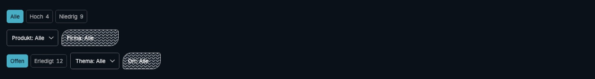
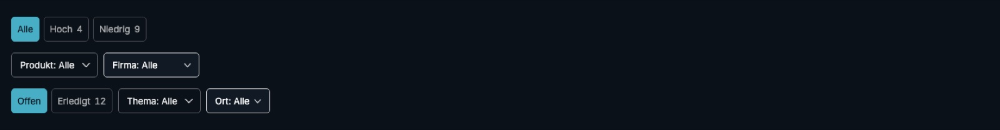
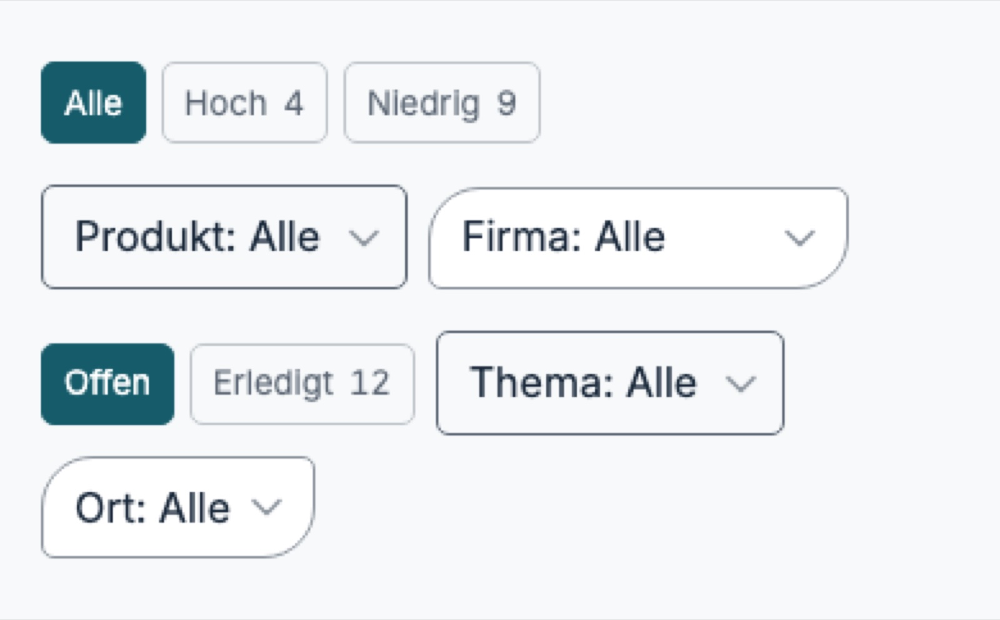
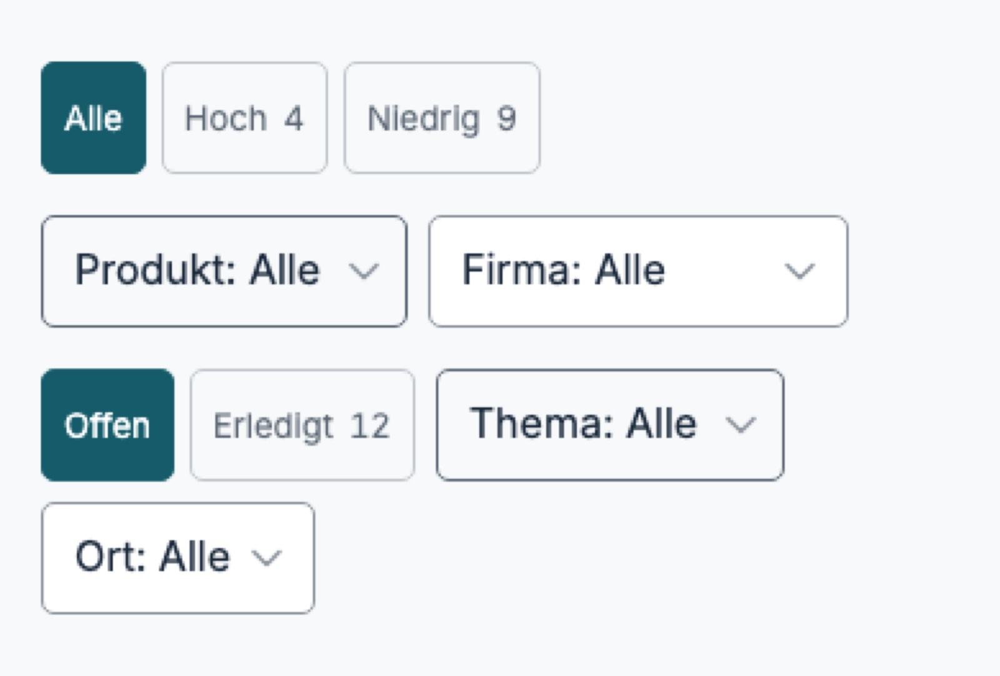
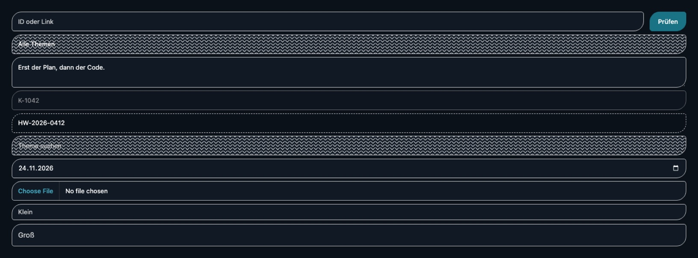
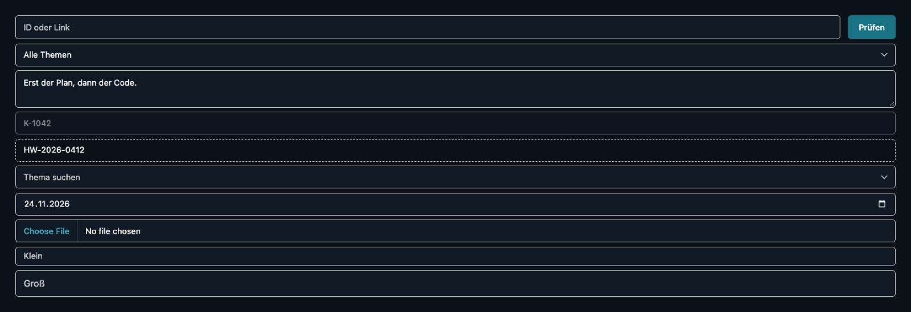
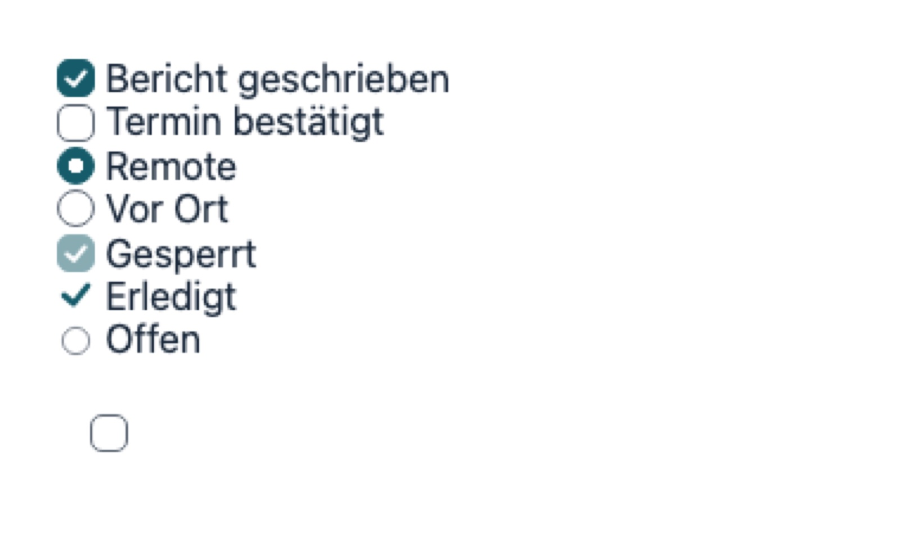
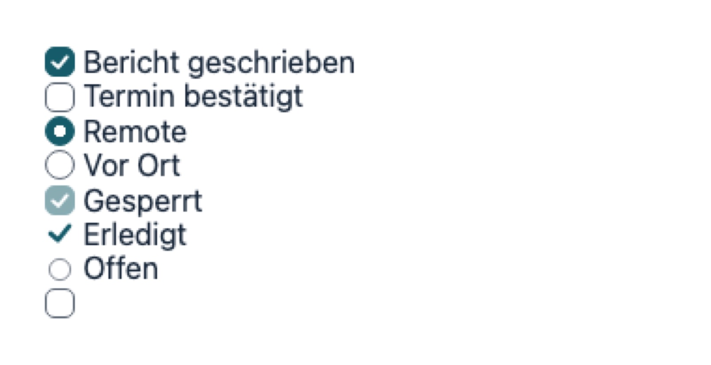

# Filter bar heights, the night select, form corners and the lone check box

This report covers four changes to the shared form elements in brand v2.17.0, made on 11.11.2026.
Each section gives the measurement before, the cause, what changed, and the measurement after. The
values that were a choice went through a blind review first; its scores close the report.

All measurements come from Chrome for Testing 157, headless, software drawing, at device scale 1. A
mouse is a 1440 px viewport; touch is 390 px with `isMobile` and `hasTouch`, so
`any-pointer: coarse` holds. The pages are the built catalog (`dist/`).

## 1. Choices and selects in one filter bar take one height

**Before (v2.16.0, dense).**

|                             | Mouse, 1440 px | Touch, 390 px |
| --------------------------- | -------------- | ------------- |
| `hw-choice`                 | 32 px          | 32 px         |
| `select.form-input`         | 40 px          | 41.19 px      |
| `select.hw-field.hw-select` | 40 px          | 40 px         |

Light and night measured the same. On touch, `form-input` reaches 41.19 px because its text cannot
go below 16 px there (`--hw-field-floor`): 16 × 1.45 line height, plus 16 px padding and 2 px border.

**Review.** Four common heights were each rendered on the same story, by mouse, light and night, with
today's 32/40 px as a fifth candidate. Today's touch state was set against all controls at 44 px.
Results are in the review section below. 36 px led 40 px with every reviewer and both models, so
36 px ships, not the 40 px the os brief proposed.

**Change.** In `elements/scales.css`, the dense `--hw-control-height` is now 2.25rem (36 px).
`--hw-choice-height` and `--hw-field-height` are both
`max(var(--hw-control-height), var(--hw-touch-floor, 0px))`. In `expert/expert.css`, `.form-input`
takes the same `min-height` with `py-1.5` padding, so a 13 px or 14 px line fits inside 36 px.

**After.** Every choice and select in the story is 36 px by mouse and 44 px on touch, light and
night. The shipped build renders pixel-identical to the winning candidate, by mouse and on touch.
`test/catalog/stories.test.ts` covers this. Its control injects the v2.16.0 values, and the test
then finds more than one height.

**Cost.** In dense, by mouse, choices grow 4 px. Inputs, selects and every `hw-field` shrink 4 px,
from 40 to 36 px, in forms as well as filter bars. On touch, every dense choice, field and
`form-input` stands 44 px tall.

## 2. The select on night showed a zigzag over its whole field

**Before.** On night, `select.hw-field.hw-select` and the combobox showed `background-repeat: repeat`
at every scale, so the chevron tiled across the field and under the text. On light it was
`no-repeat`. os's `select.form-input` was not affected.

**Cause, shown by a control.** The night rule `.hw-field { background: var(--color-night-2) }` sits
in `@scope ([data-theme="dark"])`. The shorthand resets `background-repeat`. `.hw-select` sets
`no-repeat` from an unscoped rule of the same specificity, and the scoped rule wins on scope
proximity. With only that one declaration changed to `background-color`, every night select read
`no-repeat` at all four scales.

**Change.** `elements/field.css` sets `background-color` in both the night rule and the day rule.
The day rule matters for a surface that loads `select.css` before `field.css`. The code review then
found two more shorthands of the same kind. On night, a read-only combobox still tiled its chevron.
On light, a read-only combobox and a select in a joined row lost the chevron. Both rules now set
`background-color`, and a read-only combobox shows no chevron (`elements/select.css`), since it
offers nothing to choose. The test in `test/elements.test.ts` reads every select and combobox at
every scale and theme, in both load orders, the joined and read-only cases included.

## 3. Form elements take the small corner

The direction was set before this run: form elements lose the brand corner. The review compared
only the step: the scale's small corner (`--hw-corner-sm`: 5 px on screen and dense, 4 px in print,
7.5 px on stage) against square, its neighbour in the token set (`tokens/tokens.css` holds square,
sm, brand and pill). sm won.

**Change.** In `elements/field.css`, `.hw-field` (input, select, text area, file field, combobox,
date) and the joined row take `--hw-corner-sm`. So does a `.hw-button` in an `.hw-field-row`. In
`elements/list-filter.css`, the list filter's search button takes it too. A button standing alone
keeps the brand corner, and so do cards and every other element. The radius roles in
`tokens/tokens.css` now list form fields under sm.

**After.** Every form element measures 5 px on screen and dense, 4 px in print and 7.5 px on stage.
A lone button stays on the brand corner (test in `test/elements.test.ts`).

## 4. The check box without a label left its column

**Before.** Story `Forms/checkbox-and-radio` at 16 px text, with a row pitch of 18.39 px. Centres
are measured, since the read-only "Offen" ring is drawn at 0.75 scale. Its left edge sits 2 px
inside the column, while its centre is on it.

| Scale                | Lone box centre, off the column | Gap above it, beyond the row pitch |
| -------------------- | ------------------------------- | ---------------------------------- |
| screen, dense: mouse | +8 px                           | +14.8 px                           |
| screen, dense: touch | +14 px                          | +20.8 px                           |
| print, stage         | 0                               | +6.8 px                            |

**Cause.** Three rules add up:

- `.hw-check-target` draws a target square of 32 px (mouse) or 44 px (touch) round the 16 px box,
  as layout. That moves the box right by half the difference and adds height.
- The label is an `inline-flex` box with no text, so it sits on the baseline. That is the 6.8 px
  print and stage show.
- The catalog's flow rule (`.sample > * + *` in `catalog/Element.astro`, `.el-inner > * + *` in
  `catalog/portal.ts`) adds 0.5em above the label. It is unlayered, so it beats any margin the
  element sets.

**Change.** In `elements/check.css`, the target keeps its size. It takes `vertical-align: top`
and margins of `(1lh − side) / 2` and `(1em − side) / 2`, so its margin box is one line tall and
one box wide. The box stands in the column and at the row pitch, and the target reaches past it.
The two catalog flow rules skip `.hw-check-target`.

**After.** One centre axis and one pitch in every scale, by mouse and on touch. The target is still
32 px (mouse) and 44 px (touch). Tests in `test/elements.test.ts` and `test/catalog/stories.test.ts`
cover this; both failed on v2.16.0.

A consumer's own flow utility on the target's container, such as a Tailwind `space-y-*`, beats the
element's margin as the catalog's rule did. Such a lone box moves down by that margin.

## Review

**Setup.** Personas: someone in sales operations who filters lists in an internal app all day on a
laptop, and the designer who owns a design system across website, apps, documents and slides.
Each persona ran on Claude (`claude-opus-5-5`, effort medium) and Codex (`gpt-6.1-sol`, high).

The criteria were set before any score. For the bar: row alignment, visual calm, breathing room,
legibility, looks clickable (or easy to tap), fit for a dense work app. For the form set: visual
calm, reads as a field, fit with a calm brand, consistency across the four media, breathing room,
finish. Each was scored 1 to 10, with an overall 1 to 10.

Candidates carried neutral letters, in a shuffled order per reviewer. Every candidate already had
the chevron fix. The height candidates also had the small corner on `hw-field`.

| Filter bar, mouse (2 personas × 2 models × 2 runs) | Mean overall |
| -------------------------------------------------- | ------------ |
| 36 px                                              | 8.6          |
| 32 px                                              | 8.3          |
| 38 px                                              | 8.1          |
| 40 px                                              | 7.6          |
| v2.16.0: 32 px choices, 40 px selects              | 6.3          |

Noise, the spread between two runs of one reviewer, averaged 0.25 and reached 1 at most. 36 px
led 40 px in every run, by 1.0 on average, and led 38 px by 0.5. It never trailed 38 px with any
reviewer.

| Filter bar, phone (2 × 2 × 1) | Mean overall |
| ----------------------------- | ------------ |
| Every control 44 px           | 8.5          |
| v2.16.0                       | 6.75         |

| Form set, four media, light and night (2 × 2 × 1) | Mean overall |
| ------------------------------------------------- | ------------ |
| Small corner                                      | 8.5          |
| Square                                            | 7.5          |
| v2.16.0 brand corner                              | 5.75         |

sm led square by 1.0 with each reviewer and both models. Noise was not measured for these two
reviews, at one run each.

**Findings outside this change.** Every form reviewer named the screen file field in the portal's
narrow column, which shortens its text to "No fil…hosen". So did the print column's tight padding.
Most bar reviewers named the 70 % text of unselected choices on night, which passes the catalog's AA
contrast test.

## Code review

A nested `/code-review high` read the diff. Fixed: the read-only and joined-row shorthands (section
2), the portal's own search field, which still wore the brand corner, and the ExpertFrame comment,
which said `data-story-of` always names a component. Not taken, with the reason:

- Lone boxes one line apart overlap their targets, so a tap on a box's lower edge could reach the
  next row. It did not reproduce: in inline rows, block rows and a flex column, Chrome sent a tap 1
  px inside the box's edge to that box, with and without a `z-index` on it. Safari and Firefox were
  not measured.
- A consumer overriding `--hw-control-height` on a subtree moves `form-input` but not `hw-field` or
  `hw-choice`, which resolve it on the scale element. Brand sets the value per scale only, and no
  consumer overrides it today.
- A `data-size="small"` field on touch is 5/6 of 44 px, 36.7 px, under the touch floor. It was 5/6
  of 40 px before, so this is no new gap.
- `--deck-corner-lockup` maps only the day cut. stage.css has a separate night token
  (`--slide-corner-lockup-night`). The documents engine asked for this one line, so a night deck
  corner needs its own mapping when documents draws one.
- The catalog's two flow rules skip `.hw-check-target` by name, rather than limiting the 0.5em gap
  to block-level children. CSS cannot select by display, and a broader rule moves other demos.
- `.hw-list-filter-search > .hw-button` repeats the small corner that `.hw-field-row > .hw-button`
  sets: the list filter's search row is not an `hw-field-row`.

## Not explained

- The shipped form set and the winning form candidate differ in 110 of 2.9 million pixels, by at
  most 8 of 255. The pixels lie along the dashed read-only lines. One difference between the two:
  the candidate set the corner from an unlayered rule, the shipped one from the element's layer.
  No control has tested it as the cause.

## Open

- On screen, `hw-choice` is 44 px and `hw-field` 48 px, the same mismatch class as dense had. A
  screen filter bar with both needs its own review.
- In the dense list filter, the search field is now 36 px and its button 38 px (`--hw-button-height`
  2.375rem). It was 40 against 38 before.
