# The design system: hub and spokes, one catalog, two densities

State on 11.11.2026, brand v2.15.0. Every statement about what brand ships is read from this
repository's `HEAD`; a statement about another repository names the commit, item or date it comes
from.

brand is the hub. It ships the tokens, the values of the two engines, the shared elements with
their four scales, the expert layer of the internal apps and the check `brand-elements`. A spoke
(website, certificate-verifier, os, trainer hub, talks, slides, documents, and since then mail,
admin and practitioners) keeps its own organisms and the exceptions it records with a reason. Every
repository's catalog is one Astro app in scaffolding's catalog shell, which builds on Astrobook,
and every catalog page has the same shape. The apps read the elements at the dense scale, the public surfaces at the screen scale.

## How it is shaped today

### Which layer lives where

| Layer                                 | Lives in                                                                                               | Rule                                                                                                                                                                                                                          |
| ------------------------------------- | ------------------------------------------------------------------------------------------------------ | ----------------------------------------------------------------------------------------------------------------------------------------------------------------------------------------------------------------------------- |
| Primitive and semantic tokens         | brand `tokens/tokens.css`, `print.css`, `night.css`, `fonts.css`, `marker.css`                         | A spoke defines none (decision `design-system-hub-spoke`, below).                                                                                                                                                             |
| The engines' values                   | brand `tokens/stage.css` (slides), `tokens/document.css` (documents)                                   | Every length and step the engine draws; the engine keeps only `var()` roles on them (`CLAUDE.md`).                                                                                                                            |
| Shared elements (atoms and molecules) | brand `elements/`: one stylesheet each, an `hw-*` class, `--hw-*` settings, the scales in `scales.css` | 59 stylesheets besides `elements.css` and `scales.css`, the focus ring and three utilities (`chosen`, `touch`, `sr-only`) among them (`ls elements/*.css`).                                                                   |
| Element scripts                       | brand `elements/behaviour.ts`, `copy.ts`, `form.ts`, `code.ts`, `list-filter.ts`, `table.ts`           | Framework-free.                                                                                                                                                                                                               |
| Expert layer of the apps              | brand `expert/expert.css`, `header.css`, `app-base.css`, `expert/components/`                          | Ten components (`ls expert/components/*.astro`): AppHeader, FilterChip, FilterChipBar, ListFilter, ListRow, PageHeader, Pill, SpaceNav, SpaceNavTree, ThemeToggle. A component one system alone renders stays in that system. |
| Slide and document components         | `@hackersandwizards/slides`, `@hackersandwizards/documents`                                            | Never in brand.                                                                                                                                                                                                               |
| Organisms and recorded exceptions     | the spoke                                                                                              | Each exception named with its reason in the spoke's `brand-elements.json`.                                                                                                                                                    |

### The check

`brand-elements` (`scan/elements.ts`) runs in each spoke's own gate and reads the spoke's
`brand-elements.json`. It measures three things:

1. **Rendered.** Every hub element on the spoke's design-system page against a reference element
   from brand's file at the same scale: corner, fill, line, text colour, type, padding, size. A
   brand corner inside a brand corner fails too.
2. **Source.** A rule or component named like an element (card, chip, pill, tag, badge, eyebrow,
   kicker, label, callout, note, quote, button, btn, breadcrumb, fact) that sets what the element
   owns fails, unless it carries the `hw-*` class or is a recorded exception.
3. **Coverage.** Each used element and each exception has a tile on the page, at brand's version.

`brand-scan` (`scan/components.ts`) fails a consumer component named like an expert component; os
and the trainer hub run it.

### The catalog tool and the catalog page

brand's catalog is `catalog/`, built to `dist/` and published at
`https://hackersandwizards.github.io/brand/`. Its root is the brand portal (`catalog/portal.ts`).
The element stories sit at `/catalog/`: 64 story files in nine groups (Actions 4, Containers 3,
Data display 8, Feedback 7, Forms 11, Navigation 15, Overlays 6, Typography 6, Utilities 4; counted
with `find catalog/stories -name '*.stories.ts'`), the expert components' stories among them. The
portal's header links the catalogs `expert/catalogs.json` lists: Brand, Slides, Documents, Mail,
Website.

Every catalog page has one shape from scaffolding's shell: header, a left rail with search and
groups with counts, title, lead, a provenance line, and a grid of tiles per group. A spoke's catalog
shows each hub element it uses as a tile with brand's `Element.astro` (export `./Element.astro`)
and its exceptions in full with their reason. That tile is where `brand-elements` measures.

### Two densities, four scales

`elements/scales.css` sets four scales with `data-hw-scale`. A scale sets measures only, never a
colour or a shape.

| Scale    | For                                               | Type and heights                                                                                                                                                                   |
| -------- | ------------------------------------------------- | ---------------------------------------------------------------------------------------------------------------------------------------------------------------------------------- |
| `screen` | website, certificate-verifier                     | The website's px; choices and list items 44 px tall.                                                                                                                               |
| `dense`  | the apps (os, trainer hub, admin), the talks site | UI text 13 px at 1.45, micro 11 px; button 38 px; list row padding 0.5rem 0.75rem; control and field 2.5rem; choice and navigation item 32 px; check target 32 px, 44 px on touch. |
| `print`  | documents, A4 in pt                               | Paper geometry; the type is `print.css`'s.                                                                                                                                         |
| `stage`  | slides on the 1440 stage                          | The website's px times 1.5 in rem.                                                                                                                                                 |

`data-hw-type="regular"` beside `dense` keeps the expert set's 14 px UI text and 12 px micro; the
trainer hub sets it, os does not (decision `ds-roll-trainer-hub-compact`, below).

### Corners

`tokens/tokens.css` gives the brand corner (20 px 5 px) to everything that holds content and to
every button with words, the apps' buttons included, on every medium. The client surfaces' fields
take the brand corner, the apps' fields the small corner (5 px). Inside a block with the brand
corner, a block, picture, field or button takes the small corner. The corner part of
`shared-elements` (r1, corner by audience) therefore applies today to fields only: buttons left it
with v1.1.0 on 06.11. (Benedikt's review round, item `shape-and-colour-system`) and v1.39.0 on
08.11. (`2d90759`, item `work-print-shape-exception`), which removed the rule that an app's button
under 32 px takes the small corner.

## What was decided

### `shared-elements`, 01.11.2026, Benedikt

- **Options.** a: lift eleven elements into brand (label, pill, card, callout, quote, ruled table,
  link in text, focus ring, round icon control, gradient strip, code block), each as
  `elements/<name>.css` with `--hw-*` scales; brand's Elements page is the component library; each
  spoke page renders the hub elements it uses as tiles marked with their brand version and its
  exceptions in full with a reason (s2); `brand-elements` measures the tiles; total band, section
  band, stage and status, tooltip, KPI tile, chart bars, slide table, header bars and ghost button
  stay per system. a-s1: as a, but spoke pages show only their exceptions and a link per hub element
  (s1). b: only show what brand already shared (list marker, internal header, the expert
  components, the disclosure). c: keep everything per system. For the corner of buttons and fields:
  r1 by audience (brand corner on client buttons and fields, 5 px in the apps; only the
  `tokens.css` comment changes), r2 brand corner everywhere, r3 5 px everywhere.
- **Picked:** a + r1. Recorded in brand `4ee829e`; carried out from v0.27.0 (`4007f4d`); done in
  every spoke on 02.11. (`5a2ecae`); `goal.md` names v0.27.14 as the closing release.
- **Today:** a is in force. r1 applies to fields only (Corners, above).

### The four decisions of 02.11.2026, Benedikt

Recorded together in brand `229831f`.

- **`density-tiers`**: compact (UI text 13 px, micro 11 px, the dense scale sets type and the
  heights components read), tight (compact plus 15 px body, 3.5 px spacing, 5 px row padding) or
  keep 14 px. Picked compact; shipped in v0.28.0 (`bb9206c`). Today: the `dense` scale above.
- **`design-system-tool`**: Astrobook everywhere with one brand shell, our own page from the same
  stories, or Storybook 10 with the Astro framework. Picked Astrobook. Today: Astrobook 0.13.3
  runs inside scaffolding's catalog preset (a peer dependency of `@hackersandwizards/scaffolding`;
  brand's `package.json` pins it). The shell moved from brand to scaffolding by the next decision.
- **`repo-uniformity-plan`**, decided `hub-max` (Benedikt, 02.11., os item of that name): every
  repository fills scaffolding's catalog shell as one Astro catalog app with its own stories under
  `catalog/stories/`, the generators move into that app, and every surface takes one framework.
  Options were minimal (names only), hub (the catalog app and scaffolding's gate runner) and
  hub-max (hub plus one framework). brand moved in v0.32.0 (`0701b10`) and removed its own shell
  (`AstrobookHome`, `Catalogue`, `catalogue.css`) in v0.33.0 (`a32d865`); that commit records every
  repository on scaffolding's shell on 03.11.
- **`design-system-hub-spoke`**: tiered (no primitive tokens or atoms in spokes, component tokens
  for their own organisms; recommended), strict (no tokens at all in spokes) or loose (only the
  shared elements of 01.11.). Picked strict: no tokens in spokes, every value comes from brand.
  brand took the engines' values in v0.29.0 (`stage.css`, `document.css`). Not reached in os (open
  points, below).
- **`catalogue-shape`**: one shape for the brand catalog, the slide specimen and the document
  specimen, with the decision page as an os-style list, or three page forms with a shared header.
  Picked the one shape. Today: scaffolding's catalog shell.

### `ds-roll-trainer-hub-compact`, 02.11.2026, Benedikt (relayed by Ada)

The trainer hub goes back to 14 px UI text, os stays compact. Recorded in brand `ce0cc7d`, carried
out in brand v0.29.1 (`266940f`, `data-hw-type="regular"`) and trainer-hub `c99277d0`.

## What was measured

### Inventory of 01.11.2026: 23 element types

Read on `origin/main` of brand, website, os, trainer hub, talks, slides, documents and
certificate-verifier. 14 of the 23 element types were the same rule at their medium's scale in two
or more systems; three of those were shared as code.

| Group                        | Elements                                                                                                                                                                                                                            | Count |
| ---------------------------- | ----------------------------------------------------------------------------------------------------------------------------------------------------------------------------------------------------------------------------------- | ----: |
| Same rule, identical         | card (website, slides, trainer hub, talks), label (website, verifier, documents, slides), pill (website, slides), callout, prose table, link in text and quote (website, documents each), list marker (documents, slides, verifier) |     8 |
| Same rule, measurable drift  | focus ring, round icon control, code block, gradient strip, client button (website, verifier), client field (website, verifier)                                                                                                     |     6 |
| Shared as code               | list marker, dropdown chevron, the apps' expert set, the disclosure from that day                                                                                                                                                   |     4 |
| Only alike, stays per system | total band, section band, stage and status, tooltip, KPI tile, chart bars, slide table, the header bars, ghost button                                                                                                               |     9 |
| Later                        | avatar, tabs                                                                                                                                                                                                                        |     2 |

### Inventory of 02.11.2026: levels per repository

Levels after Brad Frost, _Atomic Design_, chapter 2; tokens in three tiers after Material
(primitive: a literal; semantic: a reference or role name; component: named for an element).
Counted on `origin/main` between 07:23 and 07:31. Tokens by script, each element's level by
judgement.

| Repository           | Tool then                           | Tokens p/s/c | Atoms | Molecules | Organisms |
| -------------------- | ----------------------------------- | -----------: | ----: | --------: | --------: |
| brand (hub)          | own page `catalogue.html`           |   113/105/26 |   ~12 |        ~7 |        ~2 |
| website              | Astrobook 0.13.3, `/design-system/` |       4/3/24 |    21 |        27 |        40 |
| os                   | Astrobook 0.13.3                    |      1/31/17 |    18 |        37 |        31 |
| trainer hub          | Astrobook 0.13.3                    |        0/3/0 |     7 |        13 |         4 |
| slides               | own page `specimen/index.html`      |     44/34/76 |    15 |        14 |        50 |
| documents            | own pages `specimen/*.html`         |    29/76/225 |     9 |        28 |        17 |
| talks                | own page `app/design-system`        |        0/1/1 |     4 |         1 |         1 |
| certificate-verifier | own page `/design-system`           |        3/0/2 |     7 |        10 |         4 |
| hycle-private        | none                                |        1/9/3 |     9 |        12 |         9 |
| personal site        | own page                            |      13/15/4 |    16 |        20 |        20 |

The seven h&w spokes held 81 atoms and 130 molecules together, brand about 12 and 7. The
candidates found in two or more systems went into brand v0.29.0; each is at `HEAD`. "Copies" is the
phase-2 reading of 02.11., which corrected the first reading of the same day:

| Candidate (level)                                      | Copies                            | At `HEAD`                                      |
| ------------------------------------------------------ | --------------------------------- | ---------------------------------------------- |
| Client button (atom)                                   | website, verifier                 | `hw-button` (`elements/button.css`)            |
| Arrow link with external sign (atom)                   | website, verifier                 | `hw-arrow-link` (`arrow-link.css`)             |
| Capitals tag (atom)                                    | os, trainer hub                   | `hw-pill data-caps`                            |
| Segmented control (molecule)                           | os, trainer hub                   | `hw-segmented`                                 |
| Field with button (molecule)                           | website, verifier                 | `hw-field`, `hw-field-row`                     |
| Facts list (molecule)                                  | website, verifier, trainer hub    | `hw-facts`                                     |
| List row with stripe (molecule)                        | os, trainer hub                   | `hw-row`                                       |
| Prose block (molecule)                                 | os, trainer hub                   | `hw-prose`                                     |
| Code panel (molecule)                                  | slides                            | `hw-code data-variant="panel"`                 |
| KPI tile (molecule)                                    | os, documents                     | `hw-kpi`                                       |
| Dashed frame (molecule)                                | os, trainer hub, slides           | `hw-frame`                                     |
| Status and warning note (molecule)                     | os, trainer hub, slides, verifier | `hw-status`                                    |
| Breadcrumb (molecule)                                  | os, trainer hub                   | `hw-breadcrumb`                                |
| Motion tokens, label rule under 48rem (tokens)         | website, verifier                 | five `--motion-*` in `tokens.css`; `label.css` |
| Night remap of light tokens (tokens)                   | talks, slides                     | `tokens/night.css`, `data-hw-night`            |
| App width 96rem, `--nav-offset`, screen fonts (tokens) | os, trainer hub                   | `expert.css`; `fonts.css`                      |
| Stage values `--deck-*` equal to `--slide-*` (tokens)  | documents readout, slides         | `stage.css`; `document.css` reads them         |

### Blind reviews

Every review below ran with Claude and Codex, neutral letters and an order shuffled per run.
Noise is the gap between two runs of the same reviewer.

**Shared elements prototype, 01.11.** Label, pill and card as one CSS file with a scale preset per
medium, put into scratch copies of documents (proposal, preparation sheet, onepager) and slides
(content and cards slide). Personas: a brand designer, a client's head of engineering who sees
website, proposal PDF and workshop slides within one week, an internal person working in os daily;
one run each, the brand designer twice. Display: website at 1440 px, A4 at 70 % zoom, projected
slide, all images at 1000 px. Criteria 0 to 10.

| Version   | Overall | Consistency |  Fit | Calm | Legibility | Claude overall | Codex overall |
| --------- | ------: | ----------: | ---: | ---: | ---------: | -------------: | ------------: |
| Before    |    7.86 |        7.94 | 8.00 | 8.19 |       7.94 |           7.13 |          8.60 |
| Prototype |    8.26 |        8.50 | 8.00 | 8.50 |       8.06 |           7.88 |          8.65 |

Noise 0.5 (Claude), 0.2 to 0.4 (Codex). The overall lead of 0.4 lies in the noise, consistency
(0.56) just above it. Votes: 5 prototype, 3 tie, 0 before. In slides the prototype changed no
pixel; in documents the type pill went from 40 % to 15 % tint and the emphasised card's line from
full teal to 40 %, both towards the website. Not reviewed: os and the verifier as users, night, the
apps.

One prompt verbatim (brand designer, Claude, run 1; file list shortened):

> You are a senior brand designer who has to keep one visual system consistent across a website,
> printed documents and slide decks. Medium: three surfaces from hackers&wizards, a consultancy for
> agentic software engineering, seen by one person within one week: a section of the website on a
> 1440 px laptop screen (file \*-1-website.png), the first page of an A4 proposal PDF viewed at about
> 70 % zoom on a laptop (\*-2-pdf.png), and two 16:9 slides projected in a training room or shared
> in a video call (\*-3-slide.png, \*-4-slide.png). Images are shown at 1000 px on the long side.
> Audience: the brand's own design team. There are two sets, K and M, each with the same four
> surfaces; files are named <set>-<surface>.png: […]. Look at every file. Criteria fixed before any
> score (2026-11-01): consistency (the labels, tags/pills and cards read as one family across
> website, PDF and slide), fit per medium (each surface looks right for how it is seen: laptop
> screen, A4 PDF at about 70 % zoom, projected 16:9 slide), calm (nothing competes, no clutter,
> breathing room), legibility (every label, tag and card text readable at its display size). Each
> 0-10, plus overall. Judge each set as a whole. […]

**Density, 02.11.** Put into the running os (`2cf40b3d2`) by stylesheet, dashboard and deals, same
data, 1440x900, light. Personas: the co-founder as daily user on a 14-inch MacBook, an operations
lead working in os for hours a day, a UX designer of expert tools; the co-founder twice; images at
full size.

| Variant | Change                                                                                 | Dashboard: rows, row height | Deals: rows, row height |
| ------- | -------------------------------------------------------------------------------------- | --------------------------- | ----------------------- |
| 14 px   | as on 02.11.                                                                           | 7, 80 px                    | 7, 62 px                |
| compact | `--text-ui` 13 px at 1.45, `--text-micro` 11 px                                        | 8, 73.5 px                  | 7, 59.8 px              |
| tight   | compact plus body 15 px, Tailwind `--spacing` 3.5 px, row padding 5 px, segments 32 px | 10, 63.6 px                 | 8, 52.5 px              |

| Variant | Overall | Information per screen | Legibility | Calm | Hierarchy | Daily use |
| ------- | ------: | ---------------------: | ---------: | ---: | --------: | --------: |
| compact |    8.25 |                   7.89 |       8.12 | 7.86 |      7.84 |      8.36 |
| tight   |    7.40 |                   9.06 |       6.71 | 6.15 |      7.01 |      7.66 |
| 14 px   |    7.26 |                   6.19 |       8.94 | 8.20 |      8.07 |      7.04 |

Noise up to 1.0 (Claude), up to 0.5 (Codex). Compact's lead of 0.99 is at the edge of the noise,
the choice is not: 7 of 8 runs pick compact, one tight. On deals a token change alone gains no row:
the heights sit in the components (`list-row` 8 px padding, segments `min-h-10`), and the block of
tiles and filters pushes the table down to about 410 px. Platform references: Apple sets 13 pt text
and 28 pt controls on the Mac, 17 pt and 44 pt on the iPhone; Spectrum ships the same component at
32 px on desktop and 40 px on mobile.

One prompt verbatim (density, co-founder, Claude, run 1; paths shortened):

> You are the co-founder of a small consultancy. Every day you work in the company's internal
> operating system on a 14-inch MacBook at desk distance: you scan the deals pipeline and the list
> of items that need attention, and you want to see as much as possible on one screen without
> strain. Medium: the internal operating system of the consultancy (a web app, used only on
> desktop), two pages: the dashboard with its attention list, and the deals list. Viewed in a
> browser at 1440x900 CSS px on a laptop at desk distance. Images are full-size screenshots of that
> viewport. There are three sets, R, S and T, each showing the same two pages with the same data;
> files are named <set>-<n>-<page>.png. Audience: you, in the role above. Files, look at every one:
> […] Criteria fixed before any score: information per screen (how much you can scan without
> scrolling), legibility (every text readable without strain at desk distance), calm (breathing
> room, not cramped, nothing competes), hierarchy (what matters reads first), fit for daily expert
> work. Score each 0-10, plus overall 0-10, for each set as a whole. For each criterion name in one
> sentence what keeps it below 10. Then pick the set you would choose, or say tie.

**Tool, 02.11.** The same label, pill, card and callout from brand v0.27.9, plus the pill in React,
with the same story files in Storybook format, each story at `screen` and `dense`, light and night.
Personas: the co-founder reviewing ten design systems who does not want to relearn one, a frontend
developer building components weekly, a brand designer; the co-founder twice; images at 1000 px.

| Candidate | Overall | Finding | Every scale without a click | Learn once | Calm | Brand fit |
| --------- | ------: | ------: | --------------------------: | ---------: | ---: | --------: |
| Astrobook |    8.43 |    9.00 |                        9.00 |       8.75 | 8.38 |      6.75 |
| own page  |    8.10 |    7.50 |                        9.50 |       8.12 | 6.75 |      8.88 |
| Storybook |    5.75 |    8.38 |                        3.00 |       9.00 | 6.50 |      3.38 |

Noise 0 for Astrobook and the own page, 2.0 for Storybook (Claude). All four Claude runs picked the
own page, all four Codex runs Astrobook: a tie. Cost measured on the same build:

| Candidate                                                 | node_modules | Build | Output | Transfer per page |
| --------------------------------------------------------- | -----------: | ----: | -----: | ----------------: |
| Astrobook 0.13.3                                          |       183 MB | 1.2 s | 0.9 MB |           ~0.2 MB |
| Storybook 10.6.5 with `@storybook-astro/framework` 1.14.0 |       286 MB | 4.6 s | 8.5 MB |           ~5.1 MB |
| own Astro page (~40 lines)                                |       180 MB | 2.4 s | 0.5 MB |           ~0.2 MB |

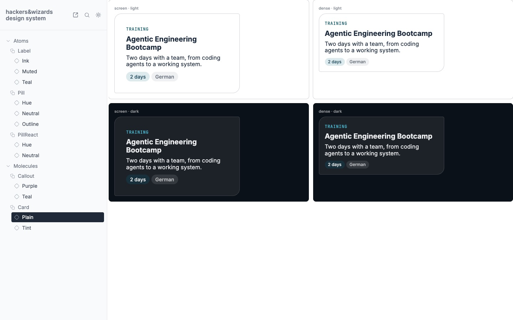
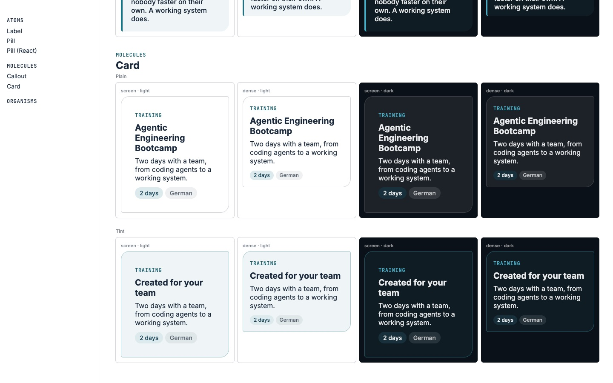
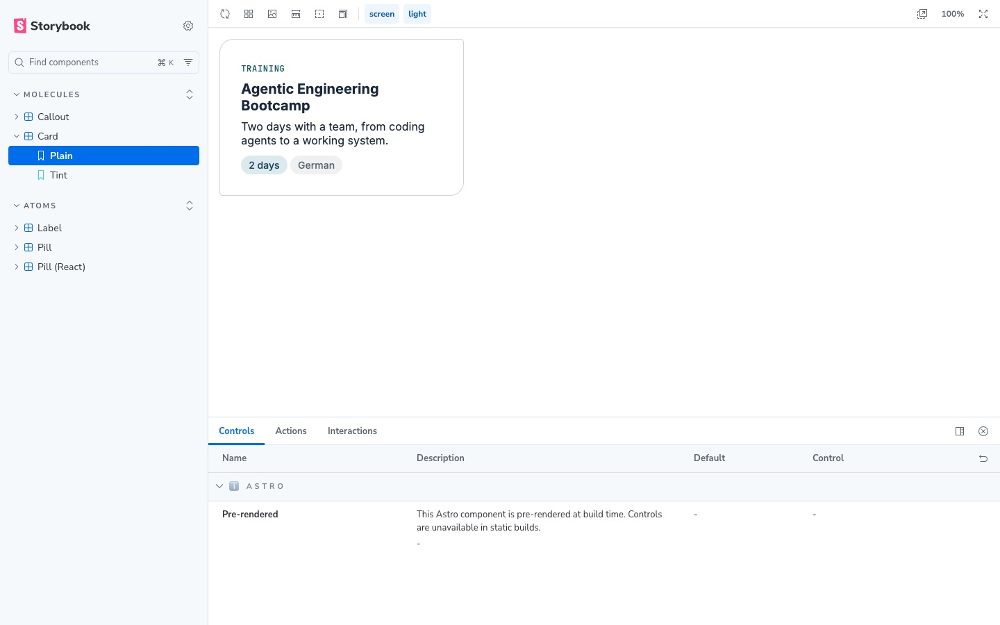

**Catalog page shape, 02.11.** One generator fed with the real brand sections, slide types and
document types. Same three personas, Claude and Codex, the co-founder twice, images at 1000 px.

| Version   | Overall | Finding | Sameness | Overview | Calm | Brand fit |
| --------- | ------: | ------: | -------: | -------: | ---: | --------: |
| one shape |    8.31 |    8.12 |     9.00 |     8.00 | 8.12 |      8.25 |
| 3 pages   |    4.71 |    5.75 |     3.50 |     4.75 | 5.00 |      6.50 |

"3 pages" is the brand catalog, the slide specimen and the document specimen as they were on
02.11. Noise 1.0 (Claude), 0.3 (Codex); lead 3.6; all 8 runs pick the one shape. Left open by the
reviewers: the rail named groups but no types, previews too small to read.

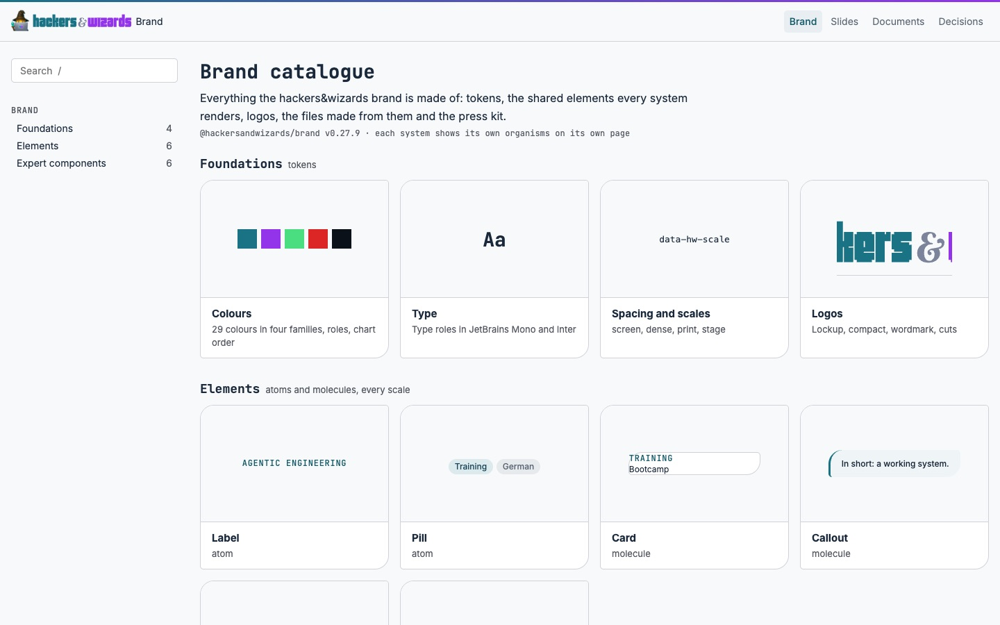
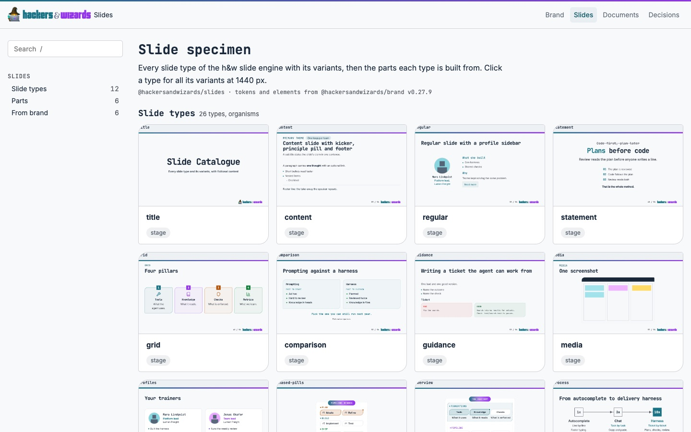
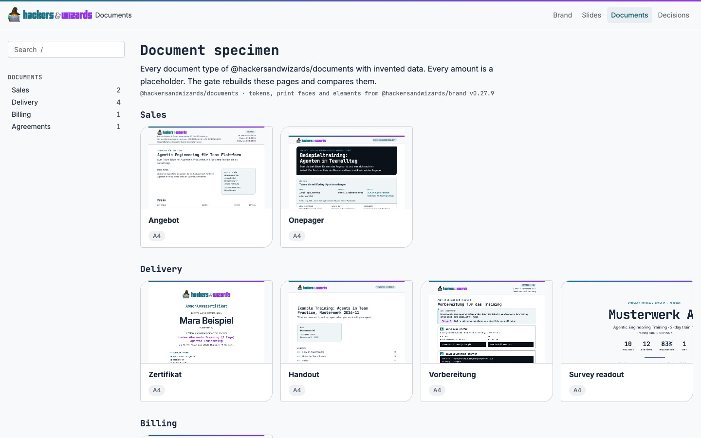

**Four P3 fixes, v0.29.0, 02.11.** Wider catalog tiles, no bare count beside the title, brand's own
crescent in `ThemeToggle`, `"lightOnly"` in `brand-elements.json`. Medium review: the co-founder on
a 14-inch MacBook (A) and a developer on a 27-inch screen (B), Claude A twice. Overall after
against before: Claude A 7:5 and 7:6, Claude B 7:6, Codex A 8:7, Codex B 8:7. Noise (Claude A): 0
on after, 1 on before. The moon alone was a tie: Claude A twice 7:8 for the old, Claude B 8:7 and
Codex A 9:8 for the new, Codex B 9:9. The crescent stayed: the talks review had preferred it in all
four runs, and Claude B read the old moon as a "C". `expert/components/theme-icons.ts` draws it
today.

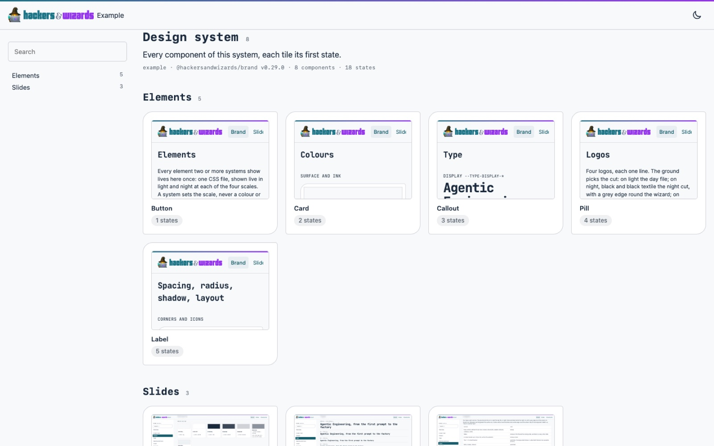
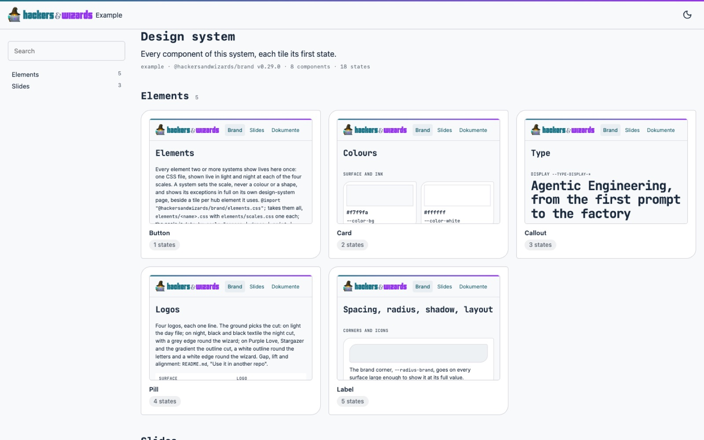
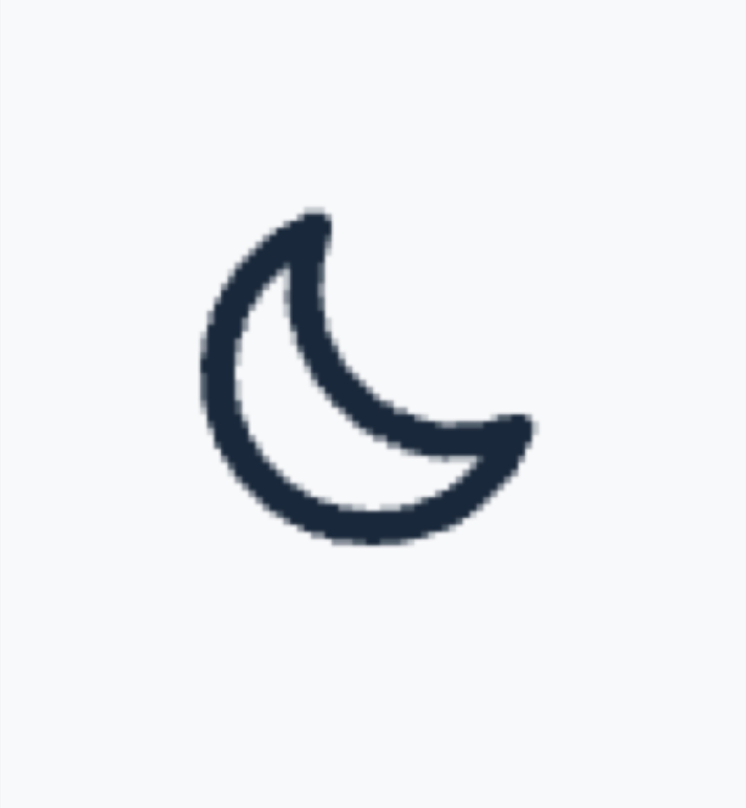
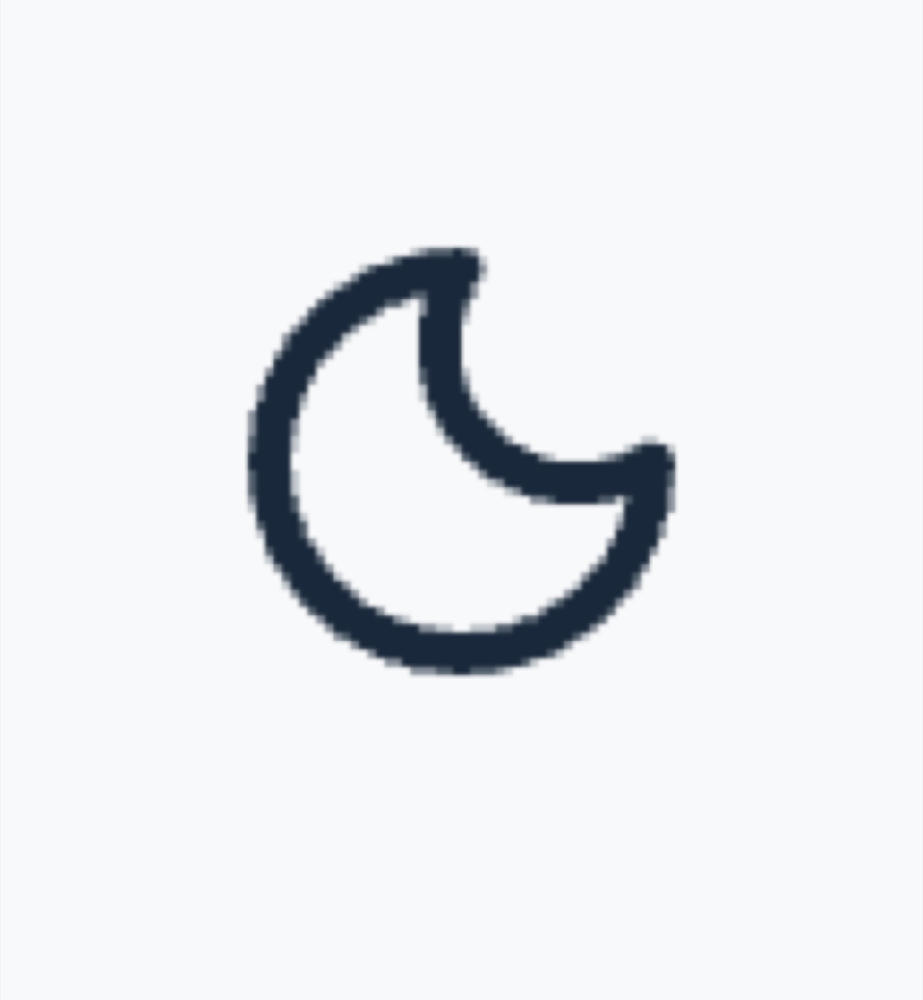

**The brand portal in the catalog shape, v0.29.2, 02.11.** Personas: the co-founder on a 14-inch
MacBook, a spoke's developer on a 27-inch screen; Claude and Codex, two runs each, light only.
Round 1, a rail of four collected groups: after 7.0 against before 8.5, dropped, since every change
of view took two clicks. Round 2, one group per view: after 8.0 against before 7.6 (Claude 8.0
against 6.5, Codex 8.0 against 8.75). Noise at most 1 point; Codex's lead for before lies in it.
Named after the change: the long overview, the narrow right margin, the pale mark on the open view.

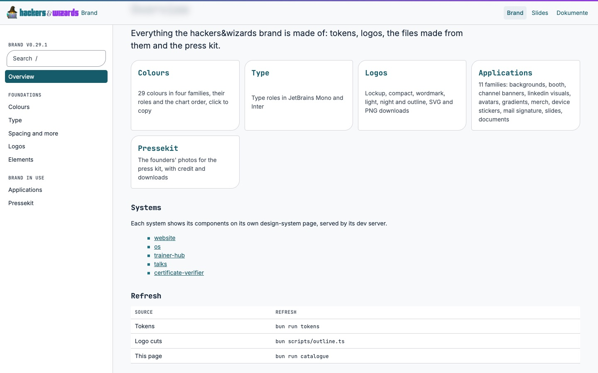
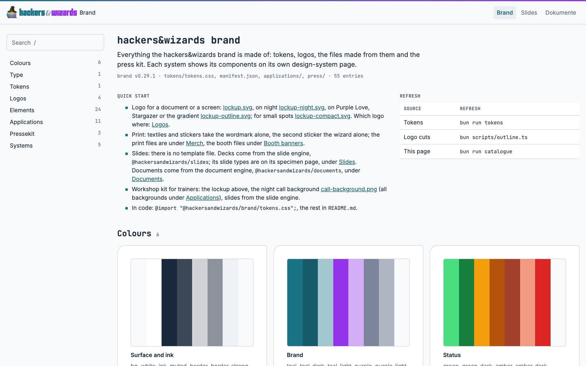

### Why the apps had grown, 26.10. against 02.11.

1440x900, light, `origin/main` of 26.10. (os `d912ffcdd`, trainer hub `8573be7`) against 02.11. (os
`2cf40b3d2`, trainer hub `6a24ce0`). The first two causes below were shown with a build of the
commit and its parent; the control builds of 30.10. ran on the tags v0.7.0 and v0.9.1, since
brand's history had been rewritten, and their content was not reconciled with the original
commits.

| Page              | Measure                  | 26.10.          | 02.11.                    |
| ----------------- | ------------------------ | --------------- | ------------------------- |
| os dashboard      | attention row            | 69.5 px         | 80 px                     |
| os dashboard      | reason and "Next:" line  | 12 and 11 px    | 14 px                     |
| os dashboard      | pills                    | 11 px           | 14 px, same height        |
| os dashboard      | rows on the first screen | 11              | 7                         |
| os deals          | row                      | 41 px, one line | 62 px, new "Next:" line   |
| os deals          | filter                   | chip 24 px      | segment 34 px             |
| os deals          | key figure tile          | 42 px           | 77 px, label wraps        |
| os deals          | rows on the first screen | 9               | 7                         |
| os people         | rows on the first screen | 12              | 14 (filters in dropdowns) |
| trainer hub units | meta line                | 11 px mono      | 14 px Inter               |
| trainer hub units | filter                   | 26 px, 4 rows   | 31 px, 6 rows             |
| trainer hub units | rows on the first screen | 12              | 10                        |

Unchanged: body 16 px, h1 24 px, header 60 px, row padding 8/12 px, search 40 px. A third of the
growth came from os `4235c4556` (28.10., UI 14 px, meta 13 px, micro 12 px, on Benedikt's
instruction: meta 12 to 13 px, attention row 69 to 74 px), two thirds from brand v0.8.0 (`92613b1`,
30.10.), where an agent's assumption merged meta 13 px into 14 px (meta 13 to 14 px, row 74 to 80
px). The filter segments came from os `5b39a247a` (01.11.), not measured by a control. The deals reading of
26.10. is the group view, the later one the table view, and the data differ between the two
states: the row counts compare first screens, not the same records.

### Best practice against the hub and spoke model, sources fetched 02.11.

- Brad Frost, "The design system ecosystem": the core contains the organisation-wide building blocks;
  product teams own recipes that are not reusable across the organisation, and a recipe that proves
  itself can graduate into the core.
- Material: component tokens are assigned to elements and point at system tokens, so a spoke's own
  organism has component tokens of its own.
- Brad Frost, _Atomic Design_: atoms, molecules and organisms are a mental model, not a linear
  process, so a gate cannot check the levels.
- GitHub runs Primer and Primer Brand over the same primitives; Adobe Spectrum runs the same
  components with sizes per platform. The 01.11. inventory (14 of 23 the same rule) points to
  Spectrum's way, which the scales follow.
- The Design Tokens Community Group published its first stable format, 2025.10, on 28.10.2025.

Sources: atomicdesign.bradfrost.com/chapter-2, bradfrost.com "The design system ecosystem",
github.com/material-components/material-web `docs/theming/README.md`, designtokens.org (2025.10),
github.com/primer/brand `packages/design-tokens/scripts/build-tokens.js`, developer.apple.com HIG
`accessibility`, `buttons`, `designing-for-macos`, github.com/angular/components
`guides/theming.md`, carbondesignsystem.com data table, github.com/adobe/spectrum-design-data
`docs/markdown/tokens/layout.md`.

## What stays open

- **Strict hub and spoke in os.** os `origin/main` on 11.11. still defines its own tokens:
  `--fin-*` (`src/styles/finance.css`, some as typed hex values), `--board-gap`
  (`PipelineBoard.astro`), `--breadcrumb-top` (`DetailPane.css`). Whether each becomes a brand
  token or a recorded exception is not decided: a brief for an os session (11.11.). The website's component values (radar, tuning
  desk, PageHero) were named in the same question and are not checked here.
- **brand's remaining proposals:** night lines, hero corner glows, slides' shared names, the
  settings from the spoke switches, the ring setting and a compact `hw-row` variant (item
  `work-design-system-rollout-what-remains-after-02`).
- **Running text at the dense scale:** 33em is 429 px at 13 px (item `work-dense-prose-width`).
- **Heights at the dense scale** keep the values measured on 02.11. (row padding 0.5rem 0.75rem,
  control 2.5rem). Only the type step was reviewed; lower heights wait for their own review, which nothing has asked
  for yet.
- **The slides table.** slides `origin/main` on 11.11. still stripes every second row
  (`components/slides/ContentSlide.tsx`, `bg-primary/7`). Whether that is the medium or drift is
  not yet explained: a brief for a slides session (11.11.).
- **`brand-elements` green in every spoke.** `goal.md` records every spoke
  running the check in its gate, and its passing at each spoke's pinned brand version as not yet
  checked.
- **Not measured:** the catalog shape at night and on a phone; `tokens.json` in the DTCG 2025.10
  format.
