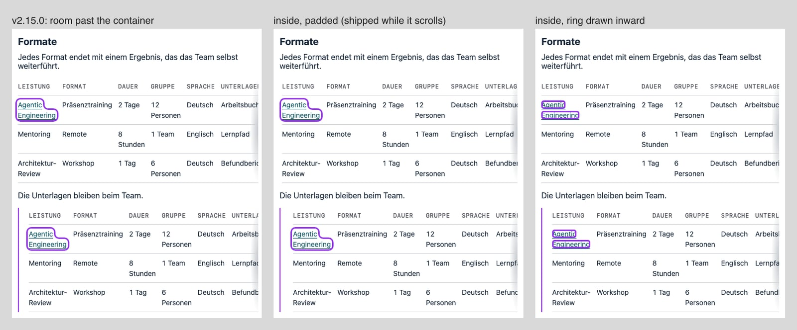
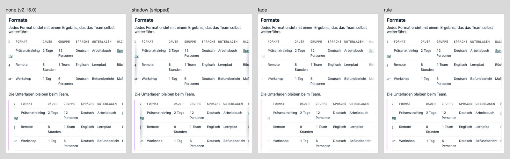
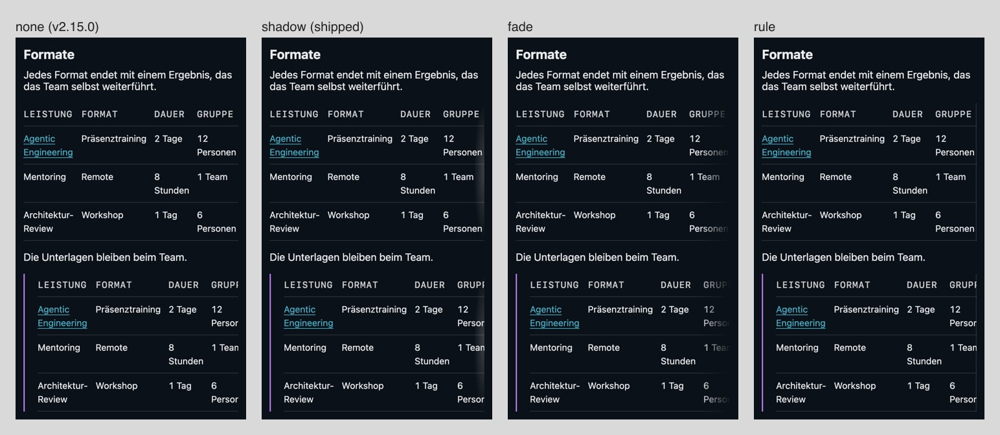
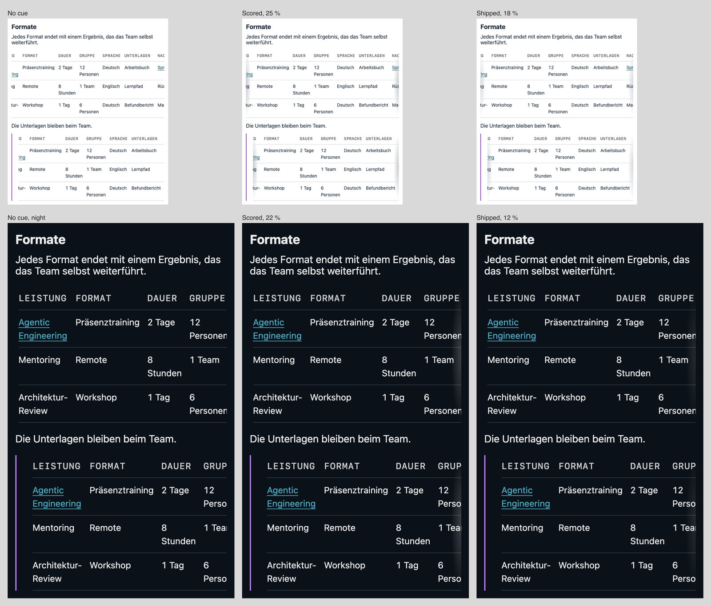
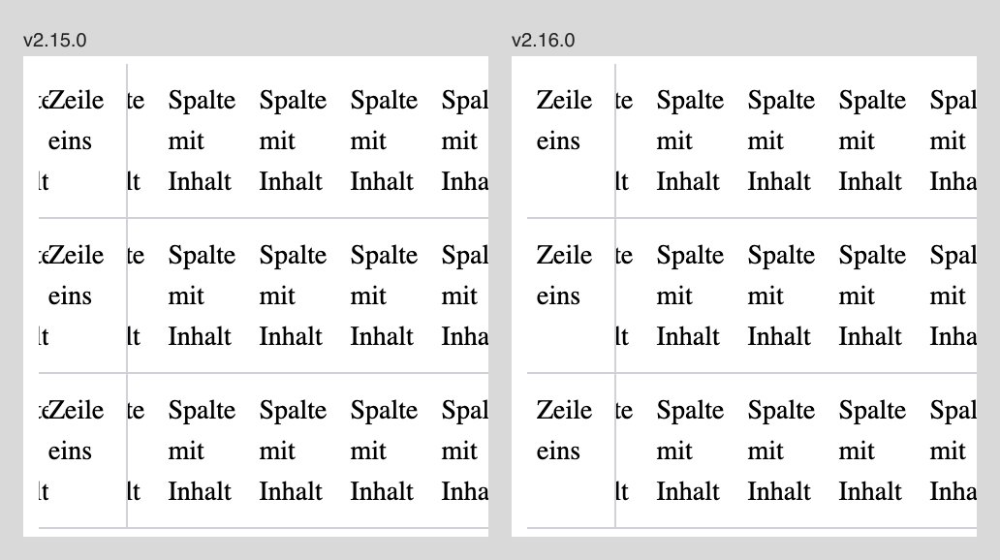

# The shared elements: what each does now, what set its values, what stays open

This report covers the shared elements in `elements/` and the expert components the catalog shows
beside them, as of brand v2.15.0 (HEAD 402e23a, 11.11.2026). It follows the catalog's sections in
their order (`SECTIONS` in `catalog/element-demos.ts`): Forms, Actions, Navigation, Feedback,
Overlays, Data display, Typography, Containers, Utilities. Each element states what it does now,
the review or measurement that set its value, and what stays open, with the item that holds it.
Elements with no review or measurement on record have no section: search field, arrow link,
breadcrumb, key
figure, label box, code block, dashed frame, accent rule, gradient strip, area mark, page header,
theme toggle and space nav. After the elements come the rules that span several of them (scales,
night, the expert layer, the script, the catalog), the brand files outside the catalog, the
consumer checks, the open points, and last the method every review shared, with its
three shared panels. Each statement of what ships was read against the files at HEAD.

## Forms

The section exists because two systems each built the same form pieces: the hint and error
message in the certificate verifier, the label pattern in os, the trainer hub and the verifier, the
optional mark in os and the trainer hub (read on each `origin/main`, 08.11.). Sources fetched on
08.11. (Bootstrap 3.4 and 5.3, GOV.UK, Primer, Carbon, and Tailwind Plus through two third-party
listings, as its own site needs a login) agree on a floor: every system that ships forms ships
text field, select, checkbox and radio, a label, an error message tied to its control, and
disabled; most ship a hint and a switch; only GOV.UK ships an error summary. Brand now ships every
row of that comparison. Decision `decide-form-elements-ahead`, Benedikt, 08.11. (ba00c48): option `all-listed`, prepare
every element of the comparison that brand lacked. Not built: a custom calendar, a listbox for the
combobox, a multiselect; each needs a component, and a surface that needs one asks first.

### Field

`elements/field.css`. `aria-invalid="true"` draws the line twice as thick in the error red
(red-night on night, an app's `--error` where it has one); disabled is half opacity; the class
frames a `<textarea>` and a `<select class="hw-field hw-select">`. `readonly` draws a dashed line
on no fill. `data-state="warning"` or `"success"` draws the double line in amber-dark or
green-dark. `data-size="small"` or `"large"` takes 5/6 or 7/6 of the scale's height at the same
padding. `type="file"` puts the choose button flush left, `type="date"` keeps the browser's
picker, a field with `list` and `hw-select` is a combobox over a `<datalist>`, and
`hw-field-toggle` in a joined row is the password field's show button. Every scale sets the
field's height, padding and size (`--hw-field-size`). The dropdown chevron (`select.css`, export
`./select.css`) lives in `elements/` so `brand-elements` measures a select field whole.

**Error state (v1.40.0).** The form-elements panel, overall:

| Variant                                                              | Claude dev | Claude design | Codex dev | Codex design | Mean    |
| -------------------------------------------------------------------- | ---------- | ------------- | --------- | ------------ | ------- |
| Before: amber line, separate message styles, uppercase mono labels   | 7          | 6             | 8         | 8            | 7.25    |
| B: red double line, red message with icon below, medium-weight label | 8          | 8             | 9         | 9            | **8.5** |
| C: red bar along the whole question, bold message, no icon           | 7          | 6             | 8         | 8            | 7.25    |

The Codex designer's two runs gave the same scores (spread 0); the lead of 1.25 exceeds it. C's bar
was not taken: reviewers found it loud, and it shifts the field's left edge.

**Read-only (form elements ahead).**

| Variant                          | Claude dev | Claude design | Codex dev | Codex design | Mean    |
| -------------------------------- | ---------- | ------------- | --------- | ------------ | ------- |
| No style (the state before)      | 4          | 3             | 6         | 6            | 4.75    |
| Grey ground, light line          | 6.5        | 6             | 7         | 7            | 6.6     |
| Dashed line, no ground (shipped) | 8          | 8             | 8         | 8            | **8.0** |

Not taken: a lock icon or a written "read-only" (content for the surface), a tinted fill on the file
button.

**Each variant of the field, round 1 and round 2:** read-only 6.5 and 7.5, combobox 8.5 and 8, date
8.75 and 8.75, file 8.5 and 8.5, small and large 8.4 and 7.75 (round 2 keeps the scale's padding so
values align), warning 8.4 and 9, success 8.9 and 9, password with show button 9 and 8.75.

**The error on a phone (v1.43.0).** The certificate verifier's home page and a brand form from the
same parts, 390 px at 2x, right after a submit with an empty field. Persona: a certificate holder
checking a certificate on the phone. Claude and Codex, two runs each.

| Version                                               | Overall (4 runs) | Criteria mean |
| ----------------------------------------------------- | ---------------: | ------------: |
| Error between field and button (the button goes last) |             9.00 |          9.30 |
| Field and button side by side, error under the row    |             8.00 |          8.50 |
| Before: button under the field, error under it        |             7.50 |          8.05 |
| Joined row with an arrow button                       |             7.00 |          7.65 |

Noise 0.25; the lead of 1.5 holds in every run with both models. Inside an `hw-form-field`, the
stacked row's button now follows the error message, 0.75rem below it, with no change to the markup.
Side by side cut the placeholder off at 390 px; the joined row's arrow left the next step unclear.

**The textarea's corner (12.11.): no change needed.** Two reviewers of the form-elements panel saw
its resize grip in the brand corner's large curve. Measured in the catalog's form-field stories,
`textarea.hw-field` takes the small corner: 5 px at the screen, dense and night scales, 7.5 px on
stage, at every corner. The grip sits in that corner.

### Checkbox and radio

`elements/check.css`. `aria-invalid="true"` draws an unchecked box's line in the error red. A
group's options no longer each turn red: three of four reviewers read that as each option being
wrong, so the group's message names the error, a gap further from the last option. The
label is the target: 32 px under a mouse and 44 px on a touch screen at the screen and dense scales
(`--hw-check-target`, `--hw-check-target-touch`), 0 on print and stage. A box with no text beside
it sits in `<label class="hw-check-target">`. The form field's option rows, the switch and the range
read the same target.

**Target size (v1.44.0).** Light, at a 1280 px laptop and a 390 px phone (touch), in a trainer's
run sheet and checklist (dense, regular type), an internal app's form (dense) and the website's
contact form (screen). Codex only.

| Reviewer (persona, contexts)                  | none | 44 px | 32 / 44 px |
| --------------------------------------------- | ---: | ----: | ---------: |
| Freelance trainer, run sheet, run 1           |  6.5 |   8.4 |        8.8 |
| Freelance trainer, run sheet, run 2           |  6.2 |   8.6 |        8.8 |
| Consultant in the internal app, mouse         |  7.6 |   8.0 |        9.0 |
| Engineering lead on the website, laptop+phone |  7.5 |   8.5 |        9.0 |

Noise 0.3 at most. The 32 / 44 px lead over 44 px is a tie for the trainer and 1.0 in the app and
0.5 on the website (one run each); it leads on every surface, so it is the default. Not rendered:
night; print and stage, where nobody taps.

### Form field

`elements/form-field.css`: the wrapper, label, optional mark, hint, error message with its icon
drawn by the element, fieldset and legend; `hw-form-warning` and `hw-form-success` with their own
icons; `hw-form-count`, which turns into an error message once over the limit, with `form.ts`
marking the field invalid; `hw-form-float`, a floating label; the muted text of a disabled option.
The rarer kind of question is marked in words, "(optional)" or "(required)", never with an
asterisk, as GOV.UK and Carbon do and os and the trainer hub already wrote. The message stands
below its control, as in Bootstrap, Primer and Carbon. `enhanceForms()` in `form.ts` wires the
count (announced once typing pauses), the password toggle and the range fill.

Scores, round 1 and round 2 of the form-elements panel: character count over the limit 5.75 and 8;
floating label, empty 7.6 and 6. Round 2 tried the resting floating label in the label's ink and
weight; both Claude reviewers read it as a typed value (4 each), so it stays muted at regular
weight, the round-1 version. The Codex reviewers' wish to drop floating labels was not taken: the
element was asked for, and its comment says to prefer the label above.

### Switch

`elements/switch.css`: `<input type="checkbox" role="switch" class="hw-switch">`, a round track
2.25 by 1.25 em with a knob. A disabled switch that is on draws a grey track and keeps its knob
right, and its option's text turns muted: both Claude reviewers read the coloured version as a
second "on" at night.

| Variant                        | Claude dev | Claude design | Codex dev | Codex design | Mean    |
| ------------------------------ | ---------- | ------------- | --------- | ------------ | ------- |
| Round track and knob (shipped) | 8.5        | 8             | 9         | 9            | **8.6** |
| Small corner, square knob      | 6.5        | 6             | 8         | 8            | 7.1     |

The switch group: round 1 7.75, round 2 8.

### Range

`elements/range.css`: the native slider, a thin track filled in the accent up to the knob;
`form.ts` keeps `--hw-range-fill` in step, Firefox fills natively. The empty track on night sits
below the fill (both Claude reviewers). Round 1 7.9, round 2 7.75.

### Error summary

`elements/error-summary.css`: the red double line, the brand corner, a title behind the error mark
and one link per field. Its list draws no list markers (B-14; in `hw-prose` it took teal squares
before). Round 1 7.75, round 2 8.5, after the title took the error mark.

### Filter value

`hw-choice` (v1.47.0): the chosen value is the square fill, the segmented control's chosen state.
The fill lives once in `elements/chosen.css`, which `hw-choice`, `hw-segmented` and a pressed
`hw-icon-button` read: teal-dark with white text, on night teal-night with night text. Moving it
there (v1.51.0) rendered pixel-identical against v1.49.0 for every scale, day and night, at 1280 and
390 px, by mouse and by touch.

Mean overall and criteria of the consolidation panel (Method), per model the overall of run 1
/ run 2:

| Surface        | Variant                    | Overall | Criteria | Claude    | Codex     |
| -------------- | -------------------------- | ------: | -------: | --------- | --------- |
| App, dense     | square tint (the hub's)    |    7.00 |     7.80 | 6.0 / 6.0 | 8.0 / 8.0 |
|                | square fill (kept)         |    8.13 |     8.45 | 7.5 / 7.0 | 9.0 / 9.0 |
|                | round fill (the website's) |    8.38 |     8.54 | 8.0 / 8.0 | 9.0 / 8.5 |
|                | segmented strip            |    7.88 |     8.27 | 7.5 / 7.0 | 8.5 / 8.5 |
| Website, phone | square tint                |    7.88 |     8.54 | 7.5 / 7.5 | 8.5 / 8.0 |
|                | square fill (kept)         |    8.75 |     8.84 | 8.0 / 9.0 | 9.0 / 9.0 |
|                | round fill                 |    8.50 |     8.80 | 8.0 / 8.0 | 9.0 / 9.0 |
|                | segmented strip            |    7.25 |     7.79 | 6.5 / 7.0 | 8.0 / 7.5 |

Noise: app criteria 0.15, overall 0.31; phone criteria 0.39, overall 0.31. The square fill ties
the round fill (0.25 in the app, -0.25 on the phone); Claude preferred round and Codex square, and
the square shares the corner of every other control. The hub's tint trails by 1.13 in the app.

### List filter

`ListFilter.astro` over `elements/list-filter.ts`. It takes any number of facets (`facets:
Facet[]`); each shows as choices unless its labels pass `budget` characters (default 160), then as
a select. No facet shows the search alone, without the phone's Filters button. The budget keeps the
website's chip facets as chips (knowledge index 133, blog 152, with "All"); os's 25 is for a
one-row toolbar. `source`, `listed` and `inline` decide where the rows come from: without `source`
or `listed`, a `browse="active"` filter keeps its rows in an inert template and shows the form only
once the script runs.

- **Without its script.** The module marks the filter `data-ready`; at `DOMContentLoaded` without
  that mark the inline script restores the script-less state: facets open, search button shown,
  toggle hidden. Test: the screen story at 390 px with every module script stripped.
- **Back after a failed source load (v2.6.0).** A failed load records no entry for an active
  search. Where the current entry already carries one, the source page's address replaces it
  (`location.replace`), else it is a new entry; both build the address from `stateUrl`. Back from
  the source page lands on the page without the search and stays there. Three catalog tests hold
  the paths: Enter, the typing debounce and a facet picked after the load failed.
- `initListFilter` wires a root once (B-20).
- The phone's filter sheet scored 7, 9, 8, 9 in the common-elements panel (phone).

Covered in `test/catalog/list-filter.test.ts`: two choice facets filtering together, the story with
no facet, the select beside the search on the `many` story, and the `inert`, `listed` and `source`
stories.

### Filter chip and chip bar

The expert components render `hw-pill`. The remove control (`hw-pill-remove`) takes the pill's
colour (`color: inherit`), and its target is 24 px square inside the pill's padding. In round 1 of
the app-button review below, most notes on the `hw-pill` versions named the × in the browser's link
blue; `brand-elements` now measures its fill.

**Applied-filter text, dense (v1.47.0): 12 px kept.** The UI step (13 or 14 px) scored 8.00
overall and 8.02 criteria against 7.50 and 7.75 for 12 px, but only with Codex (9.0 / 9.0 against
8.0 / 8.0); Claude scored both 7.0 in every run. Noise: criteria 0.16, overall 0.00.

## Actions

### Button

`elements/button.css`. At the dense scale `hw-button` stands 38 px tall in the ui step
(`scales.css`); disabled is half opacity with no hover change. `expert.css` no longer has
`.btn-primary` and `.btn-secondary`. On a night page with `expert.css` the primary button stays teal
with white text. Under `night.css` (`data-hw-night`), teal turns teal-night and the text on the
fill is night ink (`--hw-on-fill`): 7.4:1, where white measured 2.6:1 (B-16, v2.13.0). The same
rule covers the picture icon button, the avatar and the joined field's button.

**The apps' buttons (v1.43.0).** A deals list in the operations app at 1440 px, light, full at 1:1
and a crop at 2x. Personas: an operations lead and a trainer. Claude and Codex.

| Round 1, two runs each (8 runs per version)                     | Overall | Criteria mean |
| --------------------------------------------------------------- | ------: | ------------: |
| Before: `.btn-primary`, `.btn-secondary`, `.filter-chip`        |    8.38 |          8.55 |
| `hw-button` at a dense size (38 px, ui step), `hw-pill` filters |    8.00 |          8.07 |
| `hw-button` at its own size (44 to 48 px), `hw-pill` filters    |    6.88 |          7.08 |

| Round 2, the × fixed, one run each (4 runs per version) | Overall | Criteria mean |
| ------------------------------------------------------- | ------: | ------------: |
| Before                                                  |    8.00 |          8.15 |
| `hw-button` at the dense size                           |    8.00 |          8.20 |

Noise 0.67. The tie goes to the dense size, a setting of the shared button rather than a second
button beside it. Not scored: night, and admin.

**The primary button on night (v1.47.0): teal with white text kept**, in the consolidation panel
over the website, a slide and an app at night. Teal-night with night text scored 8.38 overall and
8.42 criteria against 7.75 and 8.19 (Claude 8.0 / 7.5 against 7.0 / 7.0; Codex 9.0 / 9.0 against
8.5 / 8.5). Noise: criteria 0.27, overall 0.38. The overall lead sits outside the noise, the
criteria lead of 0.23 inside it, and the manager's criteria favour teal with Codex (9.17 / 9.00
against 9.00 / 9.00). `night.css`'s light fill with night ink (above) came later with B-16, from a
contrast measurement, not from this review.

### Copy feedback

`copyButton()` (`elements/copy.ts`, wired by `enhance()` on every `[data-hw-copy]`) follows the
certificate verifier's `public/copy.js`, which won its own blind review against the toast: the
result shows on the pressed button, one button at a time reads as copied, a failure says to select
the text, and a button that starts `hidden` shows only once wired. The toast region announces the
result through an `hw-sr-only` note. With two bundles on one page a click wrote to the clipboard
three times; the wiring guards are now registered symbols on the node (`Symbol.for`), so it writes
once (B-11).

### Round icon control

`hw-icon-button`: a toggle's pressed state (`aria-pressed`) takes the chosen fill (`chosen.css`);
`data-variant="quiet"`, for a dense toolbar or row, has no fill at rest and its icon in ink at
70 %; and `data-tone="danger"` gives os's remove button its hover and focus colours (red
mixed 70 % with ink at a 15 % wash; red-night on night).

### Segmented control

Its chosen value is the same fill as the filter value's (`chosen.css`). As a filter value the
segmented strip scored 7.88 in the app and 7.25 on the phone (table under Filter value).

## Navigation

### Link in text

`elements/link.css`: an `<svg>` as a direct child turns on the icon link, in `hw-prose` too. The
label sits on the baseline and is the only part underlined; the icon is 1em, centred on the first line,
0.3em before the label. A wrapped label keeps its icon on the first line, and the link moves to the
next line whole. `brand-elements` compares the link's alignment, gap, icon size and underline
offset in em of the link's own font size, so a row of smaller links needs no setting of its own.

**Review (v1.58.0).** An app record at 14 px (dense) and a website paragraph at 18 px (screen),
light and night, 900 px at 2x. k: the pasted `inline-flex items-center gap-1` chain (centred,
0.25rem gap, 0.875em icon). m: as shipped. r: m with no underline until hover. Personas: a
consultant reading app records, an engineering lead reading the website, a trainer in the trainer
hub; one run each per model.

| Reviewer          | k   | m   | r   |
| ----------------- | --- | --- | --- |
| consultant Claude | 5.9 | 8.3 | 7.6 |
| consultant Codex  | 8.0 | 9.2 | 8.5 |
| lead Claude       | 5.8 | 8.6 | 7.6 |
| lead Codex        | 8.5 | 9.2 | 8.8 |
| trainer Claude    | 5.9 | 8.6 | 7.6 |
| trainer Codex     | 8.2 | 9.0 | 8.5 |
| mean              | 7.1 | 8.8 | 8.1 |

m leads with every reviewer. Noise not measured. Reviewers named the jump above the baseline for k
and the colour-only cue for r.

### Disclosure

The accordion keeps its own chevron and the empty state its own dashed frame, each different from
the disclosure and `hw-frame` on purpose (a downward chevron at the end; the strong line). Merging
them would change looks that scored 9 and 7 to 9.

### Navigation list

`elements/nav.css` (v1.47.0). Items in the UI step; the current page in the accent on its 7 %
tint, weight 500. A section marked alone keeps the tint. A section whose list holds the current
page takes the full foreground at weight 500 without the tint, so one item has the fill.
The focus ring sits inside each item, so a scrolling list never clips it. The list draws no list
markers (B-14).

**Current page, app (dense), the consolidation panel:** tint (kept) 8.13 overall, 8.38 for tint
and bar, 7.38 for a bar by itself (noise: criteria 0.22, overall 0.25). Tint and bar lead by 0.25, a
tie; the bar by itself trails outside the noise.

**Section mark (v1.51.0).** Desktop at 1100 CSS px; a design-system catalog rail (the group being
scrolled through marked alone) and a handbook sidebar (a section holding the open page). Personas:
an internal user all day (Claude twice, Codex once), a developer reading a catalog (Claude, Codex).

| Section mark                     | Catalog rail, per run | Mean | Handbook, per run | Mean |
| -------------------------------- | --------------------- | ---- | ----------------- | ---- |
| Accent text on its tint (before) | 7, 8, 9, 8, 9         | 8.2  | 5, 5, 7, 6, 7     | 6.0  |
| Accent text, no tint             | 6, 7, 8, 7, 8         | 7.2  | 7, 7, 8, 8, 8     | 7.6  |
| Full foreground, weight 500      | 5, 6, 7, 6, 7         | 6.2  | 8, 8, 9, 9, 9     | 8.6  |

Noise 0 to 1. The quieter mark is a rule of where the page sits, not a setting per surface.

### Tabs

`elements/tabs.css`: the tab row draws a tab's focus ring inside the tab, as the navigation list
does, since the row's hairline must touch the tab's bottom (focus ring review under Utilities).
Common-elements panel, desktop: 8, 9, 8, 9; phone: 8, 9, 9, 9.

**The ring over the current tab's bar (12.11.): no change.** The inset ring covers the selected
tab's accent bar while it has focus. X moved the ring 2 px further in (`--hw-focus-offset` at the
ring's width plus 2 px), so the bar shows beneath it; the same candidate carried the inline code fix
(see Inline code). A sheet of brand's tab row, current tab focused, at the dense scale by day and
night, and a paragraph in a 288 px column, 2x. Personas: a frontend developer who builds from the
library, an internal user working by keyboard. Criteria: focus reads, the current tab still
reads, the column, calm, looks finished.

| Reviewer                          | T (today) | X   |
| --------------------------------- | --------- | --- |
| Claude, frontend developer, run 1 | 8         | 7   |
| Claude, frontend developer, run 2 | 7         | 7   |
| Claude, internal user             | 7         | 7   |
| Codex, frontend developer, run 1  | 7         | 9   |
| Codex, frontend developer, run 2  | 7         | 9   |
| Codex, internal user              | 7         | 9   |

Noise 0.5 (Claude), 0 (Codex). Codex leads by 2; Claude ties (-0.33). Claude's reviewers scored
"the current tab still reads" higher for X (8 against 5 and 6) and named a new flaw: the ring now
sits narrower than the bar, which reads as misaligned. No lead with both models: kept.

### Pagination

Common-elements panel, desktop: 6, 9, 7, 9; the sequence variant (previous and next lesson) 7, 8, 7,
8; phone: 5, 9, 5, 8. Below 40rem it gives way to a count.

### Stepper

Stacked is the default layout, across the wide screen's override. The line below a finished step
takes the accent when stacked too, as across (a specificity slip kept it grey before v1.51.0).
Common-elements panel, desktop across 8, 9, 8, 9, vertical 8, 9, 7, 9; phone 8, 8, 8, 9.

### Tree view

Common-elements panel, desktop: 8, 8, 8, 8.

### Accordion

`<details name>`, exclusive with no script. Common-elements panel, desktop 9, 9, 9, 9; phone 9, 9,
9, 9.

### App header

The internal header (`AppHeader.astro`, `expert/header.css`). The night lockup loads `lazy`.

**Night logo, measured (v1.58.0).** 412 px at 2x, 150 ms latency, 1.6 Mbit/s down, cache off,
median of 5; the header page held one line of text.

| Page                                    | night logo lazy | eager  | eager, `fetchpriority="low"` |
| --------------------------------------- | --------------- | ------ | ---------------------------- |
| night, LCP is the logo                  | 900 ms          | 732 ms | 724 ms                       |
| light, LCP is day logo                  | 560 ms          | 676 ms | 684 ms                       |
| brand portal, dark (LCP is a list item) | 1736 ms         |        |                              |

Eager loading saves a night page about 170 ms and costs a light page about 116 ms, as the hidden
night SVG shares the bandwidth. The screen lockups now weigh 22,491 bytes (day) and 28,960 (night),
from 24.5 KB and 34 KB: the night edge raster at the wizard's density (280 px instead of 559) and
svgo on the paths. The wizard stays at 256 px, the print floor of the v1.34.0 review. At 1.6 Mbit/s
the bytes saved are about 25 ms of the 116 ms (computed, not measured), so `lazy` stays.
`logos/logos.json` `sizes` holds every logo SVG's width and height; a test holds the header's typed
sizes to the SVGs and to `sizes` (v2.15.0), and another the night cuts' fill colours to their day
files (B-22). `header.css` has no `data-theme="auto"` (B-25): no consumer set it.

**The night logo (12.11.): two images stay.** Measured on brand's header story and admin's
dashboard story: by day the night image is never requested (`loading="lazy"` under
`display: none`), so the second image costs no request. One image switching its source would need
a width and height per theme, since the night cut's box is taller by 1640.612 / 1489.

### Space nav tree

`SpaceNavTree.astro` wraps a long title instead of cutting it, as the trainer hub asked (v1.32.0;
no review, the change is the requested behaviour).

## Feedback

### Status box

`elements/status.css`: the tone at 40 % as a hairline and at 7 % as the ground. Whether it takes
the callout's 10 % (14 % on night) is open in `work-box-wash-step`, which cites the callout's
review below.

### Callout

`elements/callout.css` (v2.9.0): teal at `--tint-callout` (10 %) in the brand corner, no rule, text
at weight 500; `data-hue="purple"` marks a result; on night the hue's night tone at
`--tint-callout-night` (14 %). The tokens sit in `tokens/tokens.css`; the callout's colours measured
unchanged when they became tokens (v2.13.0). A rule on the left now marks a quote only.

**Why the rule went (large review, 10.11.).** The quote was a purple rule, the callout a rule of its
hue over a 7 % fill, so a purple callout read as a quote. R: both as they were. K: the callout
without its rule. M: the quote's rule in neutral grey. Surfaces: documents' built offer and
one-pager (print), slides' built stories (a quotation, a grid of quotes, a cards-and-callout slide
with a purple callout), an app handbook page on brand's CSS at the dense scale, day and night. Each
variant injected over the built page, every image downscaled to 1000 px. Before scoring, each
reviewer named every ruled or tinted block. Criteria: told apart, calm, breathing room, fit for the
reader, overall.

| Round 1, overall           | K   | M   | R   |
| -------------------------- | --- | --- | --- |
| Claude, offer reader       | 8.5 | 8.0 | 7.0 |
| Claude, workshop attendee  | 8.3 | 7.7 | 7.6 |
| Claude, operations lead    | 8.9 | 8.6 | 8.4 |
| Claude, design lead, run 1 | 8.6 | 8.0 | 7.9 |
| Claude, design lead, run 2 | 8.6 | 7.9 | 7.9 |
| Codex, offer reader        | 9.0 | 9.1 | 8.1 |
| Codex, design lead         | 8.9 | 8.6 | 8.4 |

Noise 0.1. "Told apart" by itself, mean over every page: K 8.74, M 8.43, R 7.80 (Claude); K 9.93, M
9.79, R 8.57 (Codex). No reviewer named a callout a quote in any version (0 of 7 runs). K leads R by
0.85 (Claude) and 0.7 (Codex). The Claude reviewers' reason for K: a bar means someone's words, a
tint means a box. Against K: without its rule the 7 % fill almost vanishes at night and is pale on
a projector. Against M: the grey rule is too faint on a projector.

Round 2 took that cause: Z is K with the fill at 10 % in day and 14 % at night. W is K again.

| Round 2, overall           | W (= K) | Z    |
| -------------------------- | ------- | ---- |
| Claude, workshop attendee  | 7.5     | 8.5  |
| Claude, operations lead    | 7       | 8    |
| Claude, design lead, run 1 | 8       | 8.75 |
| Claude, design lead, run 2 | 7       | 8    |
| Codex, design lead         | 9.4     | 9.4  |
| Codex, operations lead     | 8.5     | 9.0  |

Z leads in all four Claude runs by 0.75 to 1.0, about this round's noise (the design lead's runs
differ by 1.0 for W and 0.75 for Z); Codex ties or leads by 0.5. Both models put Z's lead where
round 1 named the cause: at night (Codex told apart 9 to 10, operations lead overall 8 to 9) and on
the slide (fit 8 to 9 with both Codex reviewers), at a cost of one point of calm. On the overall
alone the tie rule favours W, which adds no step to the hue table; Z ships because both models lead
with it on the two pages the cause was named for. What keeps Z below 10 belongs to the slide's
layout: the callout ends short of the card row and sits close under it.

Skipped: the website, the verifier, practitioners and mail at the screen scale; os and admin from
their own builds (the app page was a mock on brand's CSS); night on every surface without one.

Open: whether the status box and the tinted card take the same step, `work-box-wash-step`. Round 2
scored today's state again as T, but its slide image was captured blank, so T's round-2 scores are
void and R's round-1 scores stand for it. Kept without a re-capture (12.11.): the decision compares
Z with W, both captured whole, and nothing reads T's round-2 scores. Why the image came out blank is
not explained.

### Toast

`elements/toast.css`, `toast()` in `behaviour.ts`. Toasts stack at the bottom centre, each as wide
as its text (at most 26rem); on a phone along the bottom edge, clear of the safe area.
`data-place="top"` holds the phone's stack at the top for an app with a bottom navigation;
`--hw-toast-offset` lifts the stack clear of a bar. An error stays until closed, others close after
4 s, and a toast pauses under the pointer or focus. The close button's cross is drawn on `::after`:
as a mask on the button it cut the button's own 3 px focus ring away (B-03, v2.12.0).

**Placement (v1.51.0).** A desktop window, 1440 x 900 CSS px; a personal website (header links and a
button on the right) and an internal tool (header actions on the right, a table). Personas: a public
visitor copying a link (Claude twice, Codex once), an internal user all day (Claude, Codex).

| Placement     | Personal site, per run | Mean | Business tool, per run | Mean |
| ------------- | ---------------------- | ---- | ---------------------- | ---- |
| Top right     | 3, 3, 5, 2, 5          | 3.6  | 3, 2, 4, 3, 5          | 3.4  |
| Bottom right  | 7, 7, 7, 7, 7          | 7.0  | 7, 7, 7, 7, 8          | 7.2  |
| Bottom centre | 8, 8, 8, 8, 8          | 8.0  | 7, 8, 8, 7, 9          | 7.8  |

Noise 0 to 1. Top right covers the header's links and actions on both surfaces. Bottom centre
leads on the site and ties in the tool, so one placement serves both, and it matches the phone.
All three Claude runs named the empty width, hence a toast as wide as its text.

**Against the local toasts (common-elements panel, round 3).** Desktop success: new 8, 8, 7, 8
against the local version 8, 9, 8, 9; error: new 7, 7, 7, 7 against 8, 7, 8, 7; phone error 8, 7, 8, 7. A tie
within the noise; the new one stays as the one with tones and a phone placement. Round 1 chose the
bottom toast on a phone (about 8 against 3 to 6).

Images of the close button's focus ring: [day, before](2026-11-11-shared-elements/toast-focus-day-before.jpg),
[day, after](2026-11-11-shared-elements/toast-focus-day-after.jpg),
[night, after](2026-11-11-shared-elements/toast-focus-night-after.jpg).

Open (`work-element-rounds-open`): a lighter night ground for the overlays (toast, menu, dialog, popover share it),
which reviewers asked for and which needs its own cross-surface round.

### Progress bar

`<progress>`, the track drawn once. Common-elements panel, desktop 6, 6, 6, 6; phone 6, 6, 6, 7.

### Spinner

Common-elements panel, desktop: 7, 9, 6, 8.

### Skeleton

Common-elements panel, desktop: 7, 8, 8, 8.

### Empty state

`hw-empty`, with `data-variant="plain"` for a filtered list. Common-elements panel, phone: 6, 7, 7, 9.

## Overlays

The overlays sit on native HTML: `<dialog>` with `showModal()`, the `popover` attribute with
`popovertarget`. Script adds the openers, menu arrows and type-ahead (APG menu button), the
combobox highlight, placement next to the trigger and a tooltip's timing. `commandfor` invokers stay
out while the web-features explorer lists them as limited availability in Safari. Decision
`decide-common-elements-ahead`, Benedikt, 08.11. (809bce4): option `all`, every common element
missing in brand, with the spokes' local versions pulled into it and the reader groups kept in view
(internal expert systems, public non-expert systems, public expert systems); v1.49.0 built them. Not taken from that panel: the purple focus ring and the
leaf corner, both brand rules the reviewers scored as off; a dark scrim, which cannot dim a page
already at night; a larger close button, which is the shared icon button.

### Dialog

`elements/dialog.css`. Below 40rem it docks at the bottom as a sheet; its title is sans. The backdrop
is `--scrim`, night at 40 % (v2.15.0); a darker lightbox backdrop, such as the website's 70 %,
stays the surface's. `.hw-dialog:focus-visible` draws no outline, so the browser's ring is gone
outside `hw-focus-ring` too; the test in `test/behaviour.test.ts` fails on the earlier
`dialog.css`, and its control shows a control outside `hw-focus-ring` still gets the browser's ring.

Common-elements panel, desktop: new 8, 9, 7, 8 against the local version 5, 6, 5, 6, a lead outside
the noise with both models. Phone, the bottom sheet: 7, 8, 8, 8. Round 1 chose the bottom sheet over
a centred dialog on a phone (8, 9, 8, 9 against 7, 8, 6, 8), and a sans title over mono (phone 8, 9,
8, 9 against 5, 7, 5, 7; desktop 8, 8, 8, 8 against 6, 7, 6, 7).

Left (B-29): a dialog removed from the DOM while open fires no `close`. The fix needs an observer on
the body for a case no consumer shows.

### Drawer

`hw-dialog data-variant="drawer"`; it fills a phone. Common-elements panel, desktop in context: 5,
4, 5, 7. That score predates the actions pinned to the bottom and the close button moved clear of
the edge; neither change was scored again.

### Menu

`hw-menu` on the `popover` attribute, with `data-hw-context` for a context menu. It keeps room for
a focused entry's ring (`--hw-focus-room`). Common-elements panel, desktop: new 8, 8, 8, 9 against
the local version 6, 6, 5, 6; phone 6, 9, 6, 8.

### Popover

Common-elements panel, desktop: 9, 9, 9, 9.

### Tooltip

Common-elements panel, desktop: 8, 9, 9, 9.

### Command palette

`hw-dialog data-variant="command"`, `data-hw-remote` for a surface's own search. The list keeps room
for a focused entry's ring. Common-elements panel, desktop: new 9, 8, 7, 8 against the local
version 7, 7, 7, 8; phone 7, 7, 8, 8.

## Data display

### Ruled table

`elements/table.css`, `elements/table.ts`, as of v2.16.0. `hw-table-scroll` holds a table wider
than its column: it scrolls sideways and stays inside its container. `scrollStops`, which
`enhance()` runs, marks each wrapper: a table that fits (`data-hw-scrolls="false"`) sits where a
bare one does and nothing clips it; a table that scrolls (`"true"`) moves in by the ring's room,
5 px at each side, so a focused control at either side keeps its whole ring. Unmarked, without
script, the table scrolls flush with the column and clips that ring. While the table scrolls, a
soft shadow stands at each side with more to see (ink at 18 % by day, night ink at 12 % on night,
1rem wide), driven by a scroll timeline on the wrapper; a wrapper whose table fits has none. Below
48rem the first column stays in place; once the table has scrolled, that column takes
`--hw-table-ground` (the surface's `--background`, else white; on night the night ground) and a
hairline at its right, and covers the wrapper's room at its left. `--hw-table-held: none`, set on
the wrapper or above it, turns the held column off; set on the table, it reaches the cells and the
wrapper keeps its 40vw scroll padding. Shadow and held column need scroll timelines; elsewhere the
table scrolls whole and without them. On paper it does not scroll and keeps no room (the room is
set for the screen only, which the code review found missing). `tableScroll`, a rehype step,
and `tableScrollPlugin`, the same step as a Sätteri hast plugin, write the wrapper from Markdown and
name it by the heading above. The held column and the shadows are written as animation longhands:
lightningcss without browser targets folded `animation-timeline` into the shorthand, which Chrome
refuses.

The website took the wrapper for its article tables on 11.11. and kept four additions of its own
(its items `work-take-brand-table-scroll` and `work-table-held-column-strip`, its report
`2026-11-11-xreview6-website.md`). Each was reproduced in brand's own element before a change, in
a fixture with brand's CSS alone and in the catalog's new story Data display / Table scroll (a
30rem column with a table in the text, one in a quote, one on a tinted card, one that fits on a
card). Chrome for Testing 157, headless.

**Container (v2.16.0).** The v2.15.0 wrapper took its 5 px of ring room back in a negative margin.
In a container without side padding it reached past the container: the container's own overflow
was 5 px in a plain column and in a quote, with a table that scrolls and with one that fits; on a
card, 0. Making the box stay inside leaves three ways to keep a ring at the table's side whole: a
ring drawn inward, room inside the wrapper, or no clipping. A blind panel scored the first two
against v2.15.0 (below); the ring drawn inward lost on both models. Room inside every wrapper cost
alignment (every reviewer marked the table 5 px off the text), so only a table that scrolls takes
it, and a table that fits stops clipping. Now, in the same fixture: every container's overflow 0,
no wrapper past its container, a table that fits at the container's content edge, one that scrolls
5 px in. A table that fits is pixel-identical to v2.15.0 at rest and with focus in its first
column (fixture at 2x, plain column and quote). Only a table that scrolls moves, 5 px, when
`enhance()` marks it. `test/behaviour.test.ts` reads each container, wrapper and table edge, and
the ring in pixels (a purple column at both sides of a first- and last-column link, scrolled to
either end, in a scrolling and a fitting wrapper). Against v2.15.0's `table.css` it fails, and so
it does without the scrolling room and without the fitting state.



The ring panel: a desktop page at 1440 px and a phone at 390 px, the wide tables of the story with
a first-column link focused, three versions: v2.15.0 (room past the container), room inside the
wrapper, ring drawn inward. Criteria: focus seen at once, the focused words readable, the table in
line with the text, calm, overall. Overall, 1 to 10:

| Reviewer                                    | v2.15.0 | Room inside | Ring inward |
| ------------------------------------------- | ------- | ----------- | ----------- |
| Claude, accessibility specialist, run 1     | 9       | 8           | 6           |
| Claude, accessibility specialist, run 2     | 9       | 7           | 5           |
| Claude, engineering leader reading articles | 9       | 8           | 5           |
| Codex, accessibility specialist, run 1      | 9       | 9           | 7           |
| Codex, accessibility specialist, run 2      | 9       | 9           | 7           |
| Codex, engineering leader reading articles  | 9       | 9           | 8           |

Noise: 0.67 on Claude (mean spread of the two runs), 0 on Codex. Room inside beats the ring drawn
inward by 2.33 (Claude) and 1.67 (Codex), outside the noise on both. The ring drawn inward cut into
the letters and split a two-line link into two boxes. Room inside lost alignment against v2.15.0
(scores 6 to 8 against 9 to 10). The shipped state keeps v2.15.0's pixels where the table fits,
and the scored "room inside" where it scrolls: before the shadow's strength changed and the held
cell moved (both below), the story's scrolling views matched that sheet but for 2 of 295,000
pixels; not measured again since.

**Edge shadow (v2.16.0).** A table wider than its column showed no sign that it scrolls where
scrollbars overlay, as on macOS and phones. Current design systems answer with shadows at the
edges (the
[MOJ Design System's scrollable pane](https://design-patterns.service.justice.gov.uk/components/scrollable-pane):
"Shadows at the edges signal that there's more content", for a focusable region holding a table),
a shadow edge beside a held first column ([Maersk's table](https://designsystem.maersk.com/components/table/):
"Show a visible cue that more columns exist"), a shadow on the side that can still scroll
([Frontpills' scrollable element shadow hook](https://frontpills.pages.dev/posts/2023/scrollable-table-shadow)),
or masks with an indicator that hides after the first scroll
([Reckon's Balance scroll mask](https://balance.reckon.com/package/scroll-mask)); each page read on
11.11. Three variants were built as renderings of the story, each driven by the wrapper's own
scroll timeline, so a table that fits shows nothing and no ground colour is painted at rest (no
patch on a tinted card): a shadow, a fade of the text at that side, and a hairline at that side. Reviewers saw each
in four laptop views (day and night, as opened and scrolled) and four phone views at 390 px. The
cue was scored on the flush wrapper, before the scrolling room; the room moves the table 5 px and
leaves the shadow as scored: with the text and rules transparent, the wrapper with and without the
room is pixel-identical at 2x, day and night, scrolled 0, 600 px and to the end, while those three
offsets differ from each other.





| Reviewer                                      | None | Shadow | Fade | Rule |
| --------------------------------------------- | ---- | ------ | ---- | ---- |
| Claude, engineering leader, run 1             | 6    | 7      | 8    | 5    |
| Claude, engineering leader, run 2             | 5    | 7      | 7    | 5    |
| Claude, operations lead in an internal system | 5    | 7      | 8    | 6    |
| Codex, engineering leader, run 1              | 7    | 8      | 8    | 7    |
| Codex, engineering leader, run 2              | 7    | 8      | 8    | 7    |
| Codex, operations lead in an internal system  | 7    | 9      | 8    | 7    |

Overall, 1 to 10. Noise: 0.5 on Claude, 0 on Codex. Shadow and fade both beat no cue on both
models outside the noise (Claude by 1.67 and 2.33, Codex by 1.33 and 1.0). Between them the models
split: fade leads on Claude by 0.67, shadow on Codex by 0.33. A tie, which goes to the shadow: the
fade dims real text at the edge toward nothing, below the AA contrast the catalog checks on every
story, and reviewers on both models read it as disabled data. On "you can tell there is more, and
where", the shadow scored 7 to 9, no cue 3 to 6. Reviewers on both models called the night shadow
a smudge on the phone. The website's own scores (74/60 and 85/72, then 58/48 and 77/71) were not
used.

The scored shadow is a gradient on the wrapper, and axe reads no contrast over a gradient: the
catalog's AA check reported every cell of a wrapped table as not measured. Computed instead, each
table text colour (head, cell, link) over its ground (column, quote, tinted card; day and night)
with the shadow at full strength, where it meets the wrapper's edge: at the scored strength (ink
25 %, night ink 22 %) the head fell to 3.94:1 on a tinted card by day and the link to 3.53:1 on a
tinted card on night, under AA. Without the shadow the lowest pair is 6.48:1. The strongest shadow
that keeps every pair at 4.5:1 is 18 % by day (lowest 4.57:1) and 12 % on night (4.87:1).

Two more blind rounds on the same views (each view shot twice, both identical), the same personas
and models. First a box shadow (axe measures through one, 12 of 12 cells passing where the gradient
left 12 incomplete), matched to the gradient's strength at the edge (55 against 56 of 255), against
the gradient and no cue:

| Reviewer                                      | None | Gradient | Box shadow |
| --------------------------------------------- | ---- | -------- | ---------- |
| Claude, engineering leader, run 1             | 5    | 8        | 6          |
| Claude, engineering leader, run 2             | 6    | 8        | 6          |
| Claude, operations lead in an internal system | 4    | 6        | 7          |
| Codex, engineering leader, run 1              | 7    | 8        | 8          |
| Codex, engineering leader, run 2              | 7    | 8        | 7          |
| Codex, operations lead in an internal system  | 7    | 8        | 7          |

Noise 0.33 on both models; the gradient beats the box shadow by 1.0 (Claude) and 0.67 (Codex),
which reviewers read as a heavier, boxed edge. Then the gradient at the AA strength against the
scored strength and no cue:

| Reviewer                                      | None | 25 % / 22 % | 18 % / 12 % |
| --------------------------------------------- | ---- | ----------- | ----------- |
| Claude, engineering leader, run 1             | 5    | 7           | 6           |
| Claude, engineering leader, run 2             | 5    | 7           | 6           |
| Claude, operations lead in an internal system | 5    | 7           | 7           |
| Codex, engineering leader, run 1              | 7    | 8           | 8           |
| Codex, engineering leader, run 2              | 7    | 8           | 8           |
| Codex, operations lead in an internal system  | 7    | 8           | 8           |

Noise 0 on both. The AA strength beats no cue by 1.33 (Claude) and 1.0 (Codex) and trails the
scored strength by 0.67 on Claude, a tie on Codex. AA is the rule, so it ships: ink at 18 % by day,
night ink at 12 % on night. `test/behaviour.test.ts` computes every pair at full strength and fails
under 4.5:1 (a full-ink shadow as its control; the scored strength gave 3.53:1). The catalog's AA
check fits each wrapped table into its column, without the shadow, so axe measures every cell; its
control, faint cells in the last column of the scrolling story, still fails. Not met from the
blind-review rules in the second and third rounds: the versions' views were checked for
pixel-identical runs of one view, not for two versions rendering the same pixels; and the element was
scored on the catalog story alone, not on the website's or Company OS's own pages (a document or
slide table does not scroll, so it shows no shadow).



**Held column (v2.16.0).** The site saw text of the second column in the 5 px beside the held cell
at 700 px, scrolled 120 px, and could not show it with brand's element alone. Brand's element alone
shows it: in a fixture at 640, 700 and 767 px, scrolled 120 px, the 5 px left of the held cell
carried 465 ink pixels at 2x. The cause is the wrapper's ring room: the held cell sticks at the
wrapper's content edge, 5 px in, and the box shadow v2.15.0 laid over that strip is not painted on
a cell of a table with collapsed borders. Control, one factor each, the shadow painted magenta:
collapsed borders 0 magenta pixels in the strip, separate borders 3,880 of 3,880. Swept from 0 to
240 px in steps of 10, the strip held ink at 14 of 25 offsets and none at 0 to 80, 150 and 220,
which is how a check at another offset can read clean. A first fix stuck the held cell at the
wrapper's edge; the code review of this run found that it clips the left of a focused first-column
link's ring once the table has scrolled (the link then stands at the scrollport's edge). Now the cell
sticks at the wrapper's content edge, 5 px in, and a `::before` on it, behind its content, lays the
ground over the 5 px at its left while it is held. Swept at 640, 700 and 767 px, scrolled 10 to
240 px in steps of 10, three rows, the strip hits the held cell at every offset; without the
`::before` it hits a scrolled cell at every offset. The test reads that hit, the 5 px gap and the
ring in pixels, scrolled 120 px at 700 px; it fails without the `::before`, and with the first fix. A
second code review found the start's scroll padding, 40vw, short of a held cell standing 5 px in: a
focused cell could stop 5 px under it. The padding is now 40vw plus the wrapper's room plus the
ring's (290 px at 700 px), and `focus.css` names the table's own way with its room.



`--hw-table-held: none` is the one switch for a surface that stacks a table into one card per row,
set in its own media query: `none` is invalid for `position`, `z-index` and `scroll-padding` and
names no animation, so the held column's position, cap, ground, hairline and scroll padding fall
back. Print sets it too. The test reads all four on the wrapper, and the cells with the switch on
the table, the website's selector shape.

**Sätteri (v2.16.0).** Astro 7's default Markdown processor, Sätteri, runs no rehype step (Astro's
Markdown guide; the Sätteri API reference names `hastPlugins` as the option). `tableScrollPlugin`
is a factory Sätteri calls once per document, so the "(2)" count starts fresh: an element visitor
on h1 to h6 and `table`, which names and wraps each table through Sätteri's `wrapNode`. Both forms
share the naming. A test runs the same Markdown through `markdownToHtml` with the plugin and through
`markdownToHast`, `tableScroll` and `hastToHtml`: the HTML is identical (two tables under one
heading, a table in a quote, a table before any heading, a document run twice). Sätteri 0.11.7 is
a dev dependency for that test; the shipped file imports nothing from it and types the context by
the three calls it makes. The website's adapter wrapped a copy of each document's tables in order;
it registers the plugin instead. Company OS renders Markdown through `unified()` with rehype
plugins and keeps its call. It runs neither `enhance()` nor `scrollStops` (its `src` on 11.11.), so
its wrappers stay unmarked: no table reaches past its container any more, and a focused control at
a scrolling table's side has its ring clipped until it calls `scrollStops()` as the website does.

**Margins (v2.15.0), and Company OS's reading.** Company OS measured a table that is the first
child of its block, under a parent with a 12 px top margin, 4 px lower since v2.15.0, and gave two
controls on a deal page's height: v2.14.0's margin set back alone, 10 px shorter than before;
v2.14.0's padding set back alone, 4 px taller. Brand's element in a fixture, Chrome at 800 px,
`hw-prose`, a fixed box above a parent with a 12 px top margin, the wrapper its first child and a
paragraph after it (v2.14.0's rules set inline on the wrapper):

| Wrapper             | Box to table | Table to paragraph | Block against v2.14.0 |
| ------------------- | ------------ | ------------------ | --------------------- |
| v2.14.0             | 17 px        | 21 px              | 0                     |
| now (v2.15.0 on)    | 16 px        | 16 px              | -6 px                 |
| margin back alone   | 12 px        | 16 px              | -10 px                |
| padding back alone  | 21 px        | 21 px              | +4 px                 |
| bare table, no wrap | 16 px        | 16 px              | -6 px                 |

Brand's rules alone give both of Company OS's controls exactly (-10 and +4 px). Since v2.15.0 the
table stands 1 px higher, not lower, and 5 px closer to what follows; 4 px lower is the padding-alone
control. Intended: the wrapped table stands where a bare one does. The model predicts the deal page
6 px shorter than with v2.14.0 (6588 px against 6594); Company OS has not read that height.

**Scroll (v2.10.0).** A five-column table in a 358 px phone column, website (screen, day) and apps
(dense, night card), first shown and after a swipe. K: no wrapper (the table runs 46 to 61 px past
the column). Y: a scrolling wrapper. Z: the wrapper with the first column held below 48rem.

| Reviewer                               | K   | Y   | Z   |
| -------------------------------------- | --- | --- | --- |
| Claude, sales operations on a phone, 1 | 2   | 5   | 8   |
| Claude, sales operations on a phone, 2 | 2   | 5   | 8   |
| Codex, sales operations on a phone     | 4   | 7   | 9   |
| Claude, designer of dense apps         | 2   | 5   | 8   |
| Codex, designer of dense apps          | 3   | 7   | 9   |
| Claude, accessibility specialist       | 3   | 5   | 8   |
| Codex, accessibility specialist        | 4   | 7   | 9   |

Mean Z 8.43, Y 5.86, K 2.86; noise 0.00. Z as scored showed the line and a padded second column
before the swipe too; the swipe state is the one shipped. Not shown: slides (the slide engine lays a
table out itself), and paper.

**Margins (v2.15.0).** The wrapper had padded 5 px above and below and taken that back from its own
margin; beside any block with a margin over 11 px the table stood 5 px further off. Chrome at
1000 px, the gap from the table's box to the next block:

| Next block               | Bare table | Wrapper before | Wrapper now |
| ------------------------ | ---------- | -------------- | ----------- |
| paragraph                | 16 px      | 21 px          | 16 px       |
| h2                       | 24 px      | 29 px          | 24 px       |
| rule                     | 32 px      | 37 px          | 32 px       |
| nothing                  | 16 px      | 16 px          | 16 px       |
| previous paragraph above | 16 px      | 21 px          | 16 px       |

The cells' padding leaves 3 px clear above a sortable head's button and 6 px below a link in the
last row. A handbook page at 1440 px, full-resolution crops; criteria rhythm, breathing room, calm,
the table in the text's flow, overall:

| Reviewer                                     | Before, overall | Now, overall | Before, sum | Now, sum |
| -------------------------------------------- | --------------- | ------------ | ----------- | -------- |
| Claude, engineer reading the handbook, run 1 | 7               | 7            | 37          | 33       |
| Claude, engineer reading the handbook, run 2 | 8               | 8            | 39          | 40       |
| Claude, editorial designer                   | 7               | 7            | 35          | 36       |
| Codex, project lead between meetings         | 8               | 9            | 42          | 44       |

The engineer's two runs moved the lead on the sum by 5 points, so every lead sits inside the noise:
a tie, which goes to the margins the rule names.

Open (`work-element-rounds-open`): three reviewers saw more space above a table than below it in
both versions. A measurement points at the head row: in `hw-prose` at 800 px, the paragraph's text
ends 25 px above the head's text, and the last row's hairline, the table's visible lower edge, ends
16.5 px above the next paragraph's text. Above, the head cells' 8 px top padding sits outside any
line; below, the last row's sits inside the closing hairline. Not yet scored. A table on a card of
another tone, on a surface without `--background`, sets `--hw-table-ground` itself, else the held
column is white by day. The night shadow read as a smudge to reviewers on both models at 22 %. The
third round showed six reviewers the 12 % night views; their comments were not read for that point
before the run's scratch was removed, so it stays open in `work-element-rounds-open`. Kept from
this run's code review, each read from the code and not measured: below 48rem the held column covers
the left shadow once the table has scrolled (the views scored show that state, with the hairline as
the cue); the shadow is a radial gradient, strongest at the table's vertical middle, so a tall table
whose middle is out of view shows it faintly; with `--hw-table-held: none` the start's scroll
padding falls back to none rather than the ring's room (on the website's stacked cards nothing
scrolls); a print-scale preview on screen marks a wide table as scrolling and keeps it a tab stop.
`carousel.css` and `row.css` take their ring room back in a negative margin, as on the table.
Measured on 12.11. at 390 px with every side padding above them removed: the list row's lead
reaches 5 px into the row's own padding and stays inside the row; the carousel's track reaches 5 px
past its container on both sides, which scrolls a page sideways only where no ancestor clips (the
catalog's main does). No consumer renders brand's carousel; kept.

### Facts list

`hw-facts`. `data-columns` sets the facts in columns; the ruled variant then leaves its whole first row
open. `brand-elements` passes a `Fact`
component that renders a `dt`, one row of the list its parent renders (v2.15.0).

### List row

`hw-row`, `ListRow.astro` (v1.47.0), with the row's current state. Its padding is
`--hw-row-pad-block` and `--hw-row-pad-inline` (v1.32.0, the values of the former `--hw-row-pad`).
The lead, a title link, keeps room for its focus ring. Under `any-pointer: coarse` the screen and
dense scales raise `--hw-item-height` to the touch target for every item (v1.51.0, pixel-identical by
mouse and by touch). A compact variant a header row can read is open in
`work-design-system-rollout-what-remains-after-02`, point 4.

### Dot list

`hw-dot-list` draws no list markers (B-14): in `hw-prose` it lost its middle dot to a teal square
before.

### Pill

`elements/pill.css`, `Pill.astro`.

**Priority steps (v2.10.0).** `data-priority="0"` to `"4"`: P0 red, P1 amber, P2 to P4 the neutral
fill in steps, ink at 10, 7 and 4 % (on night white at 14, 10 and 6 %), under one text colour,
tabular figures. Contrast before the change, text on the pill / pill against its ground:

| Pill        | day page    | day card    | night page   | night card   |
| ----------- | ----------- | ----------- | ------------ | ------------ |
| P2          | 5.16 / 1.14 | 5.30 / 1.14 | 7.60 / 1.30  | 6.96 / 1.34  |
| P3          | 4.72 / 1.07 | 4.83 / 1.07 | 7.52 / 1.14  | 7.00 / 1.17  |
| P4          | 4.79 / 1.04 | 4.90 / 1.04 | 7.88 / 1.07  | 7.40 / 1.08  |
| a light hue | 5.79 / 1.04 | 5.79 / 1.10 | 10.93 / 1.47 | 10.93 / 1.36 |

On a dense list mock, day and night: H before, F the steps as shipped, L one grey for P2 to P4.

| Reviewer                       | F   | H   | L   |
| ------------------------------ | --- | --- | --- |
| Claude, operations lead, run 1 | 7   | 6   | 4   |
| Claude, operations lead, run 2 | 7   | 6   | 5   |
| Codex, operations lead         | 8   | 8   | 7   |
| Claude, design lead            | 8   | 6   | 5   |
| Codex, design lead             | 8.6 | 8.2 | 7.6 |
| Claude, new team member        | 7   | 6   | 5   |
| Codex, new team member         | 8   | 7   | 7   |

Mean F 7.66, H 6.74, L 5.80; noise 0.33; F leads with both models (Claude +1.33, Codex +0.47).
After: P2 5.00 / 1.21, P3 5.16 / 1.14, P4 5.32 / 1.07 on the day page; on the night page 6.84 /
1.48, 7.60 / 1.30, 8.39 / 1.14.

**P1's tint (10.11.): unchanged.** A decision-list mock at the dense scale, day and night, 2x for a
1100 px window. G: P1 as it is. J: a stronger P1 fill (24 % day, 32 % night). N: amber P1 text at
night (6.24:1). Amber text by day was dropped before scoring at 4.08:1, below AA.

| Reviewer                       | G   | J   | N   |
| ------------------------------ | --- | --- | --- |
| Claude, operations lead, run 1 | 6   | 5   | 6   |
| Claude, operations lead, run 2 | 6.5 | 5.5 | 6   |
| Claude, design lead            | 6.5 | 5.5 | 6   |
| Claude, new team member        | 5   | 4   | 5   |
| Codex, operations lead         | 8   | 8   | 7.5 |
| Codex, design lead             | 8   | 7.5 | 7.5 |

Noise 0.5. Reviewers of both rounds named P0 and P1 as equally strong, so the rounds since moved
P0.

**P0's weight (10.11. and 12.11.): unchanged.** At night P0's fill (red-night at 20 % on night) is
darker than P1's (amber at 20 %); by day both fills have the same lightness (L* 90.8 and 91.9). On
10.11., on a mock list from brand's elements, a grey P0 lost on urgency (4.0 against 6.5) and a
solid red P0 tied today's (leads of 0.34 and 1.0, the first inside the noise). On 12.11. the round
ran on os's own attention list (its catalog story, fixture rows, eight rows set to P0, P1, P2, P1,
P0, P3, P1, P2), day and night, 2x for a 1440 px window. T: today. S: solid, white on red by day
(4.83:1), night on red-night at night (6.32:1). M: the step between, red at 40 % under the pill's
own text by day (5.70:1); at night red-night at 40 % under red-night mixed 50 % into night ink
(5.17:1). Red text on red at 40 %, as the item proposed, measures 2.51:1 and was built to AA
instead. Admin was not shot: its items run P1 to P3, so it never shows a P0. Personas: the
operations lead in the system all day, a co-founder choosing the accounts that need them first.
Criteria: urgency, order, calm, legibility, coherence.

| Reviewer                       | T   | S   | M   |
| ------------------------------ | --- | --- | --- |
| Claude, operations lead, run 1 | 6   | 7   | 7   |
| Claude, operations lead, run 2 | 6   | 7   | 7   |
| Claude, co-founder             | 6   | 7   | 7   |
| Codex, operations lead, run 1  | 8   | 9   | 8   |
| Codex, operations lead, run 2  | 8   | 8   | 8   |
| Codex, co-founder              | 8   | 8   | 8   |

Noise 0 (Claude), 0.33 (Codex). S and M lead by 1 with Claude; with Codex S leads by 0.33, inside
the noise, and M ties. No lead with both models: P0 stays. Against S, Claude's reviewers named the
solid pill the loudest mark on the screen, one that looks like another component; against T, that
the side bar, not the pill, marks the P0 rows.

**The warning tone (v2.24.0).** `data-tone="warning"`: amber-light (`--color-amber-light`, amber's
40 % tint, the hue table's chip step) under the warning text role mixed 40 % into ink, as every
pill mixes its text; at night amber at 40 % on night under night ink (6.91:1). `Pill.astro` gives
the warning role (`bg-warning/<n>`, `text-warning`) this tone, so every os pill that passed
`bg-warning/15` takes it. Before, the pill mixed the warning role (amber-dark 70 % with ink) at
15 % into white, which read brown and close to the red blocked pill by day. Shot on os's attention
list (overdue, follow-up, stale beside blocked) and its clarifying questions, 2x for a 1440 px
window, day and night. Personas as for P0. Criteria: state at a glance, apart from blocked; a clean
warning hue; calm; legibility; coherence.

Round 1, every warning-hued pill and the warning status box's ground (amber itself at 7 %) changed
together. T: today. A: amber at 10 % (14 % on night). F: amber at 40 % (night ink at night).

| Reviewer                       | T   | A   | F   |
| ------------------------------ | --- | --- | --- |
| Claude, operations lead, run 1 | 6   | 6   | 7   |
| Claude, operations lead, run 2 | 5   | 6   | 7   |
| Claude, co-founder             | 4   | 7   | 8   |
| Codex, operations lead, run 1  | 7   | 7   | 8   |
| Codex, operations lead, run 2  | 7   | 8   | 8   |
| Codex, co-founder              | 7   | 8   | 8   |

Noise 0.33 with both models. F leads T by 2.33 (Claude) and 1.0 (Codex), in every run; A ties T in
run 1 with both. Round 2 took the status box out, whose effect round 1 could not separate, and added
brand's own pill story (a warning pill beside blocked and done) as the third view. T against F:

| Reviewer                       | T   | F   |
| ------------------------------ | --- | --- |
| Claude, operations lead, run 1 | 5   | 8   |
| Claude, operations lead, run 2 | 5   | 8   |
| Claude, co-founder             | 5   | 8   |
| Codex, operations lead, run 1  | 7   | 9   |
| Codex, operations lead, run 2  | 7   | 8   |
| Codex, co-founder              | 6   | 8   |

Noise 0 (Claude), 0.5 (Codex). F leads by 3.0 and 1.67, in every run: it ships. The status box keeps
its ground from the warning role; whether it takes amber's is in `work-box-wash-step`. Not shot:
admin (no warning pill; its due-today pill takes amber-dark), the trainer hub, documents.

**A hue's night tone (v2.10.0).** `Pill.astro` built a colour's night tone as
`--color-<hue>-night`, falling back to the day tone; ampersand and factory have no such token, so
at night an ampersand pill took its day tone. It now takes their light tones, as the hue table
gives them. Category list, day and night, before (S) and after (G): Claude G 8.0 / S 7.0, Codex G
8.25 / S 8.5, a tie that goes to G, since G follows the hue table. A surface that passes a light
tone as the day hue gets a 15 % wash of an already light grey; that is the surface's choice, and
the brief to os names it.

**The slide's principle pill (v1.32.0): brand's stage size stays**, 1.3125rem
(`--hw-pill-size` on the stage scale). Two specimen slides at 1920 x 1080; personas a workshop
participant in the back half of the room and a trainer who builds the decks. Kicker is the slide
engine's size then (1.6875rem), between 1.5rem.

| Reviewer                   | Between | Kicker | Preset |
| -------------------------- | ------: | -----: | -----: |
| Claude, participant, run 1 |       8 |      7 |      7 |
| Claude, participant, run 2 |       8 |      6 |      7 |
| Claude, trainer            |       8 |      7 |      7 |
| Codex, participant         |     8.8 |    8.4 |    8.2 |
| Codex, trainer             |     8.8 |    8.4 |    8.2 |

Noise 1. Between leads by 1 to 2 with Claude and 0.4 with Codex, inside the noise in one Claude run
and with Codex: no winner.

### Avatar

`hw-avatar` with `--hw-avatar-hue`. Under `night.css` its text is night ink, about 10:1 where white
measured 1.9:1; an avatar with its own dark hue sets `--hw-on-fill` to white (B-16). Common-elements
panel, desktop 6, 7, 6, 7; phone 7, 8, 7, 8.

## Typography

### Label

A marker inside a label (`.hw-label > .hw-marker`) centres at `--hw-marker-mid: 0.5cap`
(`tokens/marker.css`). On the stage scale the marker's size and gap read the slide engine's `--slide-marker` and
`--slide-marker-gap` (`elements/scales.css`, values in `tokens/stage.css`).

### Quote

`elements/quote.css`: the words upright behind a purple rule. Only a quote has a rule since
the callout lost its own (see Callout). In `hw-prose`, every `.hw-quote` keeps the measure,
`max-width: var(--container-measure)`, unless it holds an image, video, code block, table or figure,
as running text does; the quote sets `box-sizing: border-box` itself, so its box, rule and gap
included, is the paragraphs' width without Tailwind's preflight too (v2.6.0). Before, a quote
marked `not-prose` ran 768 px at 1440 px beside 528 px paragraphs.

**Review.** A handbook page in an app frame at 1440 px; a consultant reading the internal handbook
and a trainer preparing from knowledge articles, one run each per model. Mean of six criteria
(reading comfort, scanning, the quote reads as text yet set apart, breathing room, calm, fit):

| Variant                               | Claude, consultant | Claude, trainer | Codex, consultant | Codex, trainer | Ships |
| ------------------------------------- | ------------------ | --------------- | ----------------- | -------------- | ----- |
| Quote at the block's 768 px (before)  | 6.0                | 6.5             | 8.00              | 8.00           | 0/4   |
| Quote box at the measure, 528 px      | 7.5                | 7.8             | 8.83              | 8.83           | 3/4   |
| Quote text at the measure, box 546 px | 7.0                | 7.3             | 8.67              | 8.83           | 1/4   |

Noise not measured. The box at the measure leads the old state by 0.83 to 1.5 in every run. At the
dense scale (13 px, a 429 px measure), one consultant, old width against the measure: Claude 6.2
against 7.2, Codex 7.33 against 8.50, both shipping the measure. Not scored: widths below 768 px,
print and stage.

### Inline code

`elements/inline-code.css`: at the app's UI size, else 0.875em of the line. `data-whole`, which the
renderer sets on a chip of up to about 24 characters, makes the chip an inline block capped at the
line: it moves to the next line whole, and only a chip wider than its line wraps inside itself. The
whole chip takes `line-height: normal`: at the dense scale its line height was shorter than the
font's glyph box, which axe read as text partly hidden, and the line grew by 0.8 px; with it the
line is 18.94 px, as with an inline chip. Slides (24) and the website (28) already kept such chips
whole in their own code. In a print or stage block inside an app, the chip takes its own 0.875em
rather than the app's 13 px (B-13, under Across elements).

**Measured (v2.10.0)** in a 288 px and a 390 px phone column (screen), a 320 px column (dense), an
A4 column (print) and a slide column (stage), with three short chips, a 37-character path and a
long command:

| Variant                                            | Overflow past the column | Chips split inside   | Stranded punctuation |
| -------------------------------------------------- | ------------------------ | -------------------- | -------------------- |
| M, before                                          | 0 px (the table: yes)    | up to 3 per surface  | 0                    |
| N, every chip nowrap                               | 142 to 273 px            | 0                    | 1                    |
| O, marked chips nowrap                             | 38 px at 288 px          | 1                    | 1                    |
| P, marked chips an inline block capped at the line | 0 px                     | 1 (the long command) | 0, with the hold     |

N and O fail on overflow and were not scored. P holds the punctuation after a whole chip in a
`nowrap` span. In M the table's path chip pushed its second column past the column edge.

| Reviewer                        | M   | P   |
| ------------------------------- | --- | --- |
| Claude, developer on a phone, 1 | 4   | 7   |
| Claude, developer on a phone, 2 | 3   | 6   |
| Codex, developer on a phone     | 6   | 8   |
| Claude, editorial designer      | 3   | 6   |
| Codex, editorial designer       | 5   | 8   |
| Claude, trainer with slides     | 4   | 7   |
| Codex, trainer with slides      | 6   | 8   |

Mean P 7.14, M 4.43; noise 1.00; P leads with both models (Claude +3.0, Codex +2.3). What keeps P
below 10: a long path still breaks mid-word in a narrow table cell. Not shown: night, and the
consumers' own catalog stories.

**A comma after a whole chip at the column's width (12.11.): no change.** Measured in a 288 px
column at 16 px, held with the chip as the comment above advises: the comma runs 4.44 px past the
column, at 300 and 343 px too. `box-sizing: border-box` with `max-width: calc(100% - 0.5em)` keeps
it 2.56 px inside, but the narrower chip breaks a long path before a slash. Scored with the tab ring
(see Tabs): Claude's reviewers rated the column lower with the fix (6 against 7). Kept. Inside a link, a whole chip shows the underline only through `text-decoration:
inherit`, which the CSS sets.

### Keycap

`elements/kbd.css` (v1.32.0). On os's sticky search field (the hint inside the field) and a line of
help text with four keys, light and dark, 900 CSS px at 2x. Personas: a founder working the pipeline
with shortcuts, a trainer reading help text once. Outline was os's `.kbd-hint`.

| Reviewer               | Keycap (edge) | Filled | Outline |
| ---------------------- | ------------: | -----: | ------: |
| Claude, founder, run 1 |             8 |      5 |       7 |
| Claude, founder, run 2 |             8 |      6 |       7 |
| Claude, trainer        |             8 |      7 |       7 |
| Codex, founder         |           9.0 |    8.6 |     8.4 |
| Codex, trainer         |           8.6 |    8.6 |     8.2 |

Noise 0 on keycap and outline, 1 on filled. The keycap leads every reviewer or ties. What kept it
below 10: four keys in two lines read a little busy. Skipped: documents and the website, which show
no keyboard hints.

### Prose block

`elements/prose.css`. `--hw-prose-width` sets the block's width, default Tailwind's 3xl container
(48rem); running text inside keeps the brand measure, the quote included (see Quote), 45em at the dense
scale. The navigation list, the error summary and the dot list turn the list markers off inside it.

**The dense measure (v2.24.0): 45em.** At the dense scale 33em was 429 px at 13 px, so a record's
notes in os wrapped early on a wide page. `scales.css` sets `--container-measure: 45em` on
`[data-hw-scale="dense"]`: 585 px at 13 px, 720 px at 16 px, about 90 characters a line. It reaches
os, admin and the trainer hub, and the 16 px running text on a dense page (admin's reports and page
leads) as well as the notes. A browser window 1408 px wide at 1:1, day and night. Personas: the
operations lead reading and writing notes all day, a co-founder reading records and decisions on a
wide monitor. Criteria: reading comfort, use of space, scanning, calm, coherence.

Round 1, os's notes section (its catalog story with four paragraphs of fixture notes and a list) and
admin's decisions page with one decision opened. T: 33em. B: 40em. C: 45em. The first run of this
round is void: admin's catalog story paints no page ground, so its night views showed light text on
white in every version; the round ran again with the ground admin's layout sets.

| Reviewer                       | T   | B   | C   |
| ------------------------------ | --- | --- | --- |
| Claude, operations lead, run 1 | 6   | 7   | 8   |
| Claude, operations lead, run 2 | 7   | 7   | 8   |
| Claude, co-founder             | 6   | 6   | 7   |
| Codex, operations lead, run 1  | 7   | 8   | 9   |
| Codex, operations lead, run 2  | 7   | 8   | 9   |
| Codex, co-founder              | 7   | 8   | 9   |

Noise 0.33 (Claude), 0 (Codex). C leads T by 1.33 (Claude) and 2.0 (Codex) and B by 1.0 with both,
in every run. B leads T only with Codex.

Rounds 2 and 3 asked whether the wider measure costs long text: admin's report page (two paragraphs
of fixture text added) by day and night, and brand's dense prose story by day, against 33em.

| Reviewer                       | 33em | 40em | 33em | 45em |
| ------------------------------ | ---- | ---- | ---- | ---- |
| Claude, operations lead, run 1 | 7    | 8    | 6    | 7    |
| Claude, operations lead, run 2 | 7    | 7    | 6    | 8    |
| Claude, co-founder             | 7    | 7    | 6    | 8    |
| Codex, operations lead, run 1  | 8    | 8    | 8    | 8    |
| Codex, operations lead, run 2  | 8    | 9    | 8    | 8    |
| Codex, co-founder              | 7    | 8    | 7    | 8    |

Round 2 (40em): noise 0.5 with both models, both leads inside it. Round 3 (45em): noise 0.5
(Claude), 0 (Codex); 45em leads by 1.67 with Claude in every run and ties with Codex. Long text
does not lose at 45em, so the value round 1 chose ships. Not shot: the trainer hub (14 px) and os's
handbook, whose pages hold company records; os's Markdown body story sets no measure.

**The list marker on night (B-16, v2.13.0).** The list marker and `.hw-marker` take teal-night on
night, as `.hw-mark` and everything under `night.css` did; with `tokens.root.css` or `expert.css`
they were day teal. Two personas (a CTO reading the website in the evening on a laptop; a consultant
in a dark-mode app all day), Claude (`claude-opus-5-5`, effort medium) and Codex (high), two runs
each, X and Y shuffled per reviewer. A website night band and an app card in dark mode, each the
whole window at 1280 px downscaled to 1000 px and a crop at full resolution. All eight runs named
the marker's colour as the one difference.

| Surface | Persona    | Model  | before | after | Lead  | Noise |
| ------- | ---------- | ------ | ------ | ----- | ----- | ----- |
| Website | CTO        | Claude | 8.00   | 8.00  | 0.00  | 0.00  |
| Website | CTO        | Codex  | 8.75   | 9.10  | +0.35 | 0.10  |
| Website | Consultant | Claude | 8.20   | 8.30  | +0.10 | 0.20  |
| Website | Consultant | Codex  | 8.60   | 8.85  | +0.25 | 0.50  |
| App     | CTO        | Claude | 7.80   | 7.90  | +0.10 | 0.40  |
| App     | CTO        | Codex  | 8.85   | 9.00  | +0.15 | 0.30  |
| App     | Consultant | Claude | 7.90   | 8.20  | +0.30 | 1.00  |
| App     | Consultant | Codex  | 8.75   | 8.60  | -0.15 | 0.80  |

Per criterion, all scores averaged: findable 7.66 to 8.88, fits the other accents 7.78 to 8.84,
text first 9.19 to 8.00, calm 9.00 to 8.31, overall 8.16 to 8.44. One lead sits above its
reviewer's noise and one is negative: a tie, which goes to teal-night, one rule on every stack
instead of two colours by stylesheet. Not rendered: slides' night slides (already teal-night under
`night.css`) and documents (no night). Images:
[site, before](2026-11-11-shared-elements/marker-night-site-before.jpg),
[site, after](2026-11-11-shared-elements/marker-night-site-after.jpg).

## Containers

### Card

`elements/card.css`: the tinted card (`data-variant="tint"`) is teal at 7 % with a 40 % teal line;
on night the card is white at 7 % with a 15 % white line (`--white-wash`, `--white-line`). Open:
whether the tinted card takes the callout's 10 % wash (`work-box-wash-step`), and the card padding
at the narrow end (`work-card-pad-narrow`). The card corner rule lists its containers by hand: a
test deriving the list flagged the field and the error summary, which hold no cornered block, so no
correct derived list was found.

### Carousel

`elements/carousel.css`, `carousels(root)` in `behaviour.ts`. Settings: `--hw-carousel-item` (an
item's width, default min(85%, 22rem)) and `--hw-carousel-columns` (the grid from 48rem with
`data-hw-mobile-only`). Controls may sit outside the carousel (`data-hw-controls`), dots may be
written by the page, and `carousels(root)` wires carousels without `enhance()`'s document-wide
handlers (v2.15.0, from the website's list of what the module lacked). The track keeps room for a
focused item's ring; the script measures an item's position from the first item, so that padding
stays out of its scroll targets. The autoplay advances each tick, holds under the pointer and stops
on pause, each with a test. Common-elements panel, desktop 5, 7, 6, 8; phone 6, 7, 6, 7.

## Utilities

### Focus ring

`elements/focus.css`: the ring is 3 px wide, 2 px out; `hw-focus-ring` on a root turns it on.
`--hw-focus-room` is the ring's reach (width plus offset at the scale's values): a consumer's own
scroller pads by it and takes it back in its margin, and any sum around that scroller (a sticky
top, a max height) uses the token. Menu, command list, carousel track and list row's lead keep that
room themselves; the tab row and the navigation list draw the ring inside the item.
`data-hw-focus` shows the focus state without a keyboard, `data-hw-hover` the hover state without a
pointer (v2.13.0). In `hw-focus-ring`, `focus.css` draws the brand ring round `.form-input` too
(B-15).

**Room in scrolling elements (v2.10.0).** A scroller clips at its padding box, so a control at its
edge lost its whole 5 px ring on that side. The most clipped side of any focused item, px:

| Element                       | screen | dense | stage | after v2.10.0 |
| ----------------------------- | ------ | ----- | ----- | ------------- |
| tab row (buttons and links)   | 5      | 5     | 5     | 0 to 0.2      |
| carousel track, linked item   | 5      | 5     | 5     | 0             |
| menu, scrolled                | 5      | 5     | 5     | 0             |
| command list, scrolled        | 5      | 5     | 5     | 0             |
| list row's lead, a title link | 5      | 5     | 5     | 0             |
| command list, not scrolled    | 0      | 0     | 0     | 0             |
| dialog                        | 0      | 0     | 0     | 0             |
| list filter's long list       | 0      | 0     | 0     | 0             |
| control: button in a scroller | 5      | 5     | 5     | 5             |

The 0.2 px is a subpixel tab edge at the scrolled end. The control row clips by design and shows
the measurement can fail. On brand's element stories (dense, screen, stage), first item focused: J
before, V room (the scroller pads by the ring and takes it back in a negative margin), D inset (the
ring inside the item).

| Reviewer                                 | J   | V   | D   |
| ---------------------------------------- | --- | --- | --- |
| Claude, accessibility specialist, run 1  | 3   | 8   | 8   |
| Claude, accessibility specialist, run 2  | 3   | 8   | 8   |
| Codex, accessibility specialist          | 5   | 9   | 9   |
| Claude, designer of dense business apps  | 3   | 8   | 8   |
| Codex, designer of dense business apps   | 6   | 9   | 9   |
| Claude, web designer of the company site | 2   | 9   | 7   |
| Codex, web designer of the company site  | 5   | 9   | 8   |

Mean V 8.57, D 8.14, J 3.86; noise 0.00. V is never below D and leads with both models (Claude
+0.67, Codex +0.33); reviewers faulted D for hiding the tab's accent bar and crowding the menu text.
Room everywhere, except the tab row, which takes D's inset ring: room below the tab would draw the
row's hairline behind the text, and as a background line it left axe unable to measure the tabs'
contrast ("bgGradient"). The mix of V elsewhere and D on tabs was not scored as one set. Not shown:
night, and paper.

**The catalog's sample (v2.15.0).** It showed no ring until someone tabbed to it. Codex only, a
front-end developer looking the ring up, the catalog page at 1440 px, light and dark:

| Sample                                        | Overall | Ring seen at once |
| --------------------------------------------- | ------- | ----------------- |
| a button to tab to (before)                   | 5       | 1                 |
| one button with `data-hw-focus`               | 8       | 9                 |
| one with `data-hw-focus` beside one to tab to | 9       | 10                |

The third ships. One run, noise not measured.

**The page title's lead (12.11.): kept.** Measured on brand's page-header story with a link put
into the subtitle and focused by keyboard: 45 of the ring's 588 pixels show at 1280 px, 45 of 288 at
360 px, clipped by the subtitle's and the lead's `overflow: hidden`. No consumer puts a focusable
element in the lead: os, admin and the trainer hub pass their buttons in the action slot. Giving the
ring room (padding and a negative margin, as focus.css advises) shows 510 of 588 and makes the row
5 px wider than the screen at 360 px. Kept until a page puts a link there.

## Across elements

### Scales

No element adds a mechanism of its own. Density is the scale (`data-hw-scale="dense"` for os,
admin and the trainer hub, desktop and keyboard; `screen` for the website, the personal site and
the verifier, phone first); the touch target is `any-pointer: coarse`; a narrow screen's other
shape sits in the element at `max-width: 40rem` (dialog docks at the bottom, drawer fills,
pagination gives way to a count, stepper stacks, toasts move to the bottom edge). Motion stops
under `prefers-reduced-motion` in every element that moves.

- **Touch target.** `scales.css` raises `--hw-item-height` to the touch target under
  `any-pointer: coarse` for screen and dense, in place of the same rule in accordion, command,
  menu, pagination, tabs and tree (v1.51.0, pixel-identical by mouse and by touch).
- **The apps' UI step in a print or stage block (B-13, v2.13.0).** The dense scale sets `--text-ui`,
  and `expert.css` sets it on `:root`, so a `data-hw-scale="print"` or `"stage"` block inside an app
  inherited 13 px. Print and stage now set `--text-ui: initial`. With `expert.css` and a dense
  parent: inline code in running text 13 to 14 px, in a 32 px heading 13 to 28 px, navigation and
  segmented control 13 to 14 px, in print as in stage; without a dense ancestor nothing changes. A
  value per scale was not taken: slides' inline code (`ContentSlide.tsx`, `lib/markdown.tsx`) would
  have lost its 0.875em. Whatever reads `var(--text-ui)` without a fallback (Tailwind's `text-ui`,
  `.form-input`) now takes the block's size inside such a block; neither os nor the trainer hub has
  one in its source. The joined field on stage is 72 px tall before and after, since the button
  stretches the row. No stage size of its own for the filter value and segmented control: no slide
  shows them.
- **Pixel-identical refactors**, no review: the chosen fill (`chosen.css`), the translucent white
  tokens below.

### Night

- **Elements in a night band on a light page (B-07, v2.13.0).** `expert.css` sets its roles to night
  only for `html[data-theme="dark"]`, yet the elements' night scopes read `--accent`, `--foreground`
  and `--background`, so in a `data-theme="dark"` band on a light page tabs, pagination and stepper
  stood in day ink and menu, dialog, popover and command palette showed as light boxes. The night
  scopes of 19 elements now read `--hw-night-*`: `expert.css` sets them on a dark `html` from its
  night roles, `night.css` under `data-hw-night` from its values, else brand's night tokens apply.
  A test keeps every reading role out of the night scopes. Computed colours of every node: a night
  band without `expert.css` 0 of 815 changed; `expert.css` with night on `html` 0 of 812;
  `expert.css`, night band on a light page, 269 of 815. A rebuild of slides' and documents'
  `:root`, which sets `--background` and `--accent` to day values, showed day ink and a light menu
  in a night band before and night after; slides and documents themselves were not rendered.
  Images: [before](2026-11-11-shared-elements/night-band-expert-before.jpg),
  [after](2026-11-11-shared-elements/night-band-expert-after.jpg).
- **The quiet grey (B-01, v2.12.0).** Command, menu, carousel, stepper, pagination, tabs and empty
  read their quiet text from `--muted-foreground`, which brand defines nowhere; under `expert.css`
  it fell to `--color-muted`, there the 7 % fill. They now read `--hw-muted`, as label, table and
  field do, and `--color-night-muted` on night. `--accent-foreground` is `--on-accent`, as in
  `expert.css`. Computed colour, contrast against the page:

  | Case                              | Before, day        | Before, night            | After, day       | After, night        |
  | --------------------------------- | ------------------ | ------------------------ | ---------------- | ------------------- |
  | without `expert.css`              | `#545861`, 6.7:1   | night-muted, 12.2:1      | the same         | the same            |
  | `expert.css`, no own variable     | the fill, 1.13:1   | night-muted, 12.2:1      | `#545861`, 6.7:1 | night-muted, 12.2:1 |
  | `expert.css` with os's value      | ink at 70 %, 5.5:1 | night ink at 70 %, 8.2:1 | `#545861`, 6.7:1 | night-muted, 12.2:1 |
  | `expert.css` with the hub's value | ink at 70 %, 5.5:1 | night ink at 51 %, 4.8:1 | `#545861`, 6.7:1 | night-muted, 12.2:1 |

  The hub sets no night ground of its own (12.11., every tracked file on its `origin/main`
  7cbc499): `src/styles/tokens.css` sets `--surface` and `--dim-floor` (70 % at night too), so its
  night ground is `expert.css`'s. Images, `expert.css` by day:
  [before](2026-11-11-shared-elements/quiet-expert-day-before.jpg),
  [after](2026-11-11-shared-elements/quiet-expert-day-after.jpg).

- **Text on a fill.** `night.css` sets `--hw-on-fill` to night ink (see Button, Avatar).
- **Translucent white and the scrim (v2.15.0).** `--white-line` (white at 15 %), `--white-wash`
  (7 %) and `--scrim` (night at 40 %) name the mixes fifteen element files wrote. All 56 night
  stories render pixel-identical, except two animated ones that differ between two shots of one
  build too.
- **`data-theme` goes on a container (B-17).** In a night tile with `hw-focus-ring` and
  `data-theme="dark"` on the same `div`, a focused button shows the night ring (`#B97AF1`),
  measured on v2.13.0. An `hw-card` carrying `data-theme="dark"` itself stays day.

### The expert layer and the base files

- `expert/app-base.css` (export `./app-base.css`, v1.32.0), the base layer of os's and the hub's
  `global.css` in plain CSS. On an os page it changes no computed value of html, body, a heading, a
  link or a button, light and dark. It writes out both scrollbar thumbs (`--muted` in light,
  `--color-night-muted` in dark); in the hub the dark thumb moved from night-2 (about 1.1:1 on the
  night ground) to that grey, and a link's colour fades with `ease` over 150 ms.
- `.form-input` and `select.css` sit in `@layer components` (B-15, v2.13.0), so utilities win. With
  compiled Tailwind, `expert.css` before or after `elements.css`, the same:

  | Case                                                           | Before                | After                      |
  | -------------------------------------------------------------- | --------------------- | -------------------------- |
  | `select.form-input`                                            | right 32 px           | 32 px                      |
  | `select.form-input pr-10`                                      | 32 px                 | 40 px                      |
  | `textarea.form-input min-h-24` (os, `EntityDetailScripts`)     | 56 px tall            | 96 px                      |
  | `.form-input` focused in `hw-focus-ring` (os, the trainer hub) | no outline            | 3 px purple, as `hw-field` |
  | `.form-input` focused outside                                  | its own ring          | the same                   |
  | `hw-field hw-select`, three sizes                              | 28 / 28 / 30 px right | the same                   |

  Under forced colours `.form-input` shows a focus frame (none before). os's own unlayered rules on
  `input`, `select` and `textarea` (two, `FilterRow.astro`) are more specific and won before too.

- `tokens/text-base.css` (export `./text-base.css`): headings in their level's face at 700,
  balanced; paragraphs and list items pretty.
- **Selection colour: none.** On the content slide at 1920 x 1080 and an os page, light and dark.
  Personas: a participant copying a line from shared slides, an operations assistant copying from
  records. Solid was slides' rule, default the browser's, wash the website's night purple, light
  the verifier's 40 % teal.

  | Reviewer                   | Light | Solid | Default | Wash |
  | -------------------------- | ----: | ----: | ------: | ---: |
  | Claude, participant, run 1 |     7 |     7 |       6 |    5 |
  | Claude, participant, run 2 |     7 |     6 |       7 |    5 |
  | Claude, operations         |     8 |     7 |       6 |    5 |
  | Codex, participant         |     8 |     8 |       9 |    7 |
  | Codex, operations          |     8 |     8 |       9 |    7 |

  Noise 1. Light, solid and default tie; brand ships no selection colour, the choice with the fewest
  rules. The wash trails by 1 to 3. Skipped: the website, documents and a night slide.

- `generated/cursor.svg` (export `./cursor.svg`): the slide player's pointer, from `--color-teal`.

### The script

`elements/behaviour.ts`: `enhance()`, `openDialog()`, `toast()`, `carousels()`, covered in
`test/behaviour.test.ts` in a real browser. One `holdWhileUsed()` serves the toast's and the
carousel's pointer and focus holds. Further fixes of v2.12.0 and v2.13.0: the form script in the
portal (B-23), `checkVisibility` with a fallback (B-24), no announcement on load (B-26), a menu with
no active entries (B-27), and the code theme failing loudly with commented-out fonts not counted
(B-30, as the review report recorded it).

### The catalog and the portal

The portal's element view and `/catalog/` group the elements in sections. The catalog shell keeps
"Foundations" for its home, hence Utilities. The form-elements panel scored the grouping (v1.40.0):

| Variant                     | Claude dev | Claude design | Codex dev | Codex design | Mean    |
| --------------------------- | ---------- | ------------- | --------- | ------------ | ------- |
| Before: one flat list of 30 | 3          | 2             | 4         | 4            | 3.25    |
| Seven sections              | 8          | 8             | 9         | 9            | **8.5** |
| Four broader sections       | 6          | 6             | 8         | 8            | 7.0     |

The focus ring, accent rule and gradient strip left Actions for Utilities (all four reviewers).
v1.40.0 shipped eight sections; HEAD has nine, Overlays among them. The portal suffixes every id a
sample declares, and each attribute naming one. Left (B-28): unique ids per tile would change the
ids of the built stories the catalog tests read; no consumer shows two tiles of one element.

## Outside the catalog

- **A soft edge for a flat night panel (12.11.): no token.** The website's home hero now draws the
  tuning panel (`.tuning`: night-2, the brand corner, a hairline of white at 15 %, no shadow) over
  the corner glows. Each candidate injected into the live page as served, a laptop at 1440 x 900
  at 1:1 and a phone at 390 px at 2x scrolled to the panel. T: today. A: no line, a ring of white
  at 6 % and a drop shadow (0 24px 48px -12px, black at 60 %). B: the line at 8 % and a shadow (0
  16px 40px, black at 45 %). C: no line, a ring at 5 % and a halo (0 0 40px, black at 55 %).
  Personas: an engineering manager shortlisting providers on a laptop, a CTO on a phone. Criteria:
  separation, a soft edge, calm, breathing room, ours.

  | Reviewer                           | T   | A   | B   | C   |
  | ---------------------------------- | --- | --- | --- | --- |
  | Claude, engineering manager, run 1 | 7   | 6   | 7   | 6   |
  | Claude, engineering manager, run 2 | 6   | 6   | 7   | 6   |
  | Claude, CTO                        | 6   | 6   | 7   | 5   |
  | Codex, engineering manager, run 1  | 8   | 8   | 9   | 7   |
  | Codex, engineering manager, run 2  | 8   | 8   | 8   | 7   |
  | Codex, CTO                         | 8   | 8   | 8   | 7   |

  Noise 0.25 with both models. B leads by 0.67 (Claude) and 0.33 (Codex), but ties T in one run of
  each model: no lead, no token. The website's round of 10.11. scored a soft edge on a different
  panel (the feed panel, since replaced) with a value it did not record. Reviewers on both models
  named a dark square behind the panel's lower right corner, where the panel's round corner leaves
  its parent's night ground showing over the purple glow: a website defect, in every version.
  Surfaces skipped: slides, whose night slides turn a white card night-2 (`styles/slides.css`),
  and the portal; with no lead on the website, which named the need, no token was built to score
  there.

- **Mail signature links (10.11.).** A webmail mock on a desktop at 100 % with the template's
  example fields. A: teal, no underline. E: the website and LinkedIn links underlined. Claude
  client buyer A 8 / E 9, Claude design lead 8 / 8, Codex client buyer 9 / 9. On "recognised as
  links" E scored 9 against 7 (Claude, design lead), at a cost of calm (8 against 9). A tie, noise
  not measured; it goes to E, the variant without an exception, since brand's link in text is
  underlined. `applications/mail-signature/template.html` underlines both. Not checked against a
  real webmail screenshot; dark mode skipped. A test holds every colour of the template to the
  tokens (B-34); an empty name is handled (B-32).
- **Logo sizes.** `logos/logos.json` `sizes` names each lockup and wordmark PNG beside the SVGs
  (v2.16.0), read from each file's header: the website typed the PNG widths (and the lockup's
  2416 x 447) by hand, all equal to the files. A test reads every PNG's header against the map.
- **Imprint.** `verbal/imprint.json` has `countryCode` `DE` (v2.15.0). No address line: it would
  hold street, postcode and town a second time; a consumer joins them.
- **LinkedIn commands (B-32, B-21).** The terminal command checks its spec and deletes nothing
  before it renders; the frame reads the image size as shown, after EXIF rotation. README and
  `CLAUDE.md` name `sharp` for both. A path with spaces works (B-35).
- **Left from the same review, with a reason.** B-34, rest: the lockup's layout box and the hex
  values sit in generators the package does not ship; a `brand-colours.json` for brand itself stays
  an idea. B-35, rest: Inter 500 in the background generator, errors in the CDP client and the merch
  files change rendered images, so each fix needs a new render and a review of those images. B-36:
  simplifications without a failure; `/simplify` ran over the run's own diff. B-37: no
  vulnerability, as the static server serves only its own build on 127.0.0.1 and the author sets
  `data-source`; whether the hub mirrors `voice/negotiation.md` into public repositories is
  Benedikt's call. B-38: `goal.md` names what should hold, not the state, and `verbal.source`
  belongs to the hub. B-39: the press photos belong in the package by `CLAUDE.md`; the portal build
  runs twice and costs under 4 s.

## Consumer checks

Every scanner change has a control: the old scanner fails it, the new one passes.

**v2.15.0.**

- `brand-colours` reads no `${...}` interpolation as a literal: `font-family="${FAM[fam]}"` was a
  font finding and `fill="${white}"` a token finding. It reads the strings of an expression prop
  (`fill={on ? "var(--color-ink)" : "white"}`) and a custom property set to one colour name
  (`--mark: white`), which it missed. The `tests` exception takes Python's `test_*.py`,
  `*_test.py` and `conftest.py`.
- `brand-elements` passes a `*Button` component that renders `hw-icon-button`, and a `Fact`
  component that renders a `dt`.
- `brand-markers --site-at` and `"site": { "dir", "at" }` serve a site built under a base path such
  as `/mail/`; served at the root, `/mail/_astro/a.css` answered 404.
- Over the 11 consumers the new scanners find nothing new. Three entries go stale, each a false
  finding of the old scanner: os (`test_*.py`), website (`phone.js`), certificate-verifier
  (`src/worker.ts`, an interpolated font). Each runs `bun run brand-colours --tighten` at the raise.
- Not changed: the name match already reads whole words of the kebab-case name (`PhasedPillsSlide`
  matches on `pills`), and its exception with a reason is the mechanism; `brand-elements` cannot
  tell a page from a template a script turns into an image, and renaming the template's classes, as
  the website did, costs nothing.
- The count in v2.12.0's release note holds: on the website's tree before its fix (07ea5ba6), the
  v2.12.0 and v2.13.0 scanners both find 23 colour findings and 1 element source finding. The 24
  and 3 that a run reported do not reproduce on the committed tree.

**v2.12.0 (B-02 to B-18).**

- `brand-colours` (B-02) counts `oklch()`, `oklab()`, `lab()`, `lch()`, `hwb()`, `color()`, CSS
  colour names in colour contexts, `white` and `black` as `tokenHex`, the `font` shorthand, the SVG
  attribute `font-family`, `font-serif`, the side and offset classes of Tailwind's palette,
  `-webkit-box-shadow` and short letter-only hex where a value stands. `Interstate` no longer counts
  as Inter.
- An entry allowing more than the file holds is a finding in `brand-colours` (B-04). In
  `brand-markers` that half was taken back in v2.13.0: fewer `off` readings than allowed pass, as
  the count depends on a run's scales and pages.
- In markup a string shields its content from the comment cut; `//` is a comment only in
  frontmatter and `<script>` (B-05).
- `brand-copies` takes only the lockup out of an engine document, as `<svg>` or `data:` URI, known
  by its `viewBox` (B-08). `brand-scan` reads every component file in every folder, `.vue` and
  `.svelte` included (B-09).
- A marker inside an undeclared `data-hw-exception` is measured; a run that measures one catalog
  and finds nothing fails; `brand-elements` fails when no page shows an element (B-10). A component
  named after an element must render its class; `<style>` in `.html` is read, the engine's blocks
  excepted (B-18). `--tighten` writes no zeros and creates no empty list.
- An exception matching no page of the run is not called stale, since a run may measure part of
  the pages (B-10, rest).

**v2.13.0.** `brand-colours` counts less than v2.12.0: the code review found false counts, now gone
(`Inter !important`, `font-family: 'Inter'` in a `style` attribute, `url(#fade)`, selectors such as
`#feed`, letter hex in prose, component props such as `color="purple"`, type unions, a variable after
`color=` in Python, an apostrophe in HTML before a comment in `<style>`, frontmatter with CRLF).
`brand-elements` exits 2 with one sentence when a page path has no server (B-19); what the order of
page preparation changes in a measurement is not yet clarified. `check:tokens` fails on a file in
`generated/` no generator writes, and a test holds every `exports` target to the packed list (B-12).
Deviations from each consumer's own `brand-colours.json` on `origin/main` of 10.11., without a pin
change:

| Consumer                                                                     | v2.12.0 | v2.13.0 |
| ---------------------------------------------------------------------------- | ------- | ------- |
| os                                                                           | 283     | 282     |
| website                                                                      | 23      | 23      |
| documents, slides                                                            | 1 each  | 1 each  |
| talks                                                                        | 1       | 0       |
| admin, certificate-verifier, hycle-private, mail, practitioners, trainer-hub | 0       | 0       |

A consumer raising straight to v2.13.0 skips v2.12.0's stricter counts and its `brand-markers`
failure on fewer `off` readings. No check grows stricter for a consumer: admin sets `site`, and os
and the trainer hub do not run `brand-elements`. What a consumer sees at v2.13.0: os, utilities on
`.form-input` apply (`min-h-24` makes the textarea 96 px), elements in a night band of a light page
are night, the list marker in dark mode is teal-night; the trainer hub, `.form-input` shows the
brand ring under `hw-focus-ring`, inline code on slides in the app is 0.875em, the marker in dark
mode teal-night; the website, the marker in night bands teal-night; slides and documents, elements in
a night band take night instead of `:root`'s day roles.

**Earlier.** `brand-colours` lets an entry grow where the list's total for that metric holds, so a
value moved to a new file moves its entry (v1.32.0). `brand-elements` compares a field under a
floating label against a reference in a floating-label box, as for a joined row, the remove control's
fill on a pill, the link's icon alignment, and the target of `hw-check` and `.hw-check-target`.

**Left, with a reason.** B-30, third point: another bun version may build another `copy.js`; not
reproduced, and a version check would red every session on another bun. B-31: the check against
`HEAD` holds, since agents check before committing; a merge-base comparison needs `origin/main` in
the CI clone. B-33: a Chrome build of its own through `@puppeteer/browsers` would be a second shipped
dependency; a difference between builds is not measured.

## Open

The open points of each section above name their item. Four element points that need a round of
their own are in `work-element-rounds-open`.

## Method

Every review in this report was blind: neutral letters, a fresh order per reviewer, today's state scored
alongside without being named, and no hint of author, date or purpose. Criteria were fixed before
any score; scores run from 1 to 10. Noise is the gap between two runs of the same reviewer on the
same version (the mean over every version where the review states it). A lead counts only outside
the noise and with both models. A tie goes to the variant with fewer exceptions, or to no change.

- **Models.** Claude (Opus; the night-marker round ran `claude-opus-5-5` at effort medium) and
  Codex (`gpt-6.1-sol`, effort high). Where a review ran one model only, its section says so.
- **Size.** Medium for a value two or more systems show, two or three personas from the surface's
  readers, each on both models, one persona run twice for the noise. Large for the callout, which
  changed a shared element on four surfaces.
- **Measurements** ran in headless Chrome for Testing (156 for the v2.12.0 and v2.13.0 runs).
  Counts on consumers were read on each consumer's `origin/main`, exported with `git archive` into
  scratch, never in its checkout.

### The three shared panels

Several elements took their scores from one of three panels. Their set-up stands here once; each
element's section gives its own row.

**The form elements (v1.40.0 and the form elements built after it, 08.11.).** A desktop web page
at desk distance, about 500 CSS px per pane at 2x, light and night side by side. Personas: a
frontend developer who builds the forms from the library, a product designer who designs them.
Each on Claude and Codex; the Codex designer ran twice for the noise (spread 0 in the v1.40.0
round; 1 point on one score in the later round).
"Round 1" and "round 2" are the mean overall of the four reviewers before and after the fixes.

**The common elements (v1.49.0, 08.11.).** Three rounds, each element on its group's primary
device, day and night on one sheet. Desktop: an internal user working all day and a developer.
Phone: a public buyer and a mobile designer. Each persona on Claude and Codex, 8 reviewers per
round. Scores are round 3, overall, in the order Claude, Codex for the first persona, then Claude,
Codex for the second. Noise, the spread between rounds 2 and 3 on unchanged elements (skeleton,
tooltip, popover, tree, accordion): at most 1. Round 2's score for the local dialog is void, since
a reset in the harness broke its buttons. Fixes after round 3 were checked in renders and not
scored again, as the round ended with no element failing.

**The consolidation (v1.47.0).** Behind the filter value, the navigation list's current page, the
applied-filter text and the night button: two personas per question, Claude and Codex, two runs each. Apps at 1440 x 900 at 1:1,
the website on a phone at 390 x 844 CSS px at 2x, a slide at 1440 x 810. Personas: a freelance
trainer preparing a delivery in the trainer hub; the operations lead of a small consultancy in
its internal system all day; an engineering manager shortlisting a training on the website; a
senior developer sent the training list by their manager. Surfaces scored: the trainer hub
(dense, 14 px), Company OS (dense, 13 px), the website on a phone and a laptop at night, a slide at
night. Skipped: documents and admin (dense like os).

### Prompts, verbatim

The warning tone, round 2 (the operations lead, Claude, run 1, 12.11.; paths shortened):

```text
You are the operations lead of a small software consultancy. You work in the company's internal operating system all day on a laptop: lists of deals, deliveries and invoices, each with tags that say what is late, open or blocked.

Medium: an internal web app on a laptop screen, rendered at 2x device pixels; each image stacks three parts: the dashboard's attention list, a delivery's open clarifying questions, and the tag set of the company's interface library (its catalog page, German labels), read at laptop distance. Audience: you. Each version is shown in the day theme and the night theme. The versions differ only in details; look closely.

Versions M, Z, each shown as 2 images (day, night); the file name starts with the version's letter. Images (read every one):
<scratch>/blind/M-day.png
<scratch>/blind/Z-night.png
<scratch>/blind/M-night.png
<scratch>/blind/Z-day.png

Score each version on each criterion from 1 (poor) to 10 (excellent), then an overall score from 1 to 10:
1. State at a glance: a tag or box that means 'late or open, act on it' reads as a warning, clearly apart from 'blocked' (a fault), also without full colour vision.
2. Hue: the warning tags read as one clean warning colour, not muddy.
3. Visual calm: nothing competes for attention beyond what deserves it.
4. Legibility of the tag text.
5. Coherence: the warning tags and the other tags look like one family.

Answer in this exact form, one block per version:
<letter>: c1=<n> c2=<n> c3=<n> c4=<n> c5=<n> overall=<n>
  keeps it below 10: <one sentence per criterion that is below 10>
Then one line: "Open question: <the question the screens leave open for you>".
Judge only what you see. Do not ask questions. Do not edit any file.
```

The variant comparison (the operations lead, filter value in the app, v1.47.0; paths shortened):

```text
You are the operations lead of a small software consultancy. You work in the company's internal operating system all day on a laptop: lists of deals, deliveries and people, filtered and searched dozens of times a day.

Medium: an internal web app on a laptop screen, 1440 x 900 px, shown at 1:1, read at laptop distance. Audience: you. Context: the units list with a search and one topic chosen (you arrive from the Library menu; the step after it is opening one unit). Each version is shown in the day theme and the night theme.

Versions R, Z, K, H, each shown as 2 screens (day, night); the file name starts with the version's letter. Images (read every one):
<scratch>/choice-app/K-day.png
<scratch>/choice-app/H-night.png
<scratch>/choice-app/K-night.png
<scratch>/choice-app/Z-day.png
<scratch>/choice-app/Z-night.png
<scratch>/choice-app/R-night.png
<scratch>/choice-app/H-day.png
<scratch>/choice-app/R-day.png

Score each version on each criterion from 1 (poor) to 10 (excellent), then an overall score from 1 to 10:
1. Chosen: which topic is chosen is obvious at once.
2. Affordance: the topics read as clickable filters.
3. Counts: the number beside each topic reads without effort.
4. Legibility on a laptop.
5. Breathing room: nothing cramped.
6. Visual calm: nothing competes for attention.
7. Coherence: topics, buttons and tags look like one family.

Answer in this exact form, one block per version:
<letter>: c1=<n> c2=<n> c3=<n> c4=<n> c5=<n> c6=<n> c7=<n> overall=<n>
  keeps it below 10: <one sentence per criterion that is below 10>
Then one line: "Open question: <the question the screens leave open for you>".
Judge only what you see. Do not ask questions. Do not edit any file.
```

The element sheet (the internal user of the common-elements panel, image paths shortened):

```text
You spend your whole working day in an internal business tool of a small consultancy (customers, deals, invoices), on a laptop and desktop monitor, by mouse and keyboard. You want dense, quiet, fast screens.

You are reviewing a small company's shared interface library: overlays, feedback, navigation elements. Nothing else about the work is known to you; judge only what you see. Medium: a desktop web app seen at desk distance; each sheet shows a light page (left) and a dark page (right), each about 620 CSS px wide, rendered at 2x device pixels. Audience: the people who will use these screens as described above.

Images, read each: sheet-A.png sheet-B.png sheet-C.png sheet-D.png sheet-E.png sheet-F.png

The sheets named by letter show complete screens or element sets; where two sheets show one dialog in different type, say which you would ship. Each image is captioned with small grey labels naming the elements it shows. Two images may show the same element name in different treatments; score each one separately and refer to them by file name.

For every element in every image, score 1 to 10 overall, against these criteria: (1) Its state or purpose reads at a glance, with and without full colour vision; (2) It is consistent with the other elements on the sheet; (3) Visual calm; (4) Breathing room, not cramped (on a phone also: controls large enough for a thumb; on desktop also: appropriately dense for working all day); (5) Legibility of the text; (6) The dark version works as well as the light one.

Return only: a compact table with columns image file, element, overall (1-10), and one short clause naming what keeps it below 10 (what you, in your role, would notice). Then a list of at most five concrete defects you would fix first, each naming image and element. No preamble.
```

The ruled table's edge cue, Claude, engineering leader, run 1 (paths shortened to the file names):

```text
You are an engineering leader at a mid-sized software company who reads a training provider's knowledge articles on a laptop and on a phone, comparing formats before proposing one to the team. You see a web page in a browser: an article column about 480 px wide in a laptop window 1440 px wide, and the same page on a phone 390 px wide (phone views at the phone's CSS size). The page holds tables wider than the column; such a table scrolls sideways inside the column, and the browser shows no scrollbar until you scroll. Four versions of the same page are shown, labelled F, H, P, T. Each version has two images: one with four laptop views (day as opened, day with the table scrolled sideways, night as opened, night scrolled) and one with the same four views on a phone. The images: F: F-laptop.png and F-phone.png; H: H-laptop.png and H-phone.png; P: P-laptop.png and P-phone.png; T: T-laptop.png and T-phone.png. Score each version from 1 to 10 on each criterion, across all its views: 1. At a glance you can tell whether a table holds more than you see, and on which side the rest is. 2. Visual calm. 3. Breathing room, not cramped. 4. The table looks like it belongs to the page. Then give each version an overall score from 1 to 10, as the reader you are. Answer with one Markdown table (rows: the four criteria and overall; columns: F, H, P, T), then, per version and criterion below 10, one line naming what keeps it there. Judge only what the images show.
```
